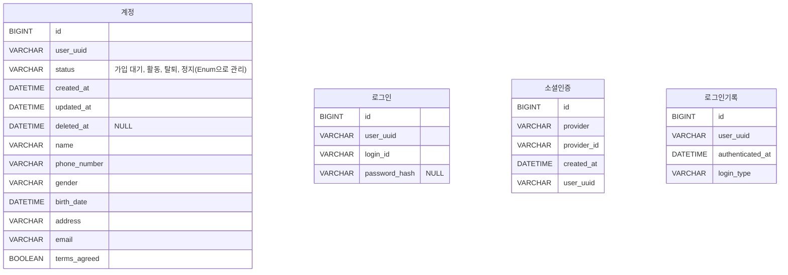
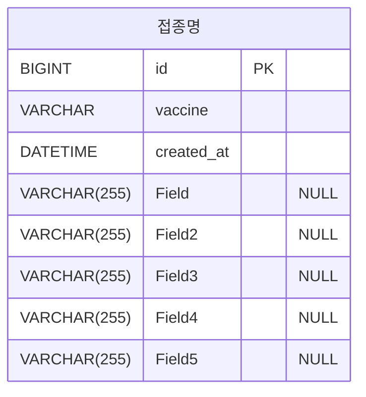
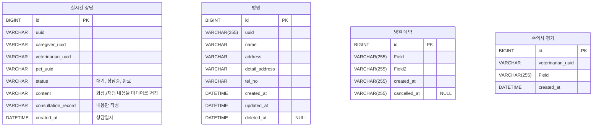
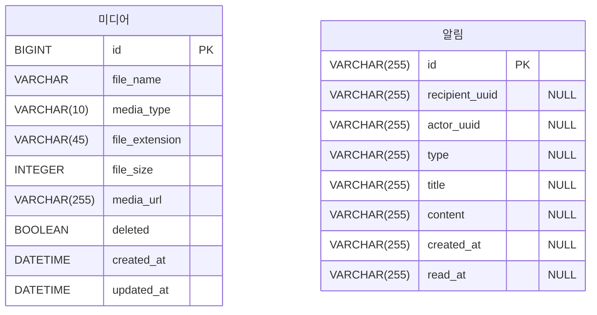
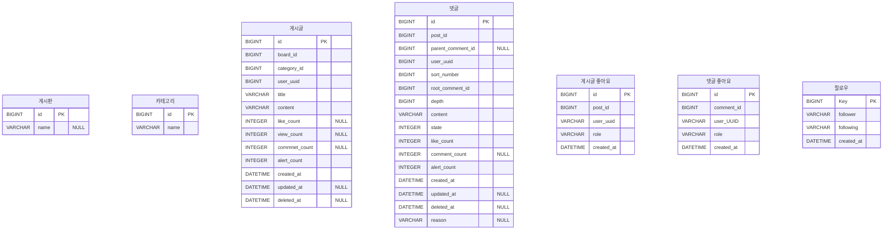
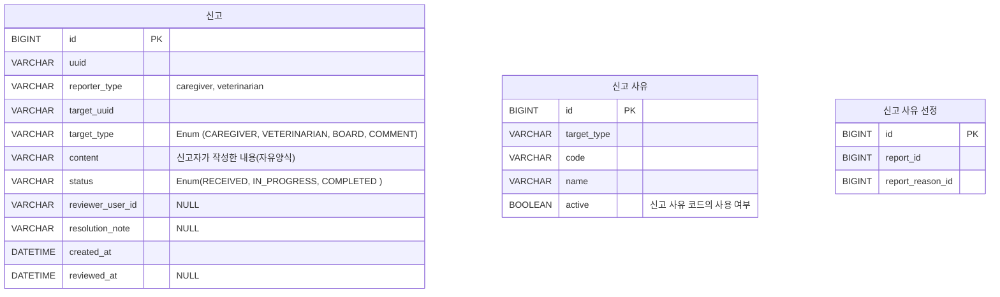

# ERD (Entity Relationship Diagram)

## 기준과 표기

2026-11-19에 제공된 SQL 내보내기를 바탕으로 **MySQL에 저장할 테이블**을 정리했다. 계정·인증 영역에는 2026-11-23에 제공된 SQL을 반영했다. 일반 회원 프로필과 반려동물 관련 데이터는 MongoDB에서 관리하며, 반려동물 영역에서는 접종명 기준 데이터만 MySQL에 둔다. 제품 요구사항은 [PRD](prd.md)를 따른다.

기능별 개발 과정에서 필요한 테이블·컬럼·관계·제약을 구체화하고, 구현과 스키마 변경에 맞춰 이 문서도 같은 작업에서 갱신한다. 아래 보완 항목은 해당 기능을 개발할 때 확인한다.

- 컬럼명·타입·NULL 허용·기본키·주석은 첨부 SQL을 따른다. 이름이 미정인 `Field` 계열과 원문의 오타도 보존했다. `DATETiME`는 다이어그램에서 `DATETIME`으로 표기한다.
- `PK`는 SQL의 기본키 선언이다. `NULL` 표기가 없으면 `NOT NULL`이다.
- SQL에는 FK·UNIQUE 제약 선언이 없다. 주석에 적힌 FK·UNIQUE는 설계 의도이며 실제 제약과 구분한다.
- 다이어그램은 SQL에 선언된 테이블 구조를 표시한다. FK와 참조 대상의 유일성이 미확정이므로 관계선은 그리지 않고, 컬럼명·주석 기반 참조 후보를 별도 표에 정리한다.
- 각 테이블의 필드 정의는 소유 영역에 한 번만 둔다.
- 원본 SQL에서 MongoDB로 옮길 프로필·반려동물 데이터를 제외한 MySQL 구조를 기록한다. 실제 개발할 기능은 PRD의 우선 개발 범위를 따른다.

## 저장소 경계

| 저장소 | 데이터 |
| --- | --- |
| MongoDB | 일반 회원 프로필, 반려동물 기본 정보·보호자 연결·종/품종, 건강 기록, 예방접종 이력, 병원진료 이력 |
| MySQL | 계정·인증, 접종명 기준 데이터와 아래 엔티티 목록 |

원본의 `유저정보`는 닉네임 등 프로필 데이터로 분류하여 MongoDB 대상으로 정리했다. MongoDB 문서의 상세 필드와 컬렉션 구조는 기능 개발 시 구체화한다. `실시간 상담.pet_uuid`는 MongoDB 반려동물의 외부 식별자로 사용하고, MongoDB 접종 이력은 MySQL 접종명 식별자와 연결한다. 저장소 간 조회·존재 확인은 애플리케이션에서 처리한다.

## 엔티티 목록

현재 MySQL ERD는 27개 테이블·203개 컬럼을 포함한다.

| 영역 | 테이블 |
| --- | --- |
| 계정·인증 | `계정`, `로그인`, `소셜인증`, `로그인기록` |
| 접종명 기준 데이터 | `접종명` |
| 실시간 상담·병원 | `실시간 상담`, `병원`, `병원 예약`, `수의사 평가` |
| 미디어·알림 | `미디어`, `알림` |
| 코인·결제·정산 | `코인 지갑`, `코인 충전 주문`, `코인 결제`, `상담 코인 홀드`, `코인 내역`, `수의사 정산` |
| 커뮤니티 | `게시판`, `카테고리`, `게시글`, `댓글`, `게시글 좋아요`, `댓글 좋아요`, `팔로우` |
| 신고 | `신고`, `신고 사유`, `신고 사유 선정` |

## 1. 계정·인증



## 2. 접종명 기준 데이터



## 3. 실시간 상담·병원



## 4. 미디어·알림



## 5. 코인·결제·정산

```mermaid
erDiagram
    "코인 지갑" {
        BIGINT id PK
        VARCHAR(255) uuid "NULL"
        VARCHAR caregiver_uuid
        INTEGER balance
        DATETIME created_at
        DATETIME updated_at
    }
    "코인 충전 주문" {
        BIGINT id PK
        BIGINT coin_wallet_id
        VARCHAR order_uuid
        VARCHAR caregiver_uuid
        INTEGER charge_amount
        VARCHAR status
        DATETIME created_at
        DATETIME expires_at
        DATETIME updated_at "ENUM(PENDING, PAID, CANCELLED, FAILED, EXPIRED)"
        VARCHAR remark "NULL"
    }
    "코인 결제" {
        BIGINT id PK
        BIGINT charge_order_id
        INTEGER original_transaction_id "NULL · FK -> coin_payment_transaction.id, 환불 시 원본 결제 참조"
        VARCHAR pg_payment_key "NULL · PG사에서 발급한 결제 식별자 UNIQUE"
        VARCHAR pg_cancel_key "NULL · PG사에서 발급한 취소 식별자"
        VARCHAR transaction_type "Enum(PAYMENT, REFUND)"
        INTEGER amount "결제는 양수(+), 환불은 음수(-)"
        VARCHAR method "카드, 간편결제"
        VARCHAR status "ENUM(PENDING, PAID, CANCELLED, FAILED, EXPIRED)"
        DATETIME paid_at "NULL · 결제 승인 또는 환불 완료 일시"
        DATETIME created_at
        DATETIME updated_at
        VARCHAR remark "NULL"
        VARCHAR refund_type "ENUM"
        VARCHAR refund_reason
    }
    "상담 코인 홀드" {
        BIGINT id PK
        BIGINT wallet_id
        VARCHAR consultation_uuid
        VARCHAR caregiver_uuid
        INTEGER hold_coint_amount
        VARCHAR status "ENUM(HEILD, RELEASED, USED)"
        DATETIME created_at
        DATETIME released_at "NULL"
        DATETIME used_at "NULL"
    }
    "코인 내역" {
        BIGINT id PK
        BIGINT wallet_id
        VARCHAR transaction_type
        INTEGER coin_amount
        INTEGER balance_after
        VARCHAR related_type "ENUM(결제, 홀드, 환불)"
        BIGINT related_id
        VARCHAR description "NULL"
        DATETIME created_at
    }
    "수의사 정산" {
        BIGINT id PK
        BIGINT consultation_hold_id
        VARCHAR veterinarian_UUID
        INTEGER coin_amount
        DECIMAL(5,2) commision_rate "BIGDECIMAL"
        INTEGER comission_amount
        INTEGER payout_amount
        VARCHAR status "ENUM(PENDING, READY, PAID, CANCELLED)"
        DATETIME paid_at "NULL"
        DATETIME created_at
    }
```

## 6. 커뮤니티



## 7. 신고



## 참조 관계 후보

SQL의 FK 선언이 아닌 검토 대상이다. UUID 참조는 대상 컬럼의 유일성과 자료형부터 확인한다.

| 참조 대상 테이블 | 참조하는 테이블 | 참조 컬럼 |
| --- | --- | --- |
| `계정` | `로그인` | `user_uuid` |
| `계정` | `소셜인증` | `user_uuid` |
| `계정` | `로그인기록` | `user_uuid` |
| `계정` | `실시간 상담` | `caregiver_uuid / veterinarian_uuid` |
| `계정` | `수의사 평가` | `veterinarian_uuid` |
| `계정` | `알림` | `recipient_uuid / actor_uuid` |
| `계정` | `코인 지갑` | `caregiver_uuid` |
| `코인 지갑` | `코인 충전 주문` | `coin_wallet_id` |
| `코인 충전 주문` | `코인 결제` | `charge_order_id` |
| `코인 결제` | `코인 결제` | `original_transaction_id` |
| `코인 지갑` | `상담 코인 홀드` | `wallet_id` |
| `실시간 상담` | `상담 코인 홀드` | `consultation_uuid` |
| `코인 지갑` | `코인 내역` | `wallet_id` |
| `상담 코인 홀드` | `수의사 정산` | `consultation_hold_id` |
| `게시판` | `게시글` | `board_id` |
| `카테고리` | `게시글` | `category_id` |
| `게시글` | `댓글` | `post_id` |
| `댓글` | `댓글` | `parent_comment_id / root_comment_id` |
| `게시글` | `게시글 좋아요` | `post_id` |
| `댓글` | `댓글 좋아요` | `comment_id` |
| `계정` | `게시글 좋아요` | `user_uuid` |
| `계정` | `댓글 좋아요` | `user_UUID` |
| `계정` | `팔로우` | `follower / following` |
| `신고` | `신고 사유 선정` | `report_id` |
| `신고 사유` | `신고 사유 선정` | `report_reason_id` |

## 개발 시 보완할 항목

아래는 현재 PRD와 시작 스키마 사이의 차이다. 해당 기능을 개발할 때 필요한 항목부터 설계하고 반영한다.

| 항목 | 확인한 차이와 필요한 결정 |
| --- | --- |
| 계정 | 계정 SQL과 MongoDB 프로필 문서 사이의 식별자 연결·속성 배치를 개발 시 구체화한다. `deleted_at`은 탈퇴 전에는 `NULL`이며, 탈퇴 시각을 기록한다. |
| 계정 식별자 | 계정·로그인·소셜인증·로그인기록의 `user_uuid` 연계와 유일성 제약이 선언되어 있지 않다. 이메일당 한 계정, 로그인 ID·소셜 제공자 식별값의 중복 정책을 스키마에 반영해야 한다. |
| 원본 테이블과 제품 범위 | SQL에는 역할·병원 예약·수의사 평가·결제·정산 관련 데이터도 포함되어 있다. 원본 구조로 기록하며, 현재 PRD의 기능을 개발할 때 사용하는 데이터만 구체화한다. |
| 접종명 | `접종명`은 MySQL의 기준 데이터다. `Field`~`Field5`의 의미는 사용 시 구체화한다. MongoDB 접종 이력의 참조 식별자와 명칭 제공 방식을 함께 정한다. |
| MongoDB 문서 | 반려동물 기본 정보·소유 관계·종/품종·건강 기록·접종 이력·병원진료와 일반 회원 프로필은 MongoDB에서 관리한다. 문서 구조와 인덱스는 기능 개발 시 구체화한다. |
| 실시간 매칭 | `실시간 상담.veterinarian_uuid`는 NOT NULL이어서 매칭 전 대기 상태를 저장하는 방식이 불명확하다. 위치·거리 탐색, 요청 증상·첨부, 채팅/화상 방식, 매칭 취소·만료 및 중복 수락 제어에 필요한 저장·연동 방식이 미정이다. |
| 상담·일지 | `content`는 화상/채팅 내용을 미디어로 저장한다는 주석이 있으나 미디어 연결 컬럼이 없다. `consultation_record`도 NOT NULL이므로 일지 작성 전 상태를 어떻게 표현하는지 확인해야 한다. 수의사 정보·일지의 외부 제공 주체도 확인 대상이다. |
| 병원·병원 예약 | `병원`에는 위치 좌표와 수의사 연결이 없다. 위치 기반 탐색의 데이터 제공 방법이 필요하다. `병원 예약`은 `Field`, `Field2`와 문자열 시각만 있으며 실시간 상담 전환 후 사용 여부가 미정이다. |
| 팔로우 | `팔로우.follower`·`following`의 계정 연결과 조합 유일성 제약을 확인한다. 자기 팔로우·중복 관계를 막고 목록·수·상태 조회와 이벤트별 알림 생성을 일관되게 처리할 구조를 개발 시 반영한다. |
| 공통 미디어 | `미디어` 테이블 하나를 사용한다. 업로드 주체·완료 상태·사용처 연결 컬럼이나 연결 테이블이 SQL에 없으므로 연결 권한·교체·미사용 파일 정리 요구사항을 만족할 설계가 필요하다. |
| 알림 | 알림 수신자·행위자·유형·본문·생성·읽음 시각은 있으나 대부분 NULL 허용이고 시각도 VARCHAR다. 직접 답글 대상 댓글 작성자에게 알리는 요구와 동일 이벤트 중복 방지를 지원할 이벤트 키·대상 연결·전달 방식을 개발 시 구체화한다. |
| 식별자 타입 | 게시글·댓글의 `user_uuid`는 BIGINT, 계정의 `user_uuid`는 VARCHAR다. `코인 결제.original_transaction_id`는 INTEGER이며 참조 후보 `id`는 BIGINT다. 실제 관계 확정 전에 타입 정합성이 필요하다. |
| 다형 참조·원문 이름 | 신고 대상과 코인 내역의 관련 대상은 유형별 참조다. 원문 `commnet_count`, `hold_coint_amount`, `HEILD`, `commision_rate`, `comission_amount` 등을 보존했으며 실제 스키마 명칭은 별도 확정한다. |
| SQL 실행성 | 길이 없는 VARCHAR, 누락된 FK·UNIQUE·인덱스, 기본값과 식별자 생성 전략 등은 실행 DB에 맞게 확정해야 한다. 이 문서에는 원본에 없는 제약을 추가하지 않았다. |

## 참고 자료

- 사용자 제공 SQL 내보내기, 2026-11-19 수신
- [제품 요구사항과 미정 항목](prd.md)
