# ERD (Entity Relationship Diagram)

## 기준과 표기

이 문서는 사용자가 최종본으로 지정한 MySQL Workbench 모델 `vetconsult.mwb`의 구조를 기준으로 한다. 모델에 기록된 스키마·테이블·컬럼·인덱스·외래키를 옮겼으며, 실제 운영 DB에 적용되었는지는 확인하지 않았다. 저장소와 서비스 경계는 모델의 스키마 이름을 그대로 표시한다. 총 11개 스키마, 87개 테이블, 668개 컬럼, 302개 인덱스, 46개 외래키를 포함한다.

- 컬럼의 NULL 허용은 모델의 `isNotNull` 값에 따른다. 기본값 `—`는 모델에 기본값이 지정되지 않은 경우다.
- PK와 UNIQUE는 인덱스의 실제 컬럼 조합을 기준으로 표시한다. 일반 인덱스도 함께 기록한다.
- 관계는 모델에 명시된 외래키만 표시한다. 원본의 외래키 14개는 참조 테이블과 컬럼의 객체가 모델에 없어 대상 이름을 확인할 수 없다. 해당 객체 ID를 미확정으로 표시한다. 관계도에서 점선은 이 미확정 참조다.
- 외래키의 삭제·수정 규칙이 비어 있으면 `미지정`으로 표시한다. 원본 주석과 명칭은 의역하거나 수정하지 않았다.
- 원본 모델은 MySQL 설계 자료이며 실제 DB나 다른 저장소의 구현 상태를 나타내지 않는다.

## 스키마 목록

| 스키마 | 테이블 수 |
| --- | ---: |
| `svc_identity` | 8 |
| `svc_clinic` | 13 |
| `svc_pet` | 7 |
| `svc_care` | 12 |
| `svc_community` | 8 |
| `svc_moderation` | 4 |
| `svc_media` | 3 |
| `svc_notification` | 2 |
| `svc_platform` | 5 |
| `svc_matching` | 5 |
| `vet_query` | 20 |

## 테이블과 관계

### `svc_identity`

관계도는 외래키가 가리키는 방향을 화살표로 표시한다.

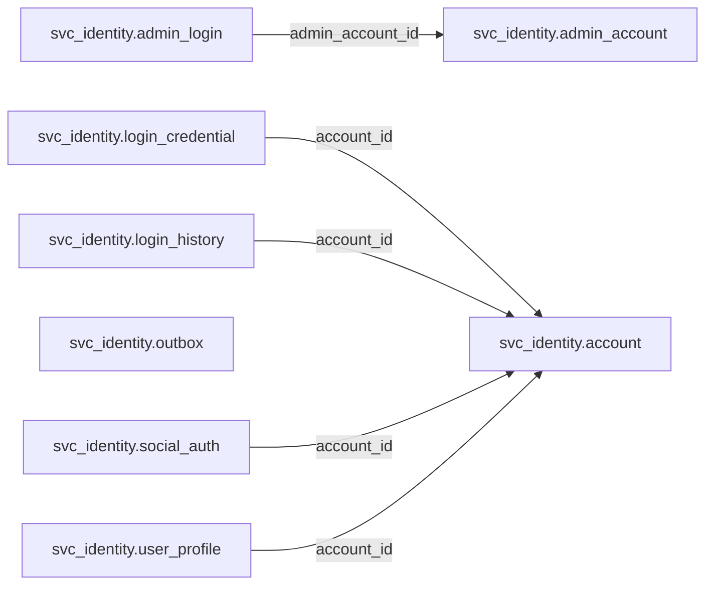

#### `svc_identity.account`

앱 사용자 계정

| 컬럼 | 타입 | NULL | 기본값 | 속성 / 주석 |
| --- | --- | --- | --- | --- |
| `id` | `BIGINT` | 불가 | — | AUTO_INCREMENT |
| `uuid` | `CHAR(36)` | 불가 | — | — |
| `status` | `VARCHAR(20)` | 불가 | — | — |
| `name` | `VARCHAR(100)` | 불가 | — | — |
| `phone_number` | `VARCHAR(30)` | 불가 | — | — |
| `gender` | `VARCHAR(20)` | 불가 | — | — |
| `birth_date` | `DATE` | 불가 | — | — |
| `address` | `VARCHAR(255)` | 불가 | — | — |
| `email` | `VARCHAR(254)` | 불가 | — | — |
| `terms_agreed` | `TINYINT(1)` | 불가 | — | — |
| `created_at` | `DATETIME` | 불가 | — | — |
| `updated_at` | `DATETIME` | 불가 | — | — |
| `deleted_at` | `DATETIME` | 허용 | `NULL` | — |

**인덱스**

| 이름 | 종류 | 컬럼 |
| --- | --- | --- |
| `PRIMARY` | PRIMARY KEY | `id` |
| `uk_account_uuid` | UNIQUE | `uuid` |
| `uk_account_email` | UNIQUE | `email` |
| `idx_account_status_created` | INDEX | `status`, `created_at` |
| `idx_account_phone` | INDEX | `phone_number` |

**외래키**

모델에 명시된 외래키가 없습니다.

#### `svc_identity.admin_account`

백오피스 관리자

| 컬럼 | 타입 | NULL | 기본값 | 속성 / 주석 |
| --- | --- | --- | --- | --- |
| `id` | `BIGINT` | 불가 | — | AUTO_INCREMENT |
| `uuid` | `CHAR(36)` | 불가 | — | — |
| `name` | `VARCHAR(100)` | 불가 | — | — |
| `phone_number` | `VARCHAR(30)` | 허용 | `NULL` | — |
| `email` | `VARCHAR(254)` | 허용 | `NULL` | — |
| `is_super_admin` | `TINYINT(1)` | 불가 | `'0'` | — |
| `status` | `VARCHAR(20)` | 불가 | `'ACTIVE'` | — |
| `created_at` | `DATETIME` | 불가 | — | — |
| `updated_at` | `DATETIME` | 불가 | — | — |
| `deleted_at` | `DATETIME` | 허용 | `NULL` | — |

**인덱스**

| 이름 | 종류 | 컬럼 |
| --- | --- | --- |
| `PRIMARY` | PRIMARY KEY | `id` |
| `uk_admin_uuid` | UNIQUE | `uuid` |
| `idx_admin_status` | INDEX | `status`, `created_at` |

**외래키**

모델에 명시된 외래키가 없습니다.

#### `svc_identity.admin_login`

관리자 자격증명

| 컬럼 | 타입 | NULL | 기본값 | 속성 / 주석 |
| --- | --- | --- | --- | --- |
| `id` | `BIGINT` | 불가 | — | AUTO_INCREMENT |
| `admin_account_id` | `BIGINT` | 불가 | — | — |
| `login_id` | `VARCHAR(100)` | 불가 | — | — |
| `password_hash` | `VARCHAR(255)` | 불가 | — | — |
| `created_at` | `DATETIME` | 불가 | — | — |
| `updated_at` | `DATETIME` | 불가 | — | — |

**인덱스**

| 이름 | 종류 | 컬럼 |
| --- | --- | --- |
| `PRIMARY` | PRIMARY KEY | `id` |
| `uk_admin_login_account` | UNIQUE | `admin_account_id` |
| `uk_admin_login_id` | UNIQUE | `login_id` |

**외래키**

| 이름 | 컬럼 | 참조 대상 | 삭제 / 수정 규칙 | 비고 |
| --- | --- | --- | --- | --- |
| `fk_admin_login_account` | `admin_account_id` | `svc_identity.admin_account` (`id`) | 미지정 / 미지정 | — |

#### `svc_identity.login_credential`

계정 자격증명. 수의사 uuid 를 두지 않는다

| 컬럼 | 타입 | NULL | 기본값 | 속성 / 주석 |
| --- | --- | --- | --- | --- |
| `id` | `BIGINT` | 불가 | — | AUTO_INCREMENT |
| `account_id` | `BIGINT` | 불가 | — | — |
| `login_id` | `VARCHAR(100)` | 불가 | — | — |
| `password_hash` | `VARCHAR(255)` | 허용 | `NULL` | — |
| `created_at` | `DATETIME` | 불가 | — | — |
| `updated_at` | `DATETIME` | 불가 | — | — |

**인덱스**

| 이름 | 종류 | 컬럼 |
| --- | --- | --- |
| `PRIMARY` | PRIMARY KEY | `id` |
| `uk_login_account` | UNIQUE | `account_id` |
| `uk_login_id` | UNIQUE | `login_id` |

**외래키**

| 이름 | 컬럼 | 참조 대상 | 삭제 / 수정 규칙 | 비고 |
| --- | --- | --- | --- | --- |
| `fk_login_account` | `account_id` | `svc_identity.account` (`id`) | 미지정 / 미지정 | — |

#### `svc_identity.login_history`

로그인 감사 로그

| 컬럼 | 타입 | NULL | 기본값 | 속성 / 주석 |
| --- | --- | --- | --- | --- |
| `id` | `BIGINT` | 불가 | — | AUTO_INCREMENT |
| `account_id` | `BIGINT` | 불가 | — | — |
| `authenticated_at` | `DATETIME` | 불가 | — | — |
| `login_type` | `VARCHAR(30)` | 불가 | — | — |

**인덱스**

| 이름 | 종류 | 컬럼 |
| --- | --- | --- |
| `PRIMARY` | PRIMARY KEY | `id` |
| `idx_login_history_account_at` | INDEX | `account_id`, `authenticated_at` |

**외래키**

| 이름 | 컬럼 | 참조 대상 | 삭제 / 수정 규칙 | 비고 |
| --- | --- | --- | --- | --- |
| `fk_login_history_account` | `account_id` | `svc_identity.account` (`id`) | 미지정 / 미지정 | — |

#### `svc_identity.outbox`

identity 트랜잭셔널 아웃박스

| 컬럼 | 타입 | NULL | 기본값 | 속성 / 주석 |
| --- | --- | --- | --- | --- |
| `id` | `BIGINT` | 불가 | — | AUTO_INCREMENT |
| `event_id` | `CHAR(36)` | 불가 | — | — |
| `event_type` | `VARCHAR(100)` | 불가 | — | — |
| `aggregate_uuid` | `CHAR(36)` | 불가 | — | — |
| `payload` | `JSON` | 불가 | — | — |
| `occurred_at` | `DATETIME(6)` | 불가 | — | — |
| `published_at` | `DATETIME(6)` | 허용 | `NULL` | — |

**인덱스**

| 이름 | 종류 | 컬럼 |
| --- | --- | --- |
| `PRIMARY` | PRIMARY KEY | `id` |
| `uk_outbox_event` | UNIQUE | `event_id` |
| `idx_outbox_unpublished` | INDEX | `published_at`, `id` |

**외래키**

모델에 명시된 외래키가 없습니다.

#### `svc_identity.social_auth`

소셜 인증

| 컬럼 | 타입 | NULL | 기본값 | 속성 / 주석 |
| --- | --- | --- | --- | --- |
| `id` | `BIGINT` | 불가 | — | AUTO_INCREMENT |
| `account_id` | `BIGINT` | 불가 | — | — |
| `provider` | `VARCHAR(30)` | 불가 | — | — |
| `provider_id` | `VARCHAR(191)` | 불가 | — | — |
| `created_at` | `DATETIME` | 불가 | — | — |

**인덱스**

| 이름 | 종류 | 컬럼 |
| --- | --- | --- |
| `PRIMARY` | PRIMARY KEY | `id` |
| `uk_social_provider` | UNIQUE | `provider`, `provider_id` |
| `idx_social_account` | INDEX | `account_id` |

**외래키**

| 이름 | 컬럼 | 참조 대상 | 삭제 / 수정 규칙 | 비고 |
| --- | --- | --- | --- | --- |
| `fk_social_account` | `account_id` | `svc_identity.account` (`id`) | 미지정 / 미지정 | — |

#### `svc_identity.user_profile`

닉네임과 사용자 유형

| 컬럼 | 타입 | NULL | 기본값 | 속성 / 주석 |
| --- | --- | --- | --- | --- |
| `id` | `BIGINT` | 불가 | — | AUTO_INCREMENT |
| `account_id` | `BIGINT` | 불가 | — | — |
| `nickname` | `VARCHAR(50)` | 불가 | — | — |
| `user_type` | `VARCHAR(20)` | 불가 | — | — |
| `created_at` | `DATETIME` | 불가 | — | — |
| `updated_at` | `DATETIME` | 불가 | — | — |

**인덱스**

| 이름 | 종류 | 컬럼 |
| --- | --- | --- |
| `PRIMARY` | PRIMARY KEY | `id` |
| `uk_profile_account` | UNIQUE | `account_id` |
| `uk_profile_nickname` | UNIQUE | `nickname` |
| `idx_profile_type` | INDEX | `user_type`, `nickname` |

**외래키**

| 이름 | 컬럼 | 참조 대상 | 삭제 / 수정 규칙 | 비고 |
| --- | --- | --- | --- | --- |
| `fk_profile_account` | `account_id` | `svc_identity.account` (`id`) | 미지정 / 미지정 | — |

### `svc_clinic`

관계도는 외래키가 가리키는 방향을 화살표로 표시한다.

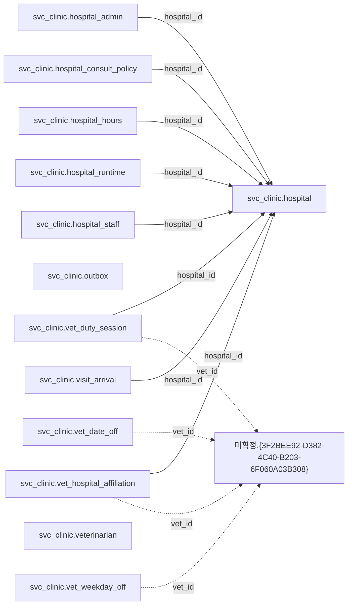

#### `svc_clinic.hospital`

동물병원

| 컬럼 | 타입 | NULL | 기본값 | 속성 / 주석 |
| --- | --- | --- | --- | --- |
| `id` | `BIGINT` | 불가 | — | AUTO_INCREMENT |
| `uuid` | `CHAR(36)` | 불가 | — | — |
| `region` | `VARCHAR(50)` | 허용 | `NULL` | — |
| `si` | `VARCHAR(50)` | 허용 | `NULL` | — |
| `gun` | `VARCHAR(50)` | 허용 | `NULL` | — |
| `gu` | `VARCHAR(50)` | 허용 | `NULL` | — |
| `name` | `VARCHAR(100)` | 불가 | — | — |
| `zip_code` | `VARCHAR(10)` | 허용 | `NULL` | — |
| `road_address` | `VARCHAR(255)` | 허용 | `NULL` | — |
| `lot_address` | `VARCHAR(255)` | 허용 | `NULL` | — |
| `tel` | `VARCHAR(20)` | 허용 | `NULL` | — |
| `mgmt_no` | `VARCHAR(50)` | 허용 | `NULL` | — |
| `licensed_at` | `DATE` | 허용 | `NULL` | — |
| `business_no` | `VARCHAR(20)` | 허용 | `NULL` | — |
| `homepage_url` | `VARCHAR(500)` | 허용 | `NULL` | — |
| `logo_url` | `VARCHAR(500)` | 허용 | `NULL` | — |
| `remark` | `VARCHAR(500)` | 허용 | `NULL` | — |
| `latitude` | `DECIMAL(9,6)` | 허용 | `NULL` | 위도 |
| `longitude` | `DECIMAL(9,6)` | 허용 | `NULL` | 경도 |
| `geohash` | `VARCHAR(12)` | 허용 | `NULL` | 지오해시 |
| `created_at` | `DATETIME` | 불가 | — | — |
| `updated_at` | `DATETIME` | 불가 | — | — |

**인덱스**

| 이름 | 종류 | 컬럼 |
| --- | --- | --- |
| `PRIMARY` | PRIMARY KEY | `id` |
| `uk_hospital_uuid` | UNIQUE | `uuid` |
| `idx_hospital_region` | INDEX | `region`, `si`, `gu`, `name` |
| `idx_hospital_name` | INDEX | `name` |
| `idx_hospital_geo` | INDEX | `latitude`, `longitude` |
| `idx_hospital_geohash` | INDEX | `geohash` |

**외래키**

모델에 명시된 외래키가 없습니다.

#### `svc_clinic.hospital_admin`

관리자-병원 배정. admin_uuid 는 identity 값이며 FK 없음

| 컬럼 | 타입 | NULL | 기본값 | 속성 / 주석 |
| --- | --- | --- | --- | --- |
| `id` | `BIGINT` | 불가 | — | AUTO_INCREMENT |
| `uuid` | `CHAR(36)` | 불가 | — | — |
| `admin_uuid` | `CHAR(36)` | 불가 | — | — |
| `hospital_id` | `BIGINT` | 불가 | — | — |
| `assigned_at` | `DATETIME` | 불가 | — | — |

**인덱스**

| 이름 | 종류 | 컬럼 |
| --- | --- | --- |
| `PRIMARY` | PRIMARY KEY | `id` |
| `uk_hospital_admin_uuid` | UNIQUE | `uuid` |
| `uk_hospital_admin_pair` | UNIQUE | `admin_uuid`, `hospital_id` |
| `idx_hospital_admin_hospital` | INDEX | `hospital_id` |

**외래키**

| 이름 | 컬럼 | 참조 대상 | 삭제 / 수정 규칙 | 비고 |
| --- | --- | --- | --- | --- |
| `fk_hospital_admin_hospital` | `hospital_id` | `svc_clinic.hospital` (`id`) | 미지정 / 미지정 | — |

#### `svc_clinic.hospital_consult_policy`

병원별 실시간 상담 정책

| 컬럼 | 타입 | NULL | 기본값 | 속성 / 주석 |
| --- | --- | --- | --- | --- |
| `hospital_id` | `BIGINT` | 불가 | — | — |
| `chat_enabled` | `TINYINT(1)` | 불가 | — | — |
| `video_enabled` | `TINYINT(1)` | 불가 | — | — |
| `emergency_enabled` | `TINYINT(1)` | 불가 | — | — |
| `max_concurrent` | `INT` | 불가 | — | — |
| `service_radius_m` | `INT` | 불가 | — | — |
| `updated_at` | `DATETIME` | 불가 | — | — |

**인덱스**

| 이름 | 종류 | 컬럼 |
| --- | --- | --- |
| `PRIMARY` | PRIMARY KEY | `hospital_id` |

**외래키**

| 이름 | 컬럼 | 참조 대상 | 삭제 / 수정 규칙 | 비고 |
| --- | --- | --- | --- | --- |
| `fk_consult_policy_hospital` | `hospital_id` | `svc_clinic.hospital` (`id`) | 미지정 / 미지정 | — |

#### `svc_clinic.hospital_hours`

병원 요일 영업. 1=월 7=일. 병원 애그리거트 자식

| 컬럼 | 타입 | NULL | 기본값 | 속성 / 주석 |
| --- | --- | --- | --- | --- |
| `id` | `BIGINT` | 불가 | — | AUTO_INCREMENT |
| `uuid` | `CHAR(36)` | 불가 | — | — |
| `hospital_id` | `BIGINT` | 불가 | — | — |
| `day_of_week` | `TINYINT` | 불가 | — | — |
| `is_closed` | `TINYINT(1)` | 불가 | — | — |
| `open_time` | `TIME` | 허용 | `NULL` | — |
| `close_time` | `TIME` | 허용 | `NULL` | — |
| `break_start` | `TIME` | 허용 | `NULL` | — |
| `break_end` | `TIME` | 허용 | `NULL` | — |
| `updated_at` | `DATETIME` | 불가 | — | — |

**인덱스**

| 이름 | 종류 | 컬럼 |
| --- | --- | --- |
| `PRIMARY` | PRIMARY KEY | `id` |
| `uk_hours_uuid` | UNIQUE | `uuid` |
| `uk_hours_day` | UNIQUE | `hospital_id`, `day_of_week` |

**외래키**

| 이름 | 컬럼 | 참조 대상 | 삭제 / 수정 규칙 | 비고 |
| --- | --- | --- | --- | --- |
| `fk_hours_hospital` | `hospital_id` | `svc_clinic.hospital` (`id`) | 미지정 / 미지정 | — |

#### `svc_clinic.hospital_runtime`

병원 앱의 지금 접수 상태. 요일 영업시간과 별개

| 컬럼 | 타입 | NULL | 기본값 | 속성 / 주석 |
| --- | --- | --- | --- | --- |
| `hospital_id` | `BIGINT` | 불가 | — | — |
| `is_accepting_visit` | `TINYINT(1)` | 불가 | — | — |
| `is_accepting_consult` | `TINYINT(1)` | 불가 | — | — |
| `pause_reason` | `VARCHAR(200)` | 허용 | `NULL` | — |
| `updated_at` | `DATETIME` | 불가 | — | — |

**인덱스**

| 이름 | 종류 | 컬럼 |
| --- | --- | --- |
| `PRIMARY` | PRIMARY KEY | `hospital_id` |

**외래키**

| 이름 | 컬럼 | 참조 대상 | 삭제 / 수정 규칙 | 비고 |
| --- | --- | --- | --- | --- |
| `fk_runtime_hospital` | `hospital_id` | `svc_clinic.hospital` (`id`) | 미지정 / 미지정 | — |

#### `svc_clinic.hospital_staff`

병원 앱 직원. account_uuid 는 identity 값

| 컬럼 | 타입 | NULL | 기본값 | 속성 / 주석 |
| --- | --- | --- | --- | --- |
| `id` | `BIGINT` | 불가 | — | AUTO_INCREMENT |
| `uuid` | `CHAR(36)` | 불가 | — | — |
| `hospital_id` | `BIGINT` | 불가 | — | — |
| `account_uuid` | `CHAR(36)` | 불가 | — | — |
| `staff_role` | `VARCHAR(20)` | 불가 | — | — |
| `status` | `VARCHAR(20)` | 불가 | — | — |
| `created_at` | `DATETIME` | 불가 | — | — |

**인덱스**

| 이름 | 종류 | 컬럼 |
| --- | --- | --- |
| `PRIMARY` | PRIMARY KEY | `id` |
| `uk_staff_uuid` | UNIQUE | `uuid` |
| `uk_staff_pair` | UNIQUE | `hospital_id`, `account_uuid` |
| `idx_staff_account` | INDEX | `account_uuid`, `status` |

**외래키**

| 이름 | 컬럼 | 참조 대상 | 삭제 / 수정 규칙 | 비고 |
| --- | --- | --- | --- | --- |
| `fk_staff_hospital` | `hospital_id` | `svc_clinic.hospital` (`id`) | 미지정 / 미지정 | — |

#### `svc_clinic.outbox`

clinic 트랜잭셔널 아웃박스

| 컬럼 | 타입 | NULL | 기본값 | 속성 / 주석 |
| --- | --- | --- | --- | --- |
| `id` | `BIGINT` | 불가 | — | AUTO_INCREMENT |
| `event_id` | `CHAR(36)` | 불가 | — | — |
| `event_type` | `VARCHAR(100)` | 불가 | — | — |
| `aggregate_uuid` | `CHAR(36)` | 불가 | — | — |
| `payload` | `JSON` | 불가 | — | — |
| `occurred_at` | `DATETIME(6)` | 불가 | — | — |
| `published_at` | `DATETIME(6)` | 허용 | `NULL` | — |

**인덱스**

| 이름 | 종류 | 컬럼 |
| --- | --- | --- |
| `PRIMARY` | PRIMARY KEY | `id` |
| `uk_outbox_event` | UNIQUE | `event_id` |
| `idx_outbox_unpublished` | INDEX | `published_at`, `id` |

**외래키**

모델에 명시된 외래키가 없습니다.

#### `svc_clinic.vet_date_off`

수의사 특정일 휴무. 요일 휴무와 별개

| 컬럼 | 타입 | NULL | 기본값 | 속성 / 주석 |
| --- | --- | --- | --- | --- |
| `id` | `BIGINT` | 불가 | — | AUTO_INCREMENT |
| `uuid` | `CHAR(36)` | 불가 | — | — |
| `vet_id` | `BIGINT` | 불가 | — | — |
| `off_date` | `DATE` | 불가 | — | — |
| `reason` | `VARCHAR(200)` | 허용 | `NULL` | — |

**인덱스**

| 이름 | 종류 | 컬럼 |
| --- | --- | --- |
| `PRIMARY` | PRIMARY KEY | `id` |
| `uk_date_off_uuid` | UNIQUE | `uuid` |
| `uk_date_off` | UNIQUE | `vet_id`, `off_date` |

**외래키**

| 이름 | 컬럼 | 참조 대상 | 삭제 / 수정 규칙 | 비고 |
| --- | --- | --- | --- | --- |
| `fk_date_off_vet` | `vet_id` | `미확정 {3F2BEE92-D382-4C40-B203-6F060A03B308}` (`미확정 {E606EE3F-6004-4845-B0D2-4C6DE6D51A21}`) | 미지정 / 미지정 | — |

#### `svc_clinic.vet_duty_session`

출근 세션. 실시간 좌표 핑은 MongoDB vet_live_location

| 컬럼 | 타입 | NULL | 기본값 | 속성 / 주석 |
| --- | --- | --- | --- | --- |
| `id` | `BIGINT` | 불가 | — | AUTO_INCREMENT |
| `uuid` | `CHAR(36)` | 불가 | — | — |
| `vet_id` | `BIGINT` | 불가 | — | — |
| `hospital_id` | `BIGINT` | 불가 | — | — |
| `accept_chat` | `TINYINT(1)` | 불가 | — | — |
| `accept_video` | `TINYINT(1)` | 불가 | — | — |
| `service_radius_m` | `INT` | 불가 | — | — |
| `origin_lat` | `DECIMAL(9,6)` | 불가 | — | — |
| `origin_lng` | `DECIMAL(9,6)` | 불가 | — | — |
| `started_at` | `DATETIME` | 불가 | — | — |
| `ended_at` | `DATETIME` | 허용 | `NULL` | — |
| `current_flag` | `TINYINT` | 허용 | `NULL` | GENERATED if((`ended_at` is null),1,NULL) STORED |

**인덱스**

| 이름 | 종류 | 컬럼 |
| --- | --- | --- |
| `PRIMARY` | PRIMARY KEY | `id` |
| `uk_duty_uuid` | UNIQUE | `uuid` |
| `uk_vet_one_duty` | UNIQUE | `vet_id`, `current_flag` |
| `idx_duty_hospital_open` | INDEX | `hospital_id`, `ended_at` |

**외래키**

| 이름 | 컬럼 | 참조 대상 | 삭제 / 수정 규칙 | 비고 |
| --- | --- | --- | --- | --- |
| `fk_duty_hospital` | `hospital_id` | `svc_clinic.hospital` (`id`) | 미지정 / 미지정 | — |
| `fk_duty_vet` | `vet_id` | `미확정 {3F2BEE92-D382-4C40-B203-6F060A03B308}` (`미확정 {E606EE3F-6004-4845-B0D2-4C6DE6D51A21}`) | 미지정 / 미지정 | — |

#### `svc_clinic.vet_hospital_affiliation`

수의사-병원 소속 이력. 현재 소속은 ended_at IS NULL

| 컬럼 | 타입 | NULL | 기본값 | 속성 / 주석 |
| --- | --- | --- | --- | --- |
| `id` | `BIGINT` | 불가 | — | AUTO_INCREMENT |
| `uuid` | `CHAR(36)` | 불가 | — | — |
| `vet_id` | `BIGINT` | 불가 | — | — |
| `hospital_id` | `BIGINT` | 불가 | — | — |
| `started_at` | `DATETIME` | 불가 | — | — |
| `ended_at` | `DATETIME` | 허용 | `NULL` | — |
| `current_flag` | `TINYINT` | 허용 | `NULL` | GENERATED if((`ended_at` is null),1,NULL) STORED |

**인덱스**

| 이름 | 종류 | 컬럼 |
| --- | --- | --- |
| `PRIMARY` | PRIMARY KEY | `id` |
| `uk_affiliation_uuid` | UNIQUE | `uuid` |
| `uk_vet_one_current` | UNIQUE | `vet_id`, `current_flag` |
| `idx_affiliation_hospital_open` | INDEX | `hospital_id`, `ended_at` |

**외래키**

| 이름 | 컬럼 | 참조 대상 | 삭제 / 수정 규칙 | 비고 |
| --- | --- | --- | --- | --- |
| `fk_affiliation_hospital` | `hospital_id` | `svc_clinic.hospital` (`id`) | 미지정 / 미지정 | — |
| `fk_affiliation_vet` | `vet_id` | `미확정 {3F2BEE92-D382-4C40-B203-6F060A03B308}` (`미확정 {E606EE3F-6004-4845-B0D2-4C6DE6D51A21}`) | 미지정 / 미지정 | — |

#### `svc_clinic.vet_weekday_off`

수의사 반복 휴무 요일. 병원 휴무와 별개

| 컬럼 | 타입 | NULL | 기본값 | 속성 / 주석 |
| --- | --- | --- | --- | --- |
| `id` | `BIGINT` | 불가 | — | AUTO_INCREMENT |
| `uuid` | `CHAR(36)` | 불가 | — | — |
| `vet_id` | `BIGINT` | 불가 | — | — |
| `day_of_week` | `TINYINT` | 불가 | — | — |

**인덱스**

| 이름 | 종류 | 컬럼 |
| --- | --- | --- |
| `PRIMARY` | PRIMARY KEY | `id` |
| `uk_vet_off_uuid` | UNIQUE | `uuid` |
| `uk_vet_off_day` | UNIQUE | `vet_id`, `day_of_week` |

**외래키**

| 이름 | 컬럼 | 참조 대상 | 삭제 / 수정 규칙 | 비고 |
| --- | --- | --- | --- | --- |
| `fk_vet_off_vet` | `vet_id` | `미확정 {3F2BEE92-D382-4C40-B203-6F060A03B308}` (`미확정 {E606EE3F-6004-4845-B0D2-4C6DE6D51A21}`) | 미지정 / 미지정 | — |

#### `svc_clinic.veterinarian`

수의사. 병원 키는 두지 않는다

| 컬럼 | 타입 | NULL | 기본값 | 속성 / 주석 |
| --- | --- | --- | --- | --- |
| `id` | `BIGINT` | 불가 | — | AUTO_INCREMENT |
| `uuid` | `CHAR(36)` | 불가 | — | — |
| `account_uuid` | `CHAR(36)` | 불가 | — | — |
| `name` | `VARCHAR(50)` | 불가 | — | — |
| `major` | `VARCHAR(100)` | 불가 | — | — |
| `specialty` | `VARCHAR(100)` | 불가 | — | — |
| `license_no` | `VARCHAR(100)` | 불가 | — | — |
| `is_available` | `TINYINT(1)` | 불가 | — | — |
| `status` | `VARCHAR(20)` | 불가 | — | — |
| `status_reason` | `VARCHAR(255)` | 허용 | `NULL` | — |
| `created_at` | `DATETIME` | 불가 | — | — |
| `updated_at` | `DATETIME` | 불가 | — | — |

**인덱스**

| 이름 | 종류 | 컬럼 |
| --- | --- | --- |
| `PRIMARY` | PRIMARY KEY | `id` |
| `uk_vet_uuid` | UNIQUE | `uuid` |
| `uk_vet_account` | UNIQUE | `account_uuid` |
| `uk_vet_license` | UNIQUE | `license_no` |
| `idx_vet_status_available` | INDEX | `status`, `is_available`, `name` |

**외래키**

모델에 명시된 외래키가 없습니다.

#### `svc_clinic.visit_arrival`

병원 앱 내원 대기열. 예약 uuid 는 care 값

| 컬럼 | 타입 | NULL | 기본값 | 속성 / 주석 |
| --- | --- | --- | --- | --- |
| `id` | `BIGINT` | 불가 | — | AUTO_INCREMENT |
| `uuid` | `CHAR(36)` | 불가 | — | — |
| `hospital_id` | `BIGINT` | 불가 | — | — |
| `reservation_uuid` | `CHAR(36)` | 불가 | — | — |
| `status` | `VARCHAR(20)` | 불가 | — | — |
| `arrived_at` | `DATETIME` | 불가 | — | — |
| `called_at` | `DATETIME` | 허용 | `NULL` | — |
| `completed_at` | `DATETIME` | 허용 | `NULL` | — |

**인덱스**

| 이름 | 종류 | 컬럼 |
| --- | --- | --- |
| `PRIMARY` | PRIMARY KEY | `id` |
| `uk_arrival_uuid` | UNIQUE | `uuid` |
| `uk_arrival_reservation` | UNIQUE | `reservation_uuid` |
| `idx_arrival_queue` | INDEX | `hospital_id`, `status`, `arrived_at` |

**외래키**

| 이름 | 컬럼 | 참조 대상 | 삭제 / 수정 규칙 | 비고 |
| --- | --- | --- | --- | --- |
| `fk_arrival_hospital` | `hospital_id` | `svc_clinic.hospital` (`id`) | 미지정 / 미지정 | — |

### `svc_pet`

관계도는 외래키가 가리키는 방향을 화살표로 표시한다.

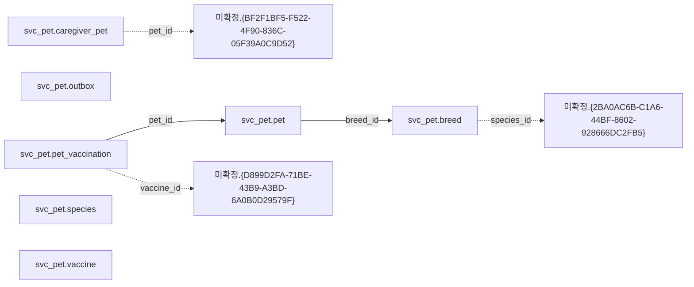

#### `svc_pet.breed`

품종

| 컬럼 | 타입 | NULL | 기본값 | 속성 / 주석 |
| --- | --- | --- | --- | --- |
| `id` | `BIGINT` | 불가 | — | AUTO_INCREMENT |
| `uuid` | `CHAR(36)` | 불가 | — | — |
| `species_id` | `BIGINT` | 불가 | — | — |
| `name` | `VARCHAR(50)` | 불가 | — | — |

**인덱스**

| 이름 | 종류 | 컬럼 |
| --- | --- | --- |
| `PRIMARY` | PRIMARY KEY | `id` |
| `uk_breed_uuid` | UNIQUE | `uuid` |
| `uk_breed_name` | UNIQUE | `species_id`, `name` |

**외래키**

| 이름 | 컬럼 | 참조 대상 | 삭제 / 수정 규칙 | 비고 |
| --- | --- | --- | --- | --- |
| `fk_breed_species` | `species_id` | `미확정 {2BA0AC6B-C1A6-44BF-8602-928666DC2FB5}` (`미확정 {5F07BA9D-DF92-4BB5-A394-1F96DB53272E}`) | 미지정 / 미지정 | — |

#### `svc_pet.caregiver_pet`

보호자-반려동물. caregiver_uuid 는 identity 값이며 FK 없음

| 컬럼 | 타입 | NULL | 기본값 | 속성 / 주석 |
| --- | --- | --- | --- | --- |
| `caregiver_uuid` | `CHAR(36)` | 불가 | — | — |
| `pet_id` | `BIGINT` | 불가 | — | — |
| `linked_at` | `DATETIME` | 불가 | — | — |

**인덱스**

| 이름 | 종류 | 컬럼 |
| --- | --- | --- |
| `PRIMARY` | PRIMARY KEY | `caregiver_uuid`, `pet_id` |
| `idx_caregiver_pet_pet` | INDEX | `pet_id` |

**외래키**

| 이름 | 컬럼 | 참조 대상 | 삭제 / 수정 규칙 | 비고 |
| --- | --- | --- | --- | --- |
| `fk_caregiver_pet_pet` | `pet_id` | `미확정 {BF2F1BF5-F522-4F90-836C-05F39A0C9D52}` (`미확정 {689C4EB4-564C-4820-9691-5135735700E0}`) | 미지정 / 미지정 | — |

#### `svc_pet.outbox`

pet 트랜잭셔널 아웃박스

| 컬럼 | 타입 | NULL | 기본값 | 속성 / 주석 |
| --- | --- | --- | --- | --- |
| `id` | `BIGINT` | 불가 | — | AUTO_INCREMENT |
| `event_id` | `CHAR(36)` | 불가 | — | — |
| `event_type` | `VARCHAR(100)` | 불가 | — | — |
| `aggregate_uuid` | `CHAR(36)` | 불가 | — | — |
| `payload` | `JSON` | 불가 | — | — |
| `occurred_at` | `DATETIME(6)` | 불가 | — | — |
| `published_at` | `DATETIME(6)` | 허용 | `NULL` | — |

**인덱스**

| 이름 | 종류 | 컬럼 |
| --- | --- | --- |
| `PRIMARY` | PRIMARY KEY | `id` |
| `uk_outbox_event` | UNIQUE | `event_id` |
| `idx_outbox_unpublished` | INDEX | `published_at`, `id` |

**외래키**

모델에 명시된 외래키가 없습니다.

#### `svc_pet.pet`

반려동물. 보호자 키는 중계 테이블에만 있다

| 컬럼 | 타입 | NULL | 기본값 | 속성 / 주석 |
| --- | --- | --- | --- | --- |
| `id` | `BIGINT` | 불가 | — | AUTO_INCREMENT |
| `uuid` | `CHAR(36)` | 불가 | — | — |
| `breed_id` | `BIGINT` | 불가 | — | — |
| `name` | `VARCHAR(50)` | 불가 | — | — |
| `birth_date` | `DATE` | 허용 | `NULL` | — |
| `weight_kg` | `DECIMAL(5,2)` | 허용 | `NULL` | — |
| `sex` | `VARCHAR(10)` | 불가 | — | — |
| `is_neutered` | `TINYINT(1)` | 허용 | `NULL` | — |
| `neutered_at` | `DATETIME` | 허용 | `NULL` | — |
| `status` | `VARCHAR(20)` | 불가 | — | — |
| `created_at` | `DATETIME` | 불가 | — | — |
| `updated_at` | `DATETIME` | 불가 | — | — |
| `deleted_at` | `DATETIME` | 허용 | `NULL` | — |

**인덱스**

| 이름 | 종류 | 컬럼 |
| --- | --- | --- |
| `PRIMARY` | PRIMARY KEY | `id` |
| `uk_pet_uuid` | UNIQUE | `uuid` |
| `idx_pet_breed_status` | INDEX | `breed_id`, `status`, `name` |
| `idx_pet_name` | INDEX | `name` |

**외래키**

| 이름 | 컬럼 | 참조 대상 | 삭제 / 수정 규칙 | 비고 |
| --- | --- | --- | --- | --- |
| `fk_pet_breed` | `breed_id` | `svc_pet.breed` (`id`) | 미지정 / 미지정 | — |

#### `svc_pet.pet_vaccination`

접종 이력. 펫과 접종명의 기능 중계

| 컬럼 | 타입 | NULL | 기본값 | 속성 / 주석 |
| --- | --- | --- | --- | --- |
| `id` | `BIGINT` | 불가 | — | AUTO_INCREMENT |
| `uuid` | `CHAR(36)` | 불가 | — | — |
| `pet_id` | `BIGINT` | 불가 | — | — |
| `vaccine_id` | `BIGINT` | 불가 | — | — |
| `evented_at` | `DATETIME` | 불가 | — | — |
| `created_at` | `DATETIME` | 불가 | — | — |
| `updated_at` | `DATETIME` | 불가 | — | — |

**인덱스**

| 이름 | 종류 | 컬럼 |
| --- | --- | --- |
| `PRIMARY` | PRIMARY KEY | `id` |
| `uk_vaccination_uuid` | UNIQUE | `uuid` |
| `idx_vaccination_pet_at` | INDEX | `pet_id`, `evented_at` |
| `idx_vaccination_vaccine` | INDEX | `vaccine_id`, `evented_at` |

**외래키**

| 이름 | 컬럼 | 참조 대상 | 삭제 / 수정 규칙 | 비고 |
| --- | --- | --- | --- | --- |
| `fk_vaccination_pet` | `pet_id` | `svc_pet.pet` (`id`) | 미지정 / 미지정 | — |
| `fk_vaccination_vaccine` | `vaccine_id` | `미확정 {D899D2FA-71BE-43B9-A3BD-6A0B0D29579F}` (`미확정 {D7BDAC1F-CA94-4CFA-BEF6-E0A9AAB743E0}`) | 미지정 / 미지정 | — |

#### `svc_pet.species`

종

| 컬럼 | 타입 | NULL | 기본값 | 속성 / 주석 |
| --- | --- | --- | --- | --- |
| `id` | `BIGINT` | 불가 | — | AUTO_INCREMENT |
| `uuid` | `CHAR(36)` | 불가 | — | — |
| `name` | `VARCHAR(50)` | 불가 | — | — |

**인덱스**

| 이름 | 종류 | 컬럼 |
| --- | --- | --- |
| `PRIMARY` | PRIMARY KEY | `id` |
| `uk_species_uuid` | UNIQUE | `uuid` |
| `uk_species_name` | UNIQUE | `name` |

**외래키**

모델에 명시된 외래키가 없습니다.

#### `svc_pet.vaccine`

접종 카탈로그

| 컬럼 | 타입 | NULL | 기본값 | 속성 / 주석 |
| --- | --- | --- | --- | --- |
| `id` | `BIGINT` | 불가 | — | AUTO_INCREMENT |
| `uuid` | `CHAR(36)` | 불가 | — | — |
| `name` | `VARCHAR(100)` | 불가 | — | — |
| `created_at` | `DATETIME` | 불가 | — | — |

**인덱스**

| 이름 | 종류 | 컬럼 |
| --- | --- | --- |
| `PRIMARY` | PRIMARY KEY | `id` |
| `uk_vaccine_uuid` | UNIQUE | `uuid` |
| `uk_vaccine_name` | UNIQUE | `name` |

**외래키**

모델에 명시된 외래키가 없습니다.

### `svc_care`

관계도는 외래키가 가리키는 방향을 화살표로 표시한다.

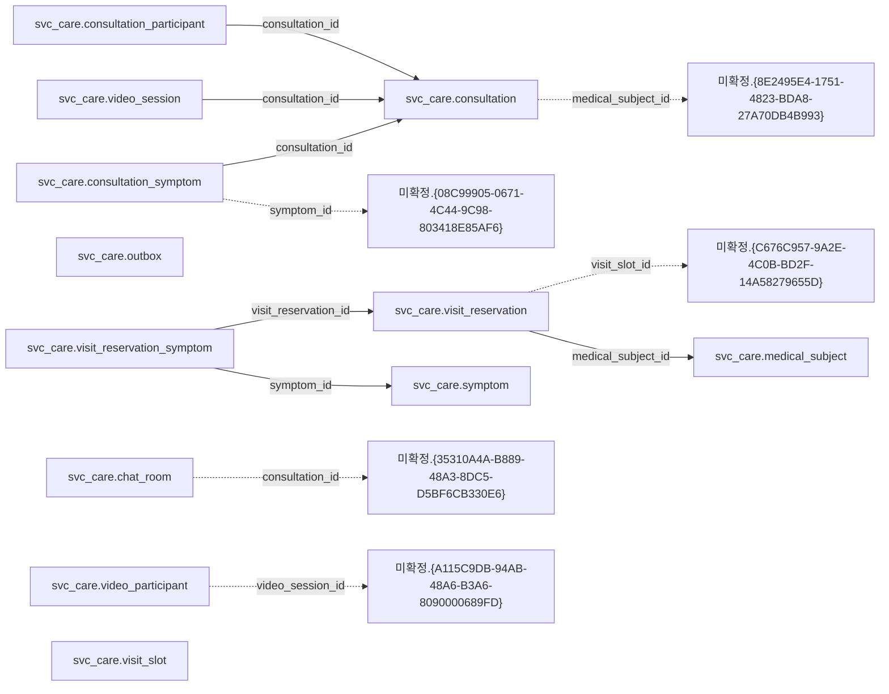

#### `svc_care.chat_room`

채팅 방 메타. 메시지 본문은 MongoDB chat_messages

| 컬럼 | 타입 | NULL | 기본값 | 속성 / 주석 |
| --- | --- | --- | --- | --- |
| `id` | `BIGINT` | 불가 | — | AUTO_INCREMENT |
| `uuid` | `CHAR(36)` | 불가 | — | — |
| `consultation_id` | `BIGINT` | 불가 | — | — |
| `status` | `VARCHAR(20)` | 불가 | — | — |
| `created_at` | `DATETIME` | 불가 | — | — |
| `closed_at` | `DATETIME` | 허용 | `NULL` | — |

**인덱스**

| 이름 | 종류 | 컬럼 |
| --- | --- | --- |
| `PRIMARY` | PRIMARY KEY | `id` |
| `uk_chat_room_uuid` | UNIQUE | `uuid` |
| `uk_chat_room_consult` | UNIQUE | `consultation_id` |

**외래키**

| 이름 | 컬럼 | 참조 대상 | 삭제 / 수정 규칙 | 비고 |
| --- | --- | --- | --- | --- |
| `fk_chat_room_consult` | `consultation_id` | `미확정 {35310A4A-B889-48A3-8DC5-D5BF6CB330E6}` (`미확정 {524D29A9-4CB3-4F97-9A49-E2314011D69C}`) | 미지정 / 미지정 | — |

#### `svc_care.consultation`

실시간상담. 보호자/펫/수의사 uuid 는 값

| 컬럼 | 타입 | NULL | 기본값 | 속성 / 주석 |
| --- | --- | --- | --- | --- |
| `id` | `BIGINT` | 불가 | — | AUTO_INCREMENT |
| `uuid` | `CHAR(36)` | 불가 | — | — |
| `request_uuid` | `CHAR(36)` | 허용 | `NULL` | matching 호출 uuid |
| `caregiver_uuid` | `CHAR(36)` | 불가 | — | — |
| `pet_uuid` | `CHAR(36)` | 불가 | — | — |
| `vet_uuid` | `CHAR(36)` | 허용 | `NULL` | — |
| `hospital_uuid` | `CHAR(36)` | 허용 | `NULL` | 배정 병원 uuid |
| `medical_subject_id` | `BIGINT` | 불가 | — | — |
| `status` | `VARCHAR(20)` | 불가 | — | — |
| `consult_type` | `VARCHAR(20)` | 불가 | — | — |
| `is_emergency` | `TINYINT(1)` | 불가 | — | — |
| `content` | `TEXT` | 허용 | `NULL` | — |
| `clinical_note` | `TEXT` | 허용 | `NULL` | — |
| `summary` | `TEXT` | 허용 | `NULL` | — |
| `recommendation` | `VARCHAR(255)` | 허용 | `NULL` | — |
| `created_at` | `DATETIME` | 불가 | — | — |
| `accepted_at` | `DATETIME` | 허용 | `NULL` | — |
| `completed_at` | `DATETIME` | 허용 | `NULL` | — |

**인덱스**

| 이름 | 종류 | 컬럼 |
| --- | --- | --- |
| `PRIMARY` | PRIMARY KEY | `id` |
| `uk_consultation_uuid` | UNIQUE | `uuid` |
| `idx_consult_status_created` | INDEX | `status`, `created_at` |
| `idx_consult_vet_status` | INDEX | `vet_uuid`, `status`, `created_at` |
| `idx_consult_caregiver_created` | INDEX | `caregiver_uuid`, `created_at` |
| `idx_consult_pet_created` | INDEX | `pet_uuid`, `created_at` |
| `idx_consult_emergency_status` | INDEX | `is_emergency`, `status`, `created_at` |
| `fk_consult_subject` | INDEX | `medical_subject_id` |
| `idx_consult_request` | INDEX | `request_uuid` |
| `idx_consult_hospital` | INDEX | `hospital_uuid`, `status` |

**외래키**

| 이름 | 컬럼 | 참조 대상 | 삭제 / 수정 규칙 | 비고 |
| --- | --- | --- | --- | --- |
| `fk_consult_subject` | `medical_subject_id` | `미확정 {8E2495E4-1751-4823-BDA8-27A70DB4B993}` (`미확정 {85FE6F3C-6376-4541-A09B-134FC223F632}`) | 미지정 / 미지정 | — |

#### `svc_care.consultation_participant`

상담 참여자 중계

| 컬럼 | 타입 | NULL | 기본값 | 속성 / 주석 |
| --- | --- | --- | --- | --- |
| `consultation_id` | `BIGINT` | 불가 | — | — |
| `participant_uuid` | `CHAR(36)` | 불가 | — | — |
| `participant_role` | `VARCHAR(20)` | 불가 | — | — |
| `joined_at` | `DATETIME` | 불가 | — | — |
| `left_at` | `DATETIME` | 허용 | `NULL` | — |

**인덱스**

| 이름 | 종류 | 컬럼 |
| --- | --- | --- |
| `PRIMARY` | PRIMARY KEY | `consultation_id`, `participant_uuid` |

**외래키**

| 이름 | 컬럼 | 참조 대상 | 삭제 / 수정 규칙 | 비고 |
| --- | --- | --- | --- | --- |
| `fk_participant_consult` | `consultation_id` | `svc_care.consultation` (`id`) | 미지정 / 미지정 | — |

#### `svc_care.consultation_symptom`

상담-증상 N:M

| 컬럼 | 타입 | NULL | 기본값 | 속성 / 주석 |
| --- | --- | --- | --- | --- |
| `id` | `BIGINT` | 불가 | — | AUTO_INCREMENT |
| `uuid` | `CHAR(36)` | 불가 | — | — |
| `consultation_id` | `BIGINT` | 불가 | — | — |
| `symptom_id` | `BIGINT` | 불가 | — | — |

**인덱스**

| 이름 | 종류 | 컬럼 |
| --- | --- | --- |
| `PRIMARY` | PRIMARY KEY | `id` |
| `uk_consult_symptom_uuid` | UNIQUE | `uuid` |
| `uk_consult_symptom_pair` | UNIQUE | `consultation_id`, `symptom_id` |
| `idx_consult_symptom_symptom` | INDEX | `symptom_id`, `consultation_id` |

**외래키**

| 이름 | 컬럼 | 참조 대상 | 삭제 / 수정 규칙 | 비고 |
| --- | --- | --- | --- | --- |
| `fk_consult_symptom_consult` | `consultation_id` | `svc_care.consultation` (`id`) | 미지정 / 미지정 | — |
| `fk_consult_symptom_symptom` | `symptom_id` | `미확정 {08C99905-0671-4C44-9C98-803418E85AF6}` (`미확정 {F4F931DA-9AD8-474E-9A5B-CC97BEA7C9C4}`) | 미지정 / 미지정 | — |

#### `svc_care.medical_subject`

진료과목

| 컬럼 | 타입 | NULL | 기본값 | 속성 / 주석 |
| --- | --- | --- | --- | --- |
| `id` | `BIGINT` | 불가 | — | AUTO_INCREMENT |
| `uuid` | `CHAR(36)` | 불가 | — | — |
| `name` | `VARCHAR(100)` | 불가 | — | — |

**인덱스**

| 이름 | 종류 | 컬럼 |
| --- | --- | --- |
| `PRIMARY` | PRIMARY KEY | `id` |
| `uk_subject_uuid` | UNIQUE | `uuid` |
| `uk_subject_name` | UNIQUE | `name` |

**외래키**

모델에 명시된 외래키가 없습니다.

#### `svc_care.outbox`

care 트랜잭셔널 아웃박스

| 컬럼 | 타입 | NULL | 기본값 | 속성 / 주석 |
| --- | --- | --- | --- | --- |
| `id` | `BIGINT` | 불가 | — | AUTO_INCREMENT |
| `event_id` | `CHAR(36)` | 불가 | — | — |
| `event_type` | `VARCHAR(100)` | 불가 | — | — |
| `aggregate_uuid` | `CHAR(36)` | 불가 | — | — |
| `payload` | `JSON` | 불가 | — | — |
| `occurred_at` | `DATETIME(6)` | 불가 | — | — |
| `published_at` | `DATETIME(6)` | 허용 | `NULL` | — |

**인덱스**

| 이름 | 종류 | 컬럼 |
| --- | --- | --- |
| `PRIMARY` | PRIMARY KEY | `id` |
| `uk_outbox_event` | UNIQUE | `event_id` |
| `idx_outbox_unpublished` | INDEX | `published_at`, `id` |

**외래키**

모델에 명시된 외래키가 없습니다.

#### `svc_care.symptom`

증상 카탈로그

| 컬럼 | 타입 | NULL | 기본값 | 속성 / 주석 |
| --- | --- | --- | --- | --- |
| `id` | `BIGINT` | 불가 | — | AUTO_INCREMENT |
| `uuid` | `CHAR(36)` | 불가 | — | — |
| `name` | `VARCHAR(100)` | 불가 | — | — |

**인덱스**

| 이름 | 종류 | 컬럼 |
| --- | --- | --- |
| `PRIMARY` | PRIMARY KEY | `id` |
| `uk_symptom_uuid` | UNIQUE | `uuid` |
| `uk_symptom_name` | UNIQUE | `name` |

**외래키**

모델에 명시된 외래키가 없습니다.

#### `svc_care.video_participant`

화상 참여자

| 컬럼 | 타입 | NULL | 기본값 | 속성 / 주석 |
| --- | --- | --- | --- | --- |
| `id` | `BIGINT` | 불가 | — | AUTO_INCREMENT |
| `video_session_id` | `BIGINT` | 불가 | — | — |
| `participant_uuid` | `CHAR(36)` | 불가 | — | — |
| `participant_role` | `VARCHAR(20)` | 불가 | — | — |
| `joined_at` | `DATETIME` | 허용 | `NULL` | — |
| `left_at` | `DATETIME` | 허용 | `NULL` | — |

**인덱스**

| 이름 | 종류 | 컬럼 |
| --- | --- | --- |
| `PRIMARY` | PRIMARY KEY | `id` |
| `uk_video_participant` | UNIQUE | `video_session_id`, `participant_uuid` |

**외래키**

| 이름 | 컬럼 | 참조 대상 | 삭제 / 수정 규칙 | 비고 |
| --- | --- | --- | --- | --- |
| `fk_video_participant_session` | `video_session_id` | `미확정 {A115C9DB-94AB-48A6-B3A6-8090000689FD}` (`미확정 {1D6F0B57-73A1-41B9-A18D-1CA6FEEAF253}`) | 미지정 / 미지정 | — |

#### `svc_care.video_session`

화상 방 메타. 입장 품질 로그는 MongoDB video_events

| 컬럼 | 타입 | NULL | 기본값 | 속성 / 주석 |
| --- | --- | --- | --- | --- |
| `id` | `BIGINT` | 불가 | — | AUTO_INCREMENT |
| `uuid` | `CHAR(36)` | 불가 | — | — |
| `consultation_id` | `BIGINT` | 불가 | — | — |
| `provider` | `VARCHAR(20)` | 불가 | — | — |
| `room_key` | `VARCHAR(80)` | 불가 | — | — |
| `status` | `VARCHAR(20)` | 불가 | — | — |
| `started_at` | `DATETIME` | 허용 | `NULL` | — |
| `ended_at` | `DATETIME` | 허용 | `NULL` | — |

**인덱스**

| 이름 | 종류 | 컬럼 |
| --- | --- | --- |
| `PRIMARY` | PRIMARY KEY | `id` |
| `uk_video_uuid` | UNIQUE | `uuid` |
| `uk_video_room` | UNIQUE | `room_key` |
| `idx_video_consult` | INDEX | `consultation_id`, `status` |

**외래키**

| 이름 | 컬럼 | 참조 대상 | 삭제 / 수정 규칙 | 비고 |
| --- | --- | --- | --- | --- |
| `fk_video_consult` | `consultation_id` | `svc_care.consultation` (`id`) | 미지정 / 미지정 | — |

#### `svc_care.visit_reservation`

내원예약. 희망 일시는 예약 값이고 슬롯은 재고 점유

| 컬럼 | 타입 | NULL | 기본값 | 속성 / 주석 |
| --- | --- | --- | --- | --- |
| `id` | `BIGINT` | 불가 | — | AUTO_INCREMENT |
| `uuid` | `CHAR(36)` | 불가 | — | — |
| `hospital_uuid` | `CHAR(36)` | 불가 | — | — |
| `caregiver_uuid` | `CHAR(36)` | 불가 | — | — |
| `pet_uuid` | `CHAR(36)` | 불가 | — | — |
| `medical_subject_id` | `BIGINT` | 불가 | — | — |
| `visit_slot_id` | `BIGINT` | 불가 | — | — |
| `status` | `VARCHAR(20)` | 불가 | — | — |
| `hoped_visit_date` | `DATE` | 불가 | — | — |
| `hoped_start_time` | `TIME` | 불가 | — | — |
| `symptom_memo` | `VARCHAR(200)` | 허용 | `NULL` | — |
| `created_at` | `DATETIME` | 불가 | — | — |
| `accepted_at` | `DATETIME` | 허용 | `NULL` | — |

**인덱스**

| 이름 | 종류 | 컬럼 |
| --- | --- | --- |
| `PRIMARY` | PRIMARY KEY | `id` |
| `uk_reservation_uuid` | UNIQUE | `uuid` |
| `uk_reservation_slot` | UNIQUE | `visit_slot_id` |
| `idx_reservation_status_date` | INDEX | `status`, `hoped_visit_date`, `hospital_uuid` |
| `idx_reservation_hospital_date` | INDEX | `hospital_uuid`, `hoped_visit_date`, `status` |
| `idx_reservation_caregiver_date` | INDEX | `caregiver_uuid`, `hoped_visit_date` |
| `idx_reservation_pet_date` | INDEX | `pet_uuid`, `hoped_visit_date` |
| `fk_reservation_subject` | INDEX | `medical_subject_id` |

**외래키**

| 이름 | 컬럼 | 참조 대상 | 삭제 / 수정 규칙 | 비고 |
| --- | --- | --- | --- | --- |
| `fk_reservation_slot` | `visit_slot_id` | `미확정 {C676C957-9A2E-4C0B-BD2F-14A58279655D}` (`미확정 {64A39D46-270A-4489-AFA2-71F3435EF4EF}`) | 미지정 / 미지정 | — |
| `fk_reservation_subject` | `medical_subject_id` | `svc_care.medical_subject` (`id`) | 미지정 / 미지정 | — |

#### `svc_care.visit_reservation_symptom`

예약-증상 N:M

| 컬럼 | 타입 | NULL | 기본값 | 속성 / 주석 |
| --- | --- | --- | --- | --- |
| `id` | `BIGINT` | 불가 | — | AUTO_INCREMENT |
| `uuid` | `CHAR(36)` | 불가 | — | — |
| `visit_reservation_id` | `BIGINT` | 불가 | — | — |
| `symptom_id` | `BIGINT` | 불가 | — | — |

**인덱스**

| 이름 | 종류 | 컬럼 |
| --- | --- | --- |
| `PRIMARY` | PRIMARY KEY | `id` |
| `uk_reservation_symptom_uuid` | UNIQUE | `uuid` |
| `uk_reservation_symptom_pair` | UNIQUE | `visit_reservation_id`, `symptom_id` |
| `idx_reservation_symptom_symptom` | INDEX | `symptom_id`, `visit_reservation_id` |

**외래키**

| 이름 | 컬럼 | 참조 대상 | 삭제 / 수정 규칙 | 비고 |
| --- | --- | --- | --- | --- |
| `fk_reservation_symptom_reservation` | `visit_reservation_id` | `svc_care.visit_reservation` (`id`) | 미지정 / 미지정 | — |
| `fk_reservation_symptom_symptom` | `symptom_id` | `svc_care.symptom` (`id`) | 미지정 / 미지정 | — |

#### `svc_care.visit_slot`

내원 슬롯 재고. 병원/수의사 uuid 는 clinic 값이며 FK 없음

| 컬럼 | 타입 | NULL | 기본값 | 속성 / 주석 |
| --- | --- | --- | --- | --- |
| `id` | `BIGINT` | 불가 | — | AUTO_INCREMENT |
| `uuid` | `CHAR(36)` | 불가 | — | — |
| `hospital_uuid` | `CHAR(36)` | 불가 | — | — |
| `vet_uuid` | `CHAR(36)` | 허용 | `NULL` | — |
| `vet_key` | `CHAR(36)` | 허용 | `NULL` | GENERATED ifnull(`vet_uuid`,_utf8mb4'') STORED |
| `slot_date` | `DATE` | 불가 | — | — |
| `start_time` | `TIME` | 불가 | — | — |
| `end_time` | `TIME` | 불가 | — | — |
| `status` | `VARCHAR(20)` | 불가 | — | — |
| `created_at` | `DATETIME` | 불가 | — | — |
| `updated_at` | `DATETIME` | 불가 | — | — |

**인덱스**

| 이름 | 종류 | 컬럼 |
| --- | --- | --- |
| `PRIMARY` | PRIMARY KEY | `id` |
| `uk_slot_uuid` | UNIQUE | `uuid` |
| `uk_slot_inventory` | UNIQUE | `hospital_uuid`, `slot_date`, `start_time`, `vet_key` |
| `idx_slot_hospital_date_status` | INDEX | `hospital_uuid`, `slot_date`, `status` |
| `idx_slot_vet_date` | INDEX | `vet_uuid`, `slot_date`, `status` |

**외래키**

모델에 명시된 외래키가 없습니다.

### `svc_community`

관계도는 외래키가 가리키는 방향을 화살표로 표시한다.

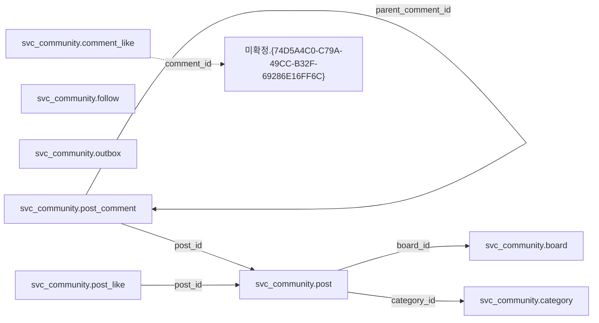

#### `svc_community.board`

게시판

| 컬럼 | 타입 | NULL | 기본값 | 속성 / 주석 |
| --- | --- | --- | --- | --- |
| `id` | `BIGINT` | 불가 | — | AUTO_INCREMENT |
| `uuid` | `CHAR(36)` | 불가 | — | — |
| `name` | `VARCHAR(100)` | 불가 | — | — |

**인덱스**

| 이름 | 종류 | 컬럼 |
| --- | --- | --- |
| `PRIMARY` | PRIMARY KEY | `id` |
| `uk_board_uuid` | UNIQUE | `uuid` |
| `uk_board_name` | UNIQUE | `name` |

**외래키**

모델에 명시된 외래키가 없습니다.

#### `svc_community.category`

글 카테고리

| 컬럼 | 타입 | NULL | 기본값 | 속성 / 주석 |
| --- | --- | --- | --- | --- |
| `id` | `BIGINT` | 불가 | — | AUTO_INCREMENT |
| `uuid` | `CHAR(36)` | 불가 | — | — |
| `name` | `VARCHAR(100)` | 불가 | — | — |

**인덱스**

| 이름 | 종류 | 컬럼 |
| --- | --- | --- |
| `PRIMARY` | PRIMARY KEY | `id` |
| `uk_category_uuid` | UNIQUE | `uuid` |
| `uk_category_name` | UNIQUE | `name` |

**외래키**

모델에 명시된 외래키가 없습니다.

#### `svc_community.comment_like`

댓글 좋아요 중계

| 컬럼 | 타입 | NULL | 기본값 | 속성 / 주석 |
| --- | --- | --- | --- | --- |
| `id` | `BIGINT` | 불가 | — | AUTO_INCREMENT |
| `comment_id` | `BIGINT` | 불가 | — | — |
| `actor_uuid` | `CHAR(36)` | 불가 | — | — |
| `actor_role` | `VARCHAR(20)` | 불가 | — | — |
| `created_at` | `DATETIME` | 불가 | — | — |

**인덱스**

| 이름 | 종류 | 컬럼 |
| --- | --- | --- |
| `PRIMARY` | PRIMARY KEY | `id` |
| `uk_comment_like` | UNIQUE | `comment_id`, `actor_uuid` |
| `idx_comment_like_actor` | INDEX | `actor_uuid`, `created_at` |

**외래키**

| 이름 | 컬럼 | 참조 대상 | 삭제 / 수정 규칙 | 비고 |
| --- | --- | --- | --- | --- |
| `fk_comment_like_comment` | `comment_id` | `미확정 {74D5A4C0-C79A-49CC-B32F-69286E16FF6C}` (`미확정 {4C6695BE-786B-4AB0-A9C2-708194CFD316}`) | 미지정 / 미지정 | — |

#### `svc_community.follow`

팔로우 중계. 양쪽 모두 identity uuid

| 컬럼 | 타입 | NULL | 기본값 | 속성 / 주석 |
| --- | --- | --- | --- | --- |
| `follower_uuid` | `CHAR(36)` | 불가 | — | — |
| `following_uuid` | `CHAR(36)` | 불가 | — | — |
| `created_at` | `DATETIME` | 불가 | — | — |

**인덱스**

| 이름 | 종류 | 컬럼 |
| --- | --- | --- |
| `PRIMARY` | PRIMARY KEY | `follower_uuid`, `following_uuid` |
| `idx_follow_following` | INDEX | `following_uuid`, `created_at` |

**외래키**

모델에 명시된 외래키가 없습니다.

#### `svc_community.outbox`

community 트랜잭셔널 아웃박스

| 컬럼 | 타입 | NULL | 기본값 | 속성 / 주석 |
| --- | --- | --- | --- | --- |
| `id` | `BIGINT` | 불가 | — | AUTO_INCREMENT |
| `event_id` | `CHAR(36)` | 불가 | — | — |
| `event_type` | `VARCHAR(100)` | 불가 | — | — |
| `aggregate_uuid` | `CHAR(36)` | 불가 | — | — |
| `payload` | `JSON` | 불가 | — | — |
| `occurred_at` | `DATETIME(6)` | 불가 | — | — |
| `published_at` | `DATETIME(6)` | 허용 | `NULL` | — |

**인덱스**

| 이름 | 종류 | 컬럼 |
| --- | --- | --- |
| `PRIMARY` | PRIMARY KEY | `id` |
| `uk_outbox_event` | UNIQUE | `event_id` |
| `idx_outbox_unpublished` | INDEX | `published_at`, `id` |

**외래키**

모델에 명시된 외래키가 없습니다.

#### `svc_community.post`

게시글. 좋아요/조회 수는 두지 않는다

| 컬럼 | 타입 | NULL | 기본값 | 속성 / 주석 |
| --- | --- | --- | --- | --- |
| `id` | `BIGINT` | 불가 | — | AUTO_INCREMENT |
| `uuid` | `CHAR(36)` | 불가 | — | — |
| `board_id` | `BIGINT` | 불가 | — | — |
| `category_id` | `BIGINT` | 불가 | — | — |
| `author_uuid` | `CHAR(36)` | 불가 | — | — |
| `title` | `VARCHAR(200)` | 불가 | — | — |
| `content` | `TEXT` | 불가 | — | — |
| `created_at` | `DATETIME` | 불가 | — | — |
| `updated_at` | `DATETIME` | 허용 | `NULL` | — |
| `deleted_at` | `DATETIME` | 허용 | `NULL` | — |

**인덱스**

| 이름 | 종류 | 컬럼 |
| --- | --- | --- |
| `PRIMARY` | PRIMARY KEY | `id` |
| `uk_post_uuid` | UNIQUE | `uuid` |
| `idx_post_board_created` | INDEX | `board_id`, `created_at` |
| `idx_post_category_created` | INDEX | `category_id`, `created_at` |
| `idx_post_author_created` | INDEX | `author_uuid`, `created_at` |

**외래키**

| 이름 | 컬럼 | 참조 대상 | 삭제 / 수정 규칙 | 비고 |
| --- | --- | --- | --- | --- |
| `fk_post_board` | `board_id` | `svc_community.board` (`id`) | 미지정 / 미지정 | — |
| `fk_post_category` | `category_id` | `svc_community.category` (`id`) | 미지정 / 미지정 | — |

#### `svc_community.post_comment`

댓글. 작성자는 uuid 값

| 컬럼 | 타입 | NULL | 기본값 | 속성 / 주석 |
| --- | --- | --- | --- | --- |
| `id` | `BIGINT` | 불가 | — | AUTO_INCREMENT |
| `uuid` | `CHAR(36)` | 불가 | — | — |
| `post_id` | `BIGINT` | 불가 | — | — |
| `parent_comment_id` | `BIGINT` | 허용 | `NULL` | — |
| `author_uuid` | `CHAR(36)` | 불가 | — | — |
| `depth` | `TINYINT` | 불가 | — | — |
| `content` | `VARCHAR(2000)` | 불가 | — | — |
| `created_at` | `DATETIME` | 불가 | — | — |
| `updated_at` | `DATETIME` | 허용 | `NULL` | — |
| `deleted_at` | `DATETIME` | 허용 | `NULL` | — |

**인덱스**

| 이름 | 종류 | 컬럼 |
| --- | --- | --- |
| `PRIMARY` | PRIMARY KEY | `id` |
| `uk_comment_uuid` | UNIQUE | `uuid` |
| `idx_comment_post_depth_created` | INDEX | `post_id`, `depth`, `created_at` |
| `idx_comment_author_created` | INDEX | `author_uuid`, `created_at` |
| `fk_comment_parent` | INDEX | `parent_comment_id` |

**외래키**

| 이름 | 컬럼 | 참조 대상 | 삭제 / 수정 규칙 | 비고 |
| --- | --- | --- | --- | --- |
| `fk_comment_parent` | `parent_comment_id` | `svc_community.post_comment` (`id`) | 미지정 / 미지정 | — |
| `fk_comment_post` | `post_id` | `svc_community.post` (`id`) | 미지정 / 미지정 | — |

#### `svc_community.post_like`

게시글 좋아요 중계

| 컬럼 | 타입 | NULL | 기본값 | 속성 / 주석 |
| --- | --- | --- | --- | --- |
| `id` | `BIGINT` | 불가 | — | AUTO_INCREMENT |
| `post_id` | `BIGINT` | 불가 | — | — |
| `actor_uuid` | `CHAR(36)` | 불가 | — | — |
| `actor_role` | `VARCHAR(20)` | 불가 | — | — |
| `created_at` | `DATETIME` | 불가 | — | — |

**인덱스**

| 이름 | 종류 | 컬럼 |
| --- | --- | --- |
| `PRIMARY` | PRIMARY KEY | `id` |
| `uk_post_like` | UNIQUE | `post_id`, `actor_uuid` |
| `idx_post_like_actor` | INDEX | `actor_uuid`, `created_at` |

**외래키**

| 이름 | 컬럼 | 참조 대상 | 삭제 / 수정 규칙 | 비고 |
| --- | --- | --- | --- | --- |
| `fk_post_like_post` | `post_id` | `svc_community.post` (`id`) | 미지정 / 미지정 | — |

### `svc_moderation`

관계도는 외래키가 가리키는 방향을 화살표로 표시한다.

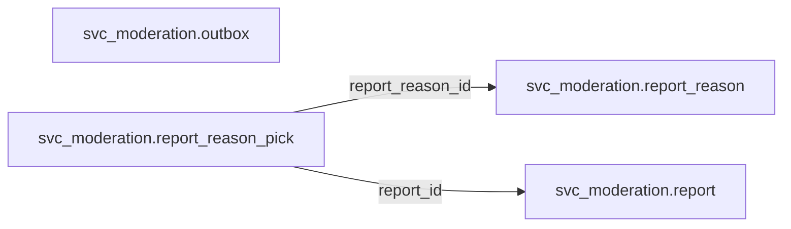

#### `svc_moderation.outbox`

moderation 트랜잭셔널 아웃박스

| 컬럼 | 타입 | NULL | 기본값 | 속성 / 주석 |
| --- | --- | --- | --- | --- |
| `id` | `BIGINT` | 불가 | — | AUTO_INCREMENT |
| `event_id` | `CHAR(36)` | 불가 | — | — |
| `event_type` | `VARCHAR(100)` | 불가 | — | — |
| `aggregate_uuid` | `CHAR(36)` | 불가 | — | — |
| `payload` | `JSON` | 불가 | — | — |
| `occurred_at` | `DATETIME(6)` | 불가 | — | — |
| `published_at` | `DATETIME(6)` | 허용 | `NULL` | — |

**인덱스**

| 이름 | 종류 | 컬럼 |
| --- | --- | --- |
| `PRIMARY` | PRIMARY KEY | `id` |
| `uk_outbox_event` | UNIQUE | `event_id` |
| `idx_outbox_unpublished` | INDEX | `published_at`, `id` |

**외래키**

모델에 명시된 외래키가 없습니다.

#### `svc_moderation.report`

신고. 대상은 type + uuid 이며 FK 없음

| 컬럼 | 타입 | NULL | 기본값 | 속성 / 주석 |
| --- | --- | --- | --- | --- |
| `id` | `BIGINT` | 불가 | — | AUTO_INCREMENT |
| `uuid` | `CHAR(36)` | 불가 | — | — |
| `reporter_uuid` | `CHAR(36)` | 불가 | — | — |
| `reporter_type` | `VARCHAR(20)` | 불가 | — | — |
| `target_uuid` | `CHAR(36)` | 불가 | — | — |
| `target_type` | `VARCHAR(30)` | 불가 | — | — |
| `content` | `VARCHAR(2000)` | 불가 | — | — |
| `status` | `VARCHAR(20)` | 불가 | — | — |
| `reviewer_admin_uuid` | `CHAR(36)` | 허용 | `NULL` | — |
| `resolution_note` | `VARCHAR(2000)` | 허용 | `NULL` | — |
| `created_at` | `DATETIME` | 불가 | — | — |
| `reviewed_at` | `DATETIME` | 허용 | `NULL` | — |

**인덱스**

| 이름 | 종류 | 컬럼 |
| --- | --- | --- |
| `PRIMARY` | PRIMARY KEY | `id` |
| `uk_report_uuid` | UNIQUE | `uuid` |
| `idx_report_status_created` | INDEX | `status`, `created_at` |
| `idx_report_target` | INDEX | `target_type`, `target_uuid` |
| `idx_report_reporter` | INDEX | `reporter_uuid`, `created_at` |

**외래키**

모델에 명시된 외래키가 없습니다.

#### `svc_moderation.report_reason`

신고 사유 코드

| 컬럼 | 타입 | NULL | 기본값 | 속성 / 주석 |
| --- | --- | --- | --- | --- |
| `id` | `BIGINT` | 불가 | — | AUTO_INCREMENT |
| `uuid` | `CHAR(36)` | 불가 | — | — |
| `target_type` | `VARCHAR(30)` | 불가 | — | — |
| `code` | `VARCHAR(50)` | 불가 | — | — |
| `name` | `VARCHAR(100)` | 불가 | — | — |
| `active` | `TINYINT(1)` | 불가 | — | — |

**인덱스**

| 이름 | 종류 | 컬럼 |
| --- | --- | --- |
| `PRIMARY` | PRIMARY KEY | `id` |
| `uk_reason_uuid` | UNIQUE | `uuid` |
| `uk_reason_code` | UNIQUE | `target_type`, `code` |
| `idx_reason_active` | INDEX | `target_type`, `active` |

**외래키**

모델에 명시된 외래키가 없습니다.

#### `svc_moderation.report_reason_pick`

신고-사유 N:M

| 컬럼 | 타입 | NULL | 기본값 | 속성 / 주석 |
| --- | --- | --- | --- | --- |
| `id` | `BIGINT` | 불가 | — | AUTO_INCREMENT |
| `report_id` | `BIGINT` | 불가 | — | — |
| `report_reason_id` | `BIGINT` | 불가 | — | — |

**인덱스**

| 이름 | 종류 | 컬럼 |
| --- | --- | --- |
| `PRIMARY` | PRIMARY KEY | `id` |
| `uk_report_reason_pick` | UNIQUE | `report_id`, `report_reason_id` |
| `idx_report_reason_pick_reason` | INDEX | `report_reason_id` |

**외래키**

| 이름 | 컬럼 | 참조 대상 | 삭제 / 수정 규칙 | 비고 |
| --- | --- | --- | --- | --- |
| `fk_pick_reason` | `report_reason_id` | `svc_moderation.report_reason` (`id`) | 미지정 / 미지정 | — |
| `fk_pick_report` | `report_id` | `svc_moderation.report` (`id`) | 미지정 / 미지정 | — |

### `svc_media`

관계도는 외래키가 가리키는 방향을 화살표로 표시한다.

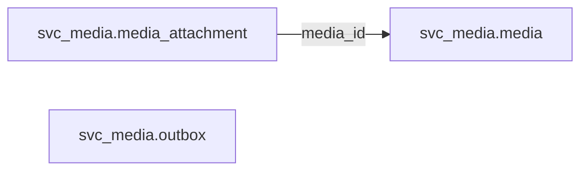

#### `svc_media.media`

파일 원본

| 컬럼 | 타입 | NULL | 기본값 | 속성 / 주석 |
| --- | --- | --- | --- | --- |
| `id` | `BIGINT` | 불가 | — | AUTO_INCREMENT |
| `uuid` | `CHAR(36)` | 불가 | — | — |
| `uploader_uuid` | `CHAR(36)` | 불가 | — | — |
| `file_name` | `VARCHAR(255)` | 불가 | — | — |
| `content_type` | `VARCHAR(100)` | 불가 | — | — |
| `object_key` | `VARCHAR(500)` | 불가 | — | — |
| `file_size` | `BIGINT` | 불가 | — | — |
| `deleted_at` | `DATETIME` | 허용 | `NULL` | — |
| `created_at` | `DATETIME` | 불가 | — | — |
| `updated_at` | `DATETIME` | 불가 | — | — |

**인덱스**

| 이름 | 종류 | 컬럼 |
| --- | --- | --- |
| `PRIMARY` | PRIMARY KEY | `id` |
| `uk_media_uuid` | UNIQUE | `uuid` |
| `uk_media_object` | UNIQUE | `object_key` |
| `idx_media_uploader_created` | INDEX | `uploader_uuid`, `created_at` |

**외래키**

모델에 명시된 외래키가 없습니다.

#### `svc_media.media_attachment`

첨부 중계. 대상 서비스 행을 FK 로 잡지 않는다

| 컬럼 | 타입 | NULL | 기본값 | 속성 / 주석 |
| --- | --- | --- | --- | --- |
| `id` | `BIGINT` | 불가 | — | AUTO_INCREMENT |
| `uuid` | `CHAR(36)` | 불가 | — | — |
| `media_id` | `BIGINT` | 불가 | — | — |
| `target_type` | `VARCHAR(30)` | 불가 | — | — |
| `target_uuid` | `CHAR(36)` | 불가 | — | — |
| `created_at` | `DATETIME` | 불가 | — | — |

**인덱스**

| 이름 | 종류 | 컬럼 |
| --- | --- | --- |
| `PRIMARY` | PRIMARY KEY | `id` |
| `uk_attachment_uuid` | UNIQUE | `uuid` |
| `uk_attachment_target` | UNIQUE | `media_id`, `target_type`, `target_uuid` |
| `idx_attachment_target` | INDEX | `target_type`, `target_uuid` |

**외래키**

| 이름 | 컬럼 | 참조 대상 | 삭제 / 수정 규칙 | 비고 |
| --- | --- | --- | --- | --- |
| `fk_attachment_media` | `media_id` | `svc_media.media` (`id`) | 미지정 / 미지정 | — |

#### `svc_media.outbox`

media 트랜잭셔널 아웃박스

| 컬럼 | 타입 | NULL | 기본값 | 속성 / 주석 |
| --- | --- | --- | --- | --- |
| `id` | `BIGINT` | 불가 | — | AUTO_INCREMENT |
| `event_id` | `CHAR(36)` | 불가 | — | — |
| `event_type` | `VARCHAR(100)` | 불가 | — | — |
| `aggregate_uuid` | `CHAR(36)` | 불가 | — | — |
| `payload` | `JSON` | 불가 | — | — |
| `occurred_at` | `DATETIME(6)` | 불가 | — | — |
| `published_at` | `DATETIME(6)` | 허용 | `NULL` | — |

**인덱스**

| 이름 | 종류 | 컬럼 |
| --- | --- | --- |
| `PRIMARY` | PRIMARY KEY | `id` |
| `uk_outbox_event` | UNIQUE | `event_id` |
| `idx_outbox_unpublished` | INDEX | `published_at`, `id` |

**외래키**

모델에 명시된 외래키가 없습니다.

### `svc_notification`

관계도는 외래키가 가리키는 방향을 화살표로 표시한다.

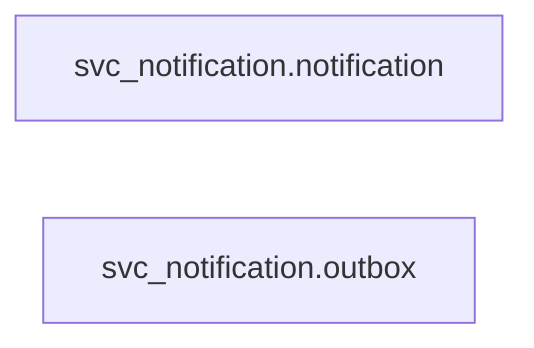

#### `svc_notification.notification`

알림 수신함. 생산자 테이블 FK 없음. event_id 로 멱등

| 컬럼 | 타입 | NULL | 기본값 | 속성 / 주석 |
| --- | --- | --- | --- | --- |
| `id` | `BIGINT` | 불가 | — | AUTO_INCREMENT |
| `uuid` | `CHAR(36)` | 불가 | — | — |
| `recipient_uuid` | `CHAR(36)` | 불가 | — | — |
| `actor_uuid` | `CHAR(36)` | 불가 | — | — |
| `event_id` | `CHAR(36)` | 불가 | — | — |
| `type` | `VARCHAR(30)` | 불가 | — | — |
| `title` | `VARCHAR(200)` | 불가 | — | — |
| `content` | `VARCHAR(500)` | 불가 | — | — |
| `target_type` | `VARCHAR(30)` | 불가 | — | — |
| `target_uuid` | `CHAR(36)` | 불가 | — | — |
| `read_at` | `DATETIME` | 허용 | `NULL` | — |
| `created_at` | `DATETIME` | 불가 | — | — |

**인덱스**

| 이름 | 종류 | 컬럼 |
| --- | --- | --- |
| `PRIMARY` | PRIMARY KEY | `id` |
| `uk_notification_uuid` | UNIQUE | `uuid` |
| `uk_notification_event` | UNIQUE | `recipient_uuid`, `event_id` |
| `idx_notification_inbox` | INDEX | `recipient_uuid`, `read_at`, `created_at` |

**외래키**

모델에 명시된 외래키가 없습니다.

#### `svc_notification.outbox`

notification 트랜잭셔널 아웃박스

| 컬럼 | 타입 | NULL | 기본값 | 속성 / 주석 |
| --- | --- | --- | --- | --- |
| `id` | `BIGINT` | 불가 | — | AUTO_INCREMENT |
| `event_id` | `CHAR(36)` | 불가 | — | — |
| `event_type` | `VARCHAR(100)` | 불가 | — | — |
| `aggregate_uuid` | `CHAR(36)` | 불가 | — | — |
| `payload` | `JSON` | 불가 | — | — |
| `occurred_at` | `DATETIME(6)` | 불가 | — | — |
| `published_at` | `DATETIME(6)` | 허용 | `NULL` | — |

**인덱스**

| 이름 | 종류 | 컬럼 |
| --- | --- | --- |
| `PRIMARY` | PRIMARY KEY | `id` |
| `uk_outbox_event` | UNIQUE | `event_id` |
| `idx_outbox_unpublished` | INDEX | `published_at`, `id` |

**외래키**

모델에 명시된 외래키가 없습니다.

### `svc_platform`

관계도는 외래키가 가리키는 방향을 화살표로 표시한다.

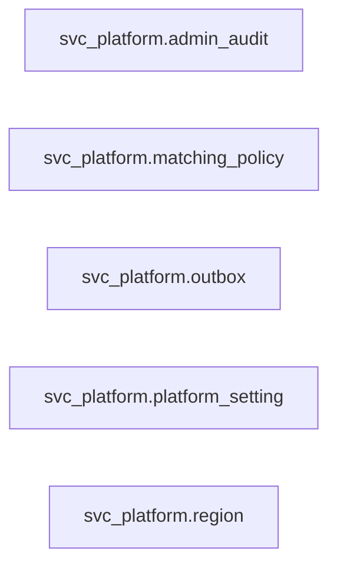

#### `svc_platform.admin_audit`

플랫폼 관리자 감사 로그

| 컬럼 | 타입 | NULL | 기본값 | 속성 / 주석 |
| --- | --- | --- | --- | --- |
| `id` | `BIGINT` | 불가 | — | AUTO_INCREMENT |
| `uuid` | `CHAR(36)` | 불가 | — | — |
| `admin_uuid` | `CHAR(36)` | 불가 | — | — |
| `action` | `VARCHAR(80)` | 불가 | — | — |
| `target_type` | `VARCHAR(40)` | 불가 | — | — |
| `target_uuid` | `CHAR(36)` | 불가 | — | — |
| `detail` | `JSON` | 허용 | `NULL` | — |
| `created_at` | `DATETIME` | 불가 | — | — |

**인덱스**

| 이름 | 종류 | 컬럼 |
| --- | --- | --- |
| `PRIMARY` | PRIMARY KEY | `id` |
| `uk_audit_uuid` | UNIQUE | `uuid` |
| `idx_audit_created` | INDEX | `created_at` |
| `idx_audit_target` | INDEX | `target_type`, `target_uuid` |

**외래키**

모델에 명시된 외래키가 없습니다.

#### `svc_platform.matching_policy`

호출 반경, 제안 수, 수락 제한시간. 카카오택시의 배차 정책에 해당

| 컬럼 | 타입 | NULL | 기본값 | 속성 / 주석 |
| --- | --- | --- | --- | --- |
| `id` | `BIGINT` | 불가 | — | AUTO_INCREMENT |
| `uuid` | `CHAR(36)` | 불가 | — | — |
| `name` | `VARCHAR(50)` | 불가 | — | — |
| `active` | `TINYINT(1)` | 불가 | — | — |
| `default_radius_m` | `INT` | 불가 | — | — |
| `emergency_radius_m` | `INT` | 불가 | — | — |
| `radius_step_m` | `INT` | 불가 | — | — |
| `max_waves` | `INT` | 불가 | — | — |
| `max_offers_per_wave` | `INT` | 불가 | — | — |
| `offer_ttl_sec` | `INT` | 불가 | — | — |
| `request_ttl_sec` | `INT` | 불가 | — | — |
| `updated_at` | `DATETIME` | 불가 | — | — |

**인덱스**

| 이름 | 종류 | 컬럼 |
| --- | --- | --- |
| `PRIMARY` | PRIMARY KEY | `id` |
| `uk_policy_uuid` | UNIQUE | `uuid` |
| `idx_policy_active` | INDEX | `active`, `updated_at` |

**외래키**

모델에 명시된 외래키가 없습니다.

#### `svc_platform.outbox`

platform 트랜잭셔널 아웃박스. 토픽 platform.policy.v1

| 컬럼 | 타입 | NULL | 기본값 | 속성 / 주석 |
| --- | --- | --- | --- | --- |
| `id` | `BIGINT` | 불가 | — | AUTO_INCREMENT |
| `event_id` | `CHAR(36)` | 불가 | — | — |
| `event_type` | `VARCHAR(100)` | 불가 | — | — |
| `aggregate_uuid` | `CHAR(36)` | 불가 | — | — |
| `payload` | `JSON` | 불가 | — | — |
| `occurred_at` | `DATETIME(6)` | 불가 | — | — |
| `published_at` | `DATETIME(6)` | 허용 | `NULL` | — |

**인덱스**

| 이름 | 종류 | 컬럼 |
| --- | --- | --- |
| `PRIMARY` | PRIMARY KEY | `id` |
| `uk_outbox_event` | UNIQUE | `event_id` |
| `idx_outbox_unpublished` | INDEX | `published_at`, `id` |

**외래키**

모델에 명시된 외래키가 없습니다.

#### `svc_platform.platform_setting`

플랫폼 운영 설정

| 컬럼 | 타입 | NULL | 기본값 | 속성 / 주석 |
| --- | --- | --- | --- | --- |
| `setting_key` | `VARCHAR(80)` | 불가 | — | — |
| `setting_value` | `JSON` | 불가 | — | — |
| `updated_at` | `DATETIME` | 불가 | — | — |

**인덱스**

| 이름 | 종류 | 컬럼 |
| --- | --- | --- |
| `PRIMARY` | PRIMARY KEY | `setting_key` |

**외래키**

모델에 명시된 외래키가 없습니다.

#### `svc_platform.region`

플랫폼 권역 코드

| 컬럼 | 타입 | NULL | 기본값 | 속성 / 주석 |
| --- | --- | --- | --- | --- |
| `id` | `BIGINT` | 불가 | — | AUTO_INCREMENT |
| `code` | `VARCHAR(20)` | 불가 | — | — |
| `name` | `VARCHAR(50)` | 불가 | — | — |
| `parent_code` | `VARCHAR(20)` | 허용 | `NULL` | — |
| `latitude` | `DECIMAL(9,6)` | 허용 | `NULL` | — |
| `longitude` | `DECIMAL(9,6)` | 허용 | `NULL` | — |

**인덱스**

| 이름 | 종류 | 컬럼 |
| --- | --- | --- |
| `PRIMARY` | PRIMARY KEY | `id` |
| `uk_region_code` | UNIQUE | `code` |
| `idx_region_parent` | INDEX | `parent_code`, `name` |

**외래키**

모델에 명시된 외래키가 없습니다.

### `svc_matching`

관계도는 외래키가 가리키는 방향을 화살표로 표시한다.

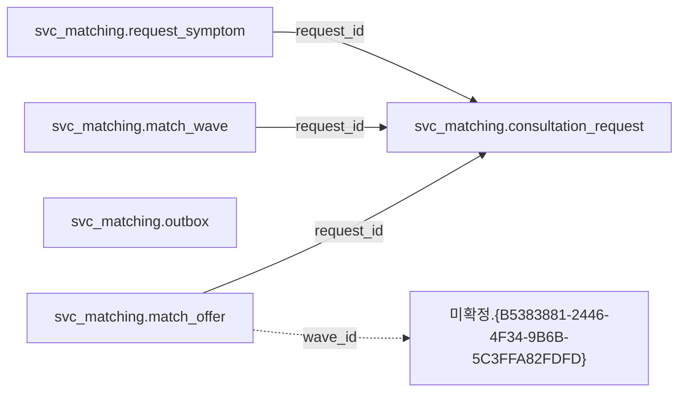

#### `svc_matching.consultation_request`

보호자 호출. 택시 호출에 해당. 실시간 후보 검색은 Mongo 2dsphere

| 컬럼 | 타입 | NULL | 기본값 | 속성 / 주석 |
| --- | --- | --- | --- | --- |
| `id` | `BIGINT` | 불가 | — | AUTO_INCREMENT |
| `uuid` | `CHAR(36)` | 불가 | — | — |
| `caregiver_uuid` | `CHAR(36)` | 불가 | — | — |
| `pet_uuid` | `CHAR(36)` | 불가 | — | — |
| `medical_subject_uuid` | `CHAR(36)` | 불가 | — | — |
| `channel` | `VARCHAR(20)` | 불가 | — | — |
| `is_emergency` | `TINYINT(1)` | 불가 | — | — |
| `status` | `VARCHAR(20)` | 불가 | — | — |
| `origin_lat` | `DECIMAL(9,6)` | 불가 | — | — |
| `origin_lng` | `DECIMAL(9,6)` | 불가 | — | — |
| `geohash` | `VARCHAR(12)` | 불가 | — | — |
| `region` | `VARCHAR(50)` | 불가 | — | — |
| `si` | `VARCHAR(50)` | 불가 | — | — |
| `gu` | `VARCHAR(50)` | 불가 | — | — |
| `search_radius_m` | `INT` | 불가 | — | — |
| `symptom_memo` | `VARCHAR(200)` | 허용 | `NULL` | — |
| `requested_at` | `DATETIME` | 불가 | — | — |
| `expire_at` | `DATETIME` | 불가 | — | — |
| `assigned_vet_uuid` | `CHAR(36)` | 허용 | `NULL` | — |
| `assigned_hospital_uuid` | `CHAR(36)` | 허용 | `NULL` | — |
| `assigned_at` | `DATETIME` | 허용 | `NULL` | — |

**인덱스**

| 이름 | 종류 | 컬럼 |
| --- | --- | --- |
| `PRIMARY` | PRIMARY KEY | `id` |
| `uk_request_uuid` | UNIQUE | `uuid` |
| `idx_request_status_at` | INDEX | `status`, `requested_at` |
| `idx_request_region` | INDEX | `region`, `status`, `is_emergency`, `requested_at` |
| `idx_request_caregiver` | INDEX | `caregiver_uuid`, `requested_at` |
| `idx_request_geo` | INDEX | `origin_lat`, `origin_lng` |

**외래키**

모델에 명시된 외래키가 없습니다.

#### `svc_matching.match_offer`

수의사 앱에 뜨는 콜 카드. 한 명이 수락하면 나머지는 SUPERSEDED

| 컬럼 | 타입 | NULL | 기본값 | 속성 / 주석 |
| --- | --- | --- | --- | --- |
| `id` | `BIGINT` | 불가 | — | AUTO_INCREMENT |
| `uuid` | `CHAR(36)` | 불가 | — | — |
| `request_id` | `BIGINT` | 불가 | — | — |
| `wave_id` | `BIGINT` | 불가 | — | — |
| `vet_uuid` | `CHAR(36)` | 불가 | — | — |
| `hospital_uuid` | `CHAR(36)` | 불가 | — | — |
| `distance_m` | `INT` | 불가 | — | — |
| `score` | `DECIMAL(6,2)` | 불가 | — | — |
| `status` | `VARCHAR(20)` | 불가 | — | — |
| `offered_at` | `DATETIME` | 불가 | — | — |
| `respond_by` | `DATETIME` | 불가 | — | — |
| `responded_at` | `DATETIME` | 허용 | `NULL` | — |

**인덱스**

| 이름 | 종류 | 컬럼 |
| --- | --- | --- |
| `PRIMARY` | PRIMARY KEY | `id` |
| `uk_offer_uuid` | UNIQUE | `uuid` |
| `uk_offer_vet` | UNIQUE | `request_id`, `vet_uuid` |
| `idx_offer_inbox` | INDEX | `vet_uuid`, `status`, `offered_at` |
| `idx_offer_request` | INDEX | `request_id`, `status` |
| `fk_offer_wave` | INDEX | `wave_id` |

**외래키**

| 이름 | 컬럼 | 참조 대상 | 삭제 / 수정 규칙 | 비고 |
| --- | --- | --- | --- | --- |
| `fk_offer_request` | `request_id` | `svc_matching.consultation_request` (`id`) | 미지정 / 미지정 | — |
| `fk_offer_wave` | `wave_id` | `미확정 {B5383881-2446-4F34-9B6B-5C3FFA82FDFD}` (`미확정 {2723F9ED-B05B-4DDC-9B89-CC893B554C4E}`) | 미지정 / 미지정 | — |

#### `svc_matching.match_wave`

반경을 넓혀 가며 다시 부르는 차수

| 컬럼 | 타입 | NULL | 기본값 | 속성 / 주석 |
| --- | --- | --- | --- | --- |
| `id` | `BIGINT` | 불가 | — | AUTO_INCREMENT |
| `uuid` | `CHAR(36)` | 불가 | — | — |
| `request_id` | `BIGINT` | 불가 | — | — |
| `wave_no` | `INT` | 불가 | — | — |
| `radius_m` | `INT` | 불가 | — | — |
| `started_at` | `DATETIME` | 불가 | — | — |
| `finished_at` | `DATETIME` | 허용 | `NULL` | — |

**인덱스**

| 이름 | 종류 | 컬럼 |
| --- | --- | --- |
| `PRIMARY` | PRIMARY KEY | `id` |
| `uk_wave_uuid` | UNIQUE | `uuid` |
| `uk_wave_no` | UNIQUE | `request_id`, `wave_no` |

**외래키**

| 이름 | 컬럼 | 참조 대상 | 삭제 / 수정 규칙 | 비고 |
| --- | --- | --- | --- | --- |
| `fk_wave_request` | `request_id` | `svc_matching.consultation_request` (`id`) | 미지정 / 미지정 | — |

#### `svc_matching.outbox`

matching 아웃박스. 토픽 matching.request.v1, matching.offer.v1

| 컬럼 | 타입 | NULL | 기본값 | 속성 / 주석 |
| --- | --- | --- | --- | --- |
| `id` | `BIGINT` | 불가 | — | AUTO_INCREMENT |
| `event_id` | `CHAR(36)` | 불가 | — | — |
| `event_type` | `VARCHAR(100)` | 불가 | — | — |
| `aggregate_uuid` | `CHAR(36)` | 불가 | — | — |
| `payload` | `JSON` | 불가 | — | — |
| `occurred_at` | `DATETIME(6)` | 불가 | — | — |
| `published_at` | `DATETIME(6)` | 허용 | `NULL` | — |

**인덱스**

| 이름 | 종류 | 컬럼 |
| --- | --- | --- |
| `PRIMARY` | PRIMARY KEY | `id` |
| `uk_outbox_event` | UNIQUE | `event_id` |
| `idx_outbox_unpublished` | INDEX | `published_at`, `id` |

**외래키**

모델에 명시된 외래키가 없습니다.

#### `svc_matching.request_symptom`

호출-증상. symptom_uuid 는 care 값

| 컬럼 | 타입 | NULL | 기본값 | 속성 / 주석 |
| --- | --- | --- | --- | --- |
| `request_id` | `BIGINT` | 불가 | — | — |
| `symptom_uuid` | `CHAR(36)` | 불가 | — | — |

**인덱스**

| 이름 | 종류 | 컬럼 |
| --- | --- | --- |
| `PRIMARY` | PRIMARY KEY | `request_id`, `symptom_uuid` |
| `idx_request_symptom` | INDEX | `symptom_uuid`, `request_id` |

**외래키**

| 이름 | 컬럼 | 참조 대상 | 삭제 / 수정 규칙 | 비고 |
| --- | --- | --- | --- | --- |
| `fk_request_symptom_request` | `request_id` | `svc_matching.consultation_request` (`id`) | 미지정 / 미지정 | — |

### `vet_query`

관계도는 외래키가 가리키는 방향을 화살표로 표시한다.

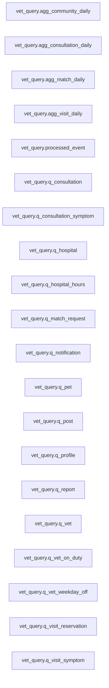

#### `vet_query.agg_community_daily`

일별 게시판 활동 건수

| 컬럼 | 타입 | NULL | 기본값 | 속성 / 주석 |
| --- | --- | --- | --- | --- |
| `stat_date` | `DATE` | 불가 | — | — |
| `board_name` | `VARCHAR(100)` | 불가 | — | — |
| `post_count` | `INT` | 불가 | — | — |
| `comment_count` | `INT` | 불가 | — | — |
| `like_count` | `INT` | 불가 | — | — |

**인덱스**

| 이름 | 종류 | 컬럼 |
| --- | --- | --- |
| `PRIMARY` | PRIMARY KEY | `stat_date`, `board_name` |

**외래키**

모델에 명시된 외래키가 없습니다.

#### `vet_query.agg_consultation_daily`

일별 상담 건수. 과목/상태/응급

| 컬럼 | 타입 | NULL | 기본값 | 속성 / 주석 |
| --- | --- | --- | --- | --- |
| `stat_date` | `DATE` | 불가 | — | — |
| `subject_name` | `VARCHAR(100)` | 불가 | — | — |
| `status` | `VARCHAR(20)` | 불가 | — | — |
| `is_emergency` | `TINYINT(1)` | 불가 | — | — |
| `consultation_count` | `INT` | 불가 | — | — |

**인덱스**

| 이름 | 종류 | 컬럼 |
| --- | --- | --- |
| `PRIMARY` | PRIMARY KEY | `stat_date`, `subject_name`, `status`, `is_emergency` |
| `idx_agg_consult_status` | INDEX | `stat_date`, `status`, `is_emergency` |

**외래키**

모델에 명시된 외래키가 없습니다.

#### `vet_query.agg_match_daily`

일별 호출 건수와 평균 배정 초

| 컬럼 | 타입 | NULL | 기본값 | 속성 / 주석 |
| --- | --- | --- | --- | --- |
| `stat_date` | `DATE` | 불가 | — | — |
| `region` | `VARCHAR(50)` | 불가 | — | — |
| `channel` | `VARCHAR(20)` | 불가 | — | — |
| `status` | `VARCHAR(20)` | 불가 | — | — |
| `is_emergency` | `TINYINT(1)` | 불가 | — | — |
| `request_count` | `INT` | 불가 | — | — |
| `avg_match_sec` | `INT` | 허용 | `NULL` | — |

**인덱스**

| 이름 | 종류 | 컬럼 |
| --- | --- | --- |
| `PRIMARY` | PRIMARY KEY | `stat_date`, `region`, `channel`, `status`, `is_emergency` |

**외래키**

모델에 명시된 외래키가 없습니다.

#### `vet_query.agg_visit_daily`

일별 병원 예약 건수. 목록 테이블을 스캔하지 않는다

| 컬럼 | 타입 | NULL | 기본값 | 속성 / 주석 |
| --- | --- | --- | --- | --- |
| `stat_date` | `DATE` | 불가 | — | — |
| `hospital_uuid` | `CHAR(36)` | 불가 | — | — |
| `hospital_name` | `VARCHAR(100)` | 불가 | — | — |
| `region` | `VARCHAR(50)` | 불가 | — | — |
| `status` | `VARCHAR(20)` | 불가 | — | — |
| `reservation_count` | `INT` | 불가 | — | — |

**인덱스**

| 이름 | 종류 | 컬럼 |
| --- | --- | --- |
| `PRIMARY` | PRIMARY KEY | `stat_date`, `hospital_uuid`, `status` |
| `idx_agg_visit_region` | INDEX | `stat_date`, `region`, `status` |

**외래키**

모델에 명시된 외래키가 없습니다.

#### `vet_query.processed_event`

프로젝터 멱등 키

| 컬럼 | 타입 | NULL | 기본값 | 속성 / 주석 |
| --- | --- | --- | --- | --- |
| `event_id` | `CHAR(36)` | 불가 | — | — |
| `event_type` | `VARCHAR(100)` | 불가 | — | — |
| `processed_at` | `DATETIME(6)` | 불가 | — | — |

**인덱스**

| 이름 | 종류 | 컬럼 |
| --- | --- | --- |
| `PRIMARY` | PRIMARY KEY | `event_id` |

**외래키**

모델에 명시된 외래키가 없습니다.

#### `vet_query.q_consultation`

상담 목록. 지역/응급/상태/과목을 한 테이블에서 필터

| 컬럼 | 타입 | NULL | 기본값 | 속성 / 주석 |
| --- | --- | --- | --- | --- |
| `consultation_uuid` | `CHAR(36)` | 불가 | — | — |
| `status` | `VARCHAR(20)` | 불가 | — | — |
| `consult_type` | `VARCHAR(20)` | 불가 | — | — |
| `is_emergency` | `TINYINT(1)` | 불가 | — | — |
| `summary` | `VARCHAR(500)` | 허용 | `NULL` | — |
| `caregiver_uuid` | `CHAR(36)` | 불가 | — | — |
| `caregiver_nickname` | `VARCHAR(50)` | 불가 | — | — |
| `pet_uuid` | `CHAR(36)` | 불가 | — | — |
| `pet_name` | `VARCHAR(50)` | 불가 | — | — |
| `species_name` | `VARCHAR(50)` | 불가 | — | — |
| `vet_uuid` | `CHAR(36)` | 허용 | `NULL` | — |
| `vet_name` | `VARCHAR(50)` | 허용 | `NULL` | — |
| `subject_name` | `VARCHAR(100)` | 불가 | — | — |
| `hospital_uuid` | `CHAR(36)` | 허용 | `NULL` | — |
| `hospital_name` | `VARCHAR(100)` | 허용 | `NULL` | — |
| `region` | `VARCHAR(50)` | 허용 | `NULL` | — |
| `created_at` | `DATETIME` | 불가 | — | — |
| `accepted_at` | `DATETIME` | 허용 | `NULL` | — |
| `completed_at` | `DATETIME` | 허용 | `NULL` | — |

**인덱스**

| 이름 | 종류 | 컬럼 |
| --- | --- | --- |
| `PRIMARY` | PRIMARY KEY | `consultation_uuid` |
| `idx_q_consult_status_created` | INDEX | `status`, `created_at` |
| `idx_q_consult_emergency` | INDEX | `is_emergency`, `status`, `region`, `created_at` |
| `idx_q_consult_vet` | INDEX | `vet_uuid`, `status`, `created_at` |
| `idx_q_consult_caregiver` | INDEX | `caregiver_uuid`, `created_at` |
| `idx_q_consult_subject` | INDEX | `subject_name`, `status`, `created_at` |
| `idx_q_consult_agg` | INDEX | `created_at`, `subject_name`, `status`, `is_emergency` |
| `ft_q_consult` | FULLTEXT | `summary`, `pet_name`, `vet_name`, `subject_name` |

**외래키**

모델에 명시된 외래키가 없습니다.

#### `vet_query.q_consultation_symptom`

상담 증상 필터

| 컬럼 | 타입 | NULL | 기본값 | 속성 / 주석 |
| --- | --- | --- | --- | --- |
| `consultation_uuid` | `CHAR(36)` | 불가 | — | — |
| `symptom_uuid` | `CHAR(36)` | 불가 | — | — |
| `symptom_name` | `VARCHAR(100)` | 불가 | — | — |

**인덱스**

| 이름 | 종류 | 컬럼 |
| --- | --- | --- |
| `PRIMARY` | PRIMARY KEY | `symptom_uuid`, `consultation_uuid` |
| `idx_q_consult_symptom_consultation` | INDEX | `consultation_uuid` |
| `idx_q_consult_symptom_name` | INDEX | `symptom_name`, `consultation_uuid` |

**외래키**

모델에 명시된 외래키가 없습니다.

#### `vet_query.q_hospital`

병원 지역 필터 + 이름/주소 검색

| 컬럼 | 타입 | NULL | 기본값 | 속성 / 주석 |
| --- | --- | --- | --- | --- |
| `hospital_uuid` | `CHAR(36)` | 불가 | — | — |
| `region` | `VARCHAR(50)` | 불가 | — | — |
| `si` | `VARCHAR(50)` | 불가 | — | — |
| `gun` | `VARCHAR(50)` | 불가 | — | — |
| `gu` | `VARCHAR(50)` | 불가 | — | — |
| `name` | `VARCHAR(100)` | 불가 | — | — |
| `road_address` | `VARCHAR(255)` | 불가 | — | — |
| `lot_address` | `VARCHAR(255)` | 불가 | — | — |
| `tel` | `VARCHAR(20)` | 허용 | `NULL` | — |

**인덱스**

| 이름 | 종류 | 컬럼 |
| --- | --- | --- |
| `PRIMARY` | PRIMARY KEY | `hospital_uuid` |
| `idx_q_hospital_region_name` | INDEX | `region`, `si`, `gu`, `name` |
| `ft_q_hospital` | FULLTEXT | `name`, `road_address`, `lot_address` |

**외래키**

모델에 명시된 외래키가 없습니다.

#### `vet_query.q_hospital_hours`

요일 영업 필터. 1=월 7=일

| 컬럼 | 타입 | NULL | 기본값 | 속성 / 주석 |
| --- | --- | --- | --- | --- |
| `hospital_uuid` | `CHAR(36)` | 불가 | — | — |
| `day_of_week` | `TINYINT` | 불가 | — | — |
| `is_closed` | `TINYINT(1)` | 불가 | — | — |
| `open_time` | `TIME` | 허용 | `NULL` | — |
| `close_time` | `TIME` | 허용 | `NULL` | — |

**인덱스**

| 이름 | 종류 | 컬럼 |
| --- | --- | --- |
| `PRIMARY` | PRIMARY KEY | `hospital_uuid`, `day_of_week` |
| `idx_q_hours_open` | INDEX | `day_of_week`, `is_closed`, `hospital_uuid` |

**외래키**

모델에 명시된 외래키가 없습니다.

#### `vet_query.q_match_request`

호출 운영 목록. 후보 반경 검색은 MongoDB

| 컬럼 | 타입 | NULL | 기본값 | 속성 / 주석 |
| --- | --- | --- | --- | --- |
| `request_uuid` | `CHAR(36)` | 불가 | — | — |
| `status` | `VARCHAR(20)` | 불가 | — | — |
| `channel` | `VARCHAR(20)` | 불가 | — | — |
| `is_emergency` | `TINYINT(1)` | 불가 | — | — |
| `region` | `VARCHAR(50)` | 불가 | — | — |
| `gu` | `VARCHAR(50)` | 불가 | — | — |
| `origin_lat` | `DECIMAL(9,6)` | 불가 | — | — |
| `origin_lng` | `DECIMAL(9,6)` | 불가 | — | — |
| `caregiver_nickname` | `VARCHAR(50)` | 불가 | — | — |
| `pet_name` | `VARCHAR(50)` | 불가 | — | — |
| `subject_name` | `VARCHAR(100)` | 불가 | — | — |
| `assigned_vet_name` | `VARCHAR(50)` | 허용 | `NULL` | — |
| `assigned_hospital_name` | `VARCHAR(100)` | 허용 | `NULL` | — |
| `distance_m` | `INT` | 허용 | `NULL` | — |
| `requested_at` | `DATETIME` | 불가 | — | — |
| `assigned_at` | `DATETIME` | 허용 | `NULL` | — |

**인덱스**

| 이름 | 종류 | 컬럼 |
| --- | --- | --- |
| `PRIMARY` | PRIMARY KEY | `request_uuid` |
| `idx_q_match_status` | INDEX | `status`, `requested_at` |
| `idx_q_match_region` | INDEX | `region`, `is_emergency`, `status`, `requested_at` |

**외래키**

모델에 명시된 외래키가 없습니다.

#### `vet_query.q_notification`

수신함. 미읽음은 is_unread=1

| 컬럼 | 타입 | NULL | 기본값 | 속성 / 주석 |
| --- | --- | --- | --- | --- |
| `notification_uuid` | `CHAR(36)` | 불가 | — | — |
| `recipient_uuid` | `CHAR(36)` | 불가 | — | — |
| `type` | `VARCHAR(30)` | 불가 | — | — |
| `title` | `VARCHAR(200)` | 불가 | — | — |
| `read_at` | `DATETIME` | 허용 | `NULL` | — |
| `created_at` | `DATETIME` | 불가 | — | — |
| `is_unread` | `TINYINT` | 허용 | `NULL` | GENERATED if((`read_at` is null),1,0) STORED |

**인덱스**

| 이름 | 종류 | 컬럼 |
| --- | --- | --- |
| `PRIMARY` | PRIMARY KEY | `notification_uuid` |
| `idx_q_notification_inbox` | INDEX | `recipient_uuid`, `is_unread`, `created_at` |
| `idx_q_notification_type` | INDEX | `recipient_uuid`, `type`, `created_at` |

**외래키**

모델에 명시된 외래키가 없습니다.

#### `vet_query.q_pet`

펫 카드. 보호자 연결마다 한 행

| 컬럼 | 타입 | NULL | 기본값 | 속성 / 주석 |
| --- | --- | --- | --- | --- |
| `pet_uuid` | `CHAR(36)` | 불가 | — | — |
| `caregiver_uuid` | `CHAR(36)` | 불가 | — | — |
| `caregiver_nickname` | `VARCHAR(50)` | 불가 | — | — |
| `name` | `VARCHAR(50)` | 불가 | — | — |
| `species_name` | `VARCHAR(50)` | 불가 | — | — |
| `breed_name` | `VARCHAR(50)` | 불가 | — | — |
| `sex` | `VARCHAR(10)` | 불가 | — | — |
| `birth_date` | `DATE` | 허용 | `NULL` | — |
| `weight_kg` | `DECIMAL(5,2)` | 허용 | `NULL` | — |
| `is_neutered` | `TINYINT(1)` | 허용 | `NULL` | — |
| `status` | `VARCHAR(20)` | 불가 | — | — |

**인덱스**

| 이름 | 종류 | 컬럼 |
| --- | --- | --- |
| `PRIMARY` | PRIMARY KEY | `pet_uuid`, `caregiver_uuid` |
| `idx_q_pet_caregiver` | INDEX | `caregiver_uuid`, `status`, `name` |
| `idx_q_pet_species` | INDEX | `species_name`, `breed_name`, `status` |
| `ft_q_pet` | FULLTEXT | `name`, `breed_name`, `species_name`, `caregiver_nickname` |

**외래키**

모델에 명시된 외래키가 없습니다.

#### `vet_query.q_post`

피드. 카운터는 좋아요/댓글 이벤트의 조회값

| 컬럼 | 타입 | NULL | 기본값 | 속성 / 주석 |
| --- | --- | --- | --- | --- |
| `post_uuid` | `CHAR(36)` | 불가 | — | — |
| `board_name` | `VARCHAR(100)` | 불가 | — | — |
| `category_name` | `VARCHAR(100)` | 불가 | — | — |
| `author_uuid` | `CHAR(36)` | 불가 | — | — |
| `author_nickname` | `VARCHAR(50)` | 불가 | — | — |
| `author_type` | `VARCHAR(20)` | 불가 | — | — |
| `title` | `VARCHAR(200)` | 불가 | — | — |
| `content` | `TEXT` | 불가 | — | — |
| `like_count` | `INT` | 불가 | — | — |
| `comment_count` | `INT` | 불가 | — | — |
| `created_at` | `DATETIME` | 불가 | — | — |

**인덱스**

| 이름 | 종류 | 컬럼 |
| --- | --- | --- |
| `PRIMARY` | PRIMARY KEY | `post_uuid` |
| `idx_q_post_board_created` | INDEX | `board_name`, `created_at` |
| `idx_q_post_category_created` | INDEX | `category_name`, `created_at` |
| `idx_q_post_author_created` | INDEX | `author_uuid`, `created_at` |
| `ft_q_post` | FULLTEXT | `title`, `content` |

**외래키**

모델에 명시된 외래키가 없습니다.

#### `vet_query.q_profile`

사용자 검색. 닉네임/이름

| 컬럼 | 타입 | NULL | 기본값 | 속성 / 주석 |
| --- | --- | --- | --- | --- |
| `account_uuid` | `CHAR(36)` | 불가 | — | — |
| `nickname` | `VARCHAR(50)` | 불가 | — | — |
| `user_type` | `VARCHAR(20)` | 불가 | — | — |
| `status` | `VARCHAR(20)` | 불가 | — | — |
| `name` | `VARCHAR(100)` | 불가 | — | — |

**인덱스**

| 이름 | 종류 | 컬럼 |
| --- | --- | --- |
| `PRIMARY` | PRIMARY KEY | `account_uuid` |
| `uk_q_profile_nickname` | UNIQUE | `nickname` |
| `idx_q_profile_type_status` | INDEX | `user_type`, `status`, `nickname` |
| `ft_q_profile_name` | FULLTEXT | `nickname`, `name` |

**외래키**

모델에 명시된 외래키가 없습니다.

#### `vet_query.q_report`

신고 큐. reason_codes 는 표시용이고 필터 키는 status+target_type

| 컬럼 | 타입 | NULL | 기본값 | 속성 / 주석 |
| --- | --- | --- | --- | --- |
| `report_uuid` | `CHAR(36)` | 불가 | — | — |
| `status` | `VARCHAR(20)` | 불가 | — | — |
| `reporter_type` | `VARCHAR(20)` | 불가 | — | — |
| `reporter_uuid` | `CHAR(36)` | 불가 | — | — |
| `target_type` | `VARCHAR(30)` | 불가 | — | — |
| `target_uuid` | `CHAR(36)` | 불가 | — | — |
| `reason_codes` | `VARCHAR(255)` | 불가 | — | — |
| `created_at` | `DATETIME` | 불가 | — | — |
| `reviewed_at` | `DATETIME` | 허용 | `NULL` | — |

**인덱스**

| 이름 | 종류 | 컬럼 |
| --- | --- | --- |
| `PRIMARY` | PRIMARY KEY | `report_uuid` |
| `idx_q_report_queue` | INDEX | `status`, `target_type`, `created_at` |
| `idx_q_report_target` | INDEX | `target_type`, `target_uuid` |
| `idx_q_report_reporter` | INDEX | `reporter_uuid`, `created_at` |

**외래키**

모델에 명시된 외래키가 없습니다.

#### `vet_query.q_vet`

현재 소속 기준 수의사 한 행. 소속 이력은 쓰지 않는다

| 컬럼 | 타입 | NULL | 기본값 | 속성 / 주석 |
| --- | --- | --- | --- | --- |
| `vet_uuid` | `CHAR(36)` | 불가 | — | — |
| `account_uuid` | `CHAR(36)` | 불가 | — | — |
| `name` | `VARCHAR(50)` | 불가 | — | — |
| `major` | `VARCHAR(100)` | 불가 | — | — |
| `specialty` | `VARCHAR(100)` | 불가 | — | — |
| `is_available` | `TINYINT(1)` | 불가 | — | — |
| `status` | `VARCHAR(20)` | 불가 | — | — |
| `hospital_uuid` | `CHAR(36)` | 불가 | — | — |
| `hospital_name` | `VARCHAR(100)` | 불가 | — | — |
| `region` | `VARCHAR(50)` | 불가 | — | — |
| `si` | `VARCHAR(50)` | 불가 | — | — |
| `gu` | `VARCHAR(50)` | 불가 | — | — |

**인덱스**

| 이름 | 종류 | 컬럼 |
| --- | --- | --- |
| `PRIMARY` | PRIMARY KEY | `vet_uuid` |
| `idx_q_vet_place` | INDEX | `region`, `si`, `gu`, `status`, `is_available` |
| `idx_q_vet_hospital` | INDEX | `hospital_uuid`, `status`, `is_available` |
| `idx_q_vet_specialty` | INDEX | `specialty`, `status`, `is_available` |
| `ft_q_vet` | FULLTEXT | `name`, `major`, `specialty`, `hospital_name` |

**외래키**

모델에 명시된 외래키가 없습니다.

#### `vet_query.q_vet_on_duty`

출근 중 수의사. 하트비트 좌표는 MongoDB가 최신

| 컬럼 | 타입 | NULL | 기본값 | 속성 / 주석 |
| --- | --- | --- | --- | --- |
| `vet_uuid` | `CHAR(36)` | 불가 | — | — |
| `vet_name` | `VARCHAR(50)` | 불가 | — | — |
| `hospital_uuid` | `CHAR(36)` | 불가 | — | — |
| `hospital_name` | `VARCHAR(100)` | 불가 | — | — |
| `region` | `VARCHAR(50)` | 불가 | — | — |
| `accept_chat` | `TINYINT(1)` | 불가 | — | — |
| `accept_video` | `TINYINT(1)` | 불가 | — | — |
| `service_radius_m` | `INT` | 불가 | — | — |
| `origin_lat` | `DECIMAL(9,6)` | 불가 | — | — |
| `origin_lng` | `DECIMAL(9,6)` | 불가 | — | — |
| `started_at` | `DATETIME` | 불가 | — | — |

**인덱스**

| 이름 | 종류 | 컬럼 |
| --- | --- | --- |
| `PRIMARY` | PRIMARY KEY | `vet_uuid` |
| `idx_q_duty_region` | INDEX | `region`, `accept_video`, `accept_chat` |

**외래키**

모델에 명시된 외래키가 없습니다.

#### `vet_query.q_vet_weekday_off`

휴무 요일 제외 필터. NOT EXISTS 용

| 컬럼 | 타입 | NULL | 기본값 | 속성 / 주석 |
| --- | --- | --- | --- | --- |
| `vet_uuid` | `CHAR(36)` | 불가 | — | — |
| `day_of_week` | `TINYINT` | 불가 | — | — |

**인덱스**

| 이름 | 종류 | 컬럼 |
| --- | --- | --- |
| `PRIMARY` | PRIMARY KEY | `day_of_week`, `vet_uuid` |
| `idx_q_vet_off_vet` | INDEX | `vet_uuid`, `day_of_week` |

**외래키**

모델에 명시된 외래키가 없습니다.

#### `vet_query.q_visit_reservation`

예약 목록. 필터 컬럼을 평탄화

| 컬럼 | 타입 | NULL | 기본값 | 속성 / 주석 |
| --- | --- | --- | --- | --- |
| `reservation_uuid` | `CHAR(36)` | 불가 | — | — |
| `status` | `VARCHAR(20)` | 불가 | — | — |
| `hoped_visit_date` | `DATE` | 불가 | — | — |
| `hoped_start_time` | `TIME` | 불가 | — | — |
| `symptom_memo` | `VARCHAR(200)` | 허용 | `NULL` | — |
| `hospital_uuid` | `CHAR(36)` | 불가 | — | — |
| `hospital_name` | `VARCHAR(100)` | 불가 | — | — |
| `region` | `VARCHAR(50)` | 불가 | — | — |
| `si` | `VARCHAR(50)` | 불가 | — | — |
| `gu` | `VARCHAR(50)` | 불가 | — | — |
| `subject_name` | `VARCHAR(100)` | 불가 | — | — |
| `slot_uuid` | `CHAR(36)` | 불가 | — | — |
| `slot_start` | `TIME` | 불가 | — | — |
| `slot_end` | `TIME` | 불가 | — | — |
| `caregiver_uuid` | `CHAR(36)` | 불가 | — | — |
| `caregiver_nickname` | `VARCHAR(50)` | 불가 | — | — |
| `pet_uuid` | `CHAR(36)` | 불가 | — | — |
| `pet_name` | `VARCHAR(50)` | 불가 | — | — |
| `species_name` | `VARCHAR(50)` | 불가 | — | — |
| `breed_name` | `VARCHAR(50)` | 불가 | — | — |
| `created_at` | `DATETIME` | 불가 | — | — |

**인덱스**

| 이름 | 종류 | 컬럼 |
| --- | --- | --- |
| `PRIMARY` | PRIMARY KEY | `reservation_uuid` |
| `idx_q_visit_status_date_hospital` | INDEX | `status`, `hoped_visit_date`, `hospital_uuid` |
| `idx_q_visit_hospital_date` | INDEX | `hospital_uuid`, `hoped_visit_date`, `status` |
| `idx_q_visit_region_date` | INDEX | `region`, `hoped_visit_date`, `status` |
| `idx_q_visit_caregiver_date` | INDEX | `caregiver_uuid`, `hoped_visit_date` |
| `idx_q_visit_pet_date` | INDEX | `pet_uuid`, `hoped_visit_date` |
| `idx_q_visit_agg` | INDEX | `hoped_visit_date`, `hospital_uuid`, `status` |

**외래키**

모델에 명시된 외래키가 없습니다.

#### `vet_query.q_visit_symptom`

예약 증상 필터. 이름 조건은 이 인덱스를 탄다

| 컬럼 | 타입 | NULL | 기본값 | 속성 / 주석 |
| --- | --- | --- | --- | --- |
| `reservation_uuid` | `CHAR(36)` | 불가 | — | — |
| `symptom_uuid` | `CHAR(36)` | 불가 | — | — |
| `symptom_name` | `VARCHAR(100)` | 불가 | — | — |

**인덱스**

| 이름 | 종류 | 컬럼 |
| --- | --- | --- |
| `PRIMARY` | PRIMARY KEY | `symptom_uuid`, `reservation_uuid` |
| `idx_q_visit_symptom_reservation` | INDEX | `reservation_uuid` |
| `idx_q_visit_symptom_name` | INDEX | `symptom_name`, `reservation_uuid` |

**외래키**

모델에 명시된 외래키가 없습니다.
