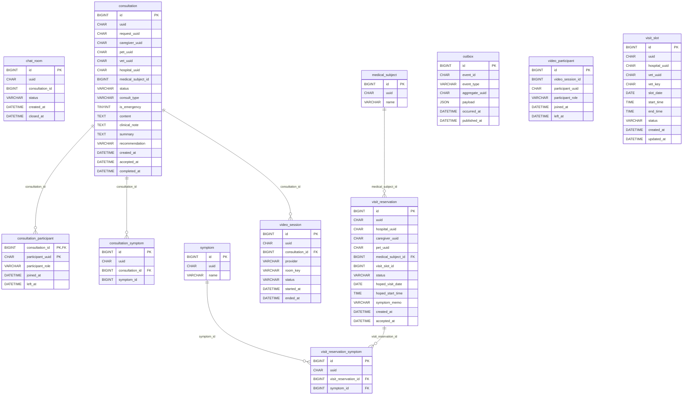

# svc_care ERD

[전체 ERD 목록](../erd.md)

## 테이블 구조

컬럼 타입은 기본 타입으로 표시한다. 길이·NULL 허용·기본값과 복합 인덱스는 아래 상세 표를 따른다. 관계선은 참조 대상이 확인된 외래키이며, 필수 여부와 유일성은 모델의 컬럼과 인덱스를 기준으로 표시한다.

#### `svc_care.chat_room`

채팅 방 메타. 메시지 본문은 MongoDB chat_messages

| 컬럼 | 타입 | NULL | 기본값 | 속성 / 주석 |
| --- | --- | --- | --- | --- |
| `id` | `BIGINT` | 불가 | — | AUTO_INCREMENT |
| `uuid` | `CHAR(36)` | 불가 | — | — |
| `consultation_id` | `BIGINT` | 불가 | — | — |
| `status` | `VARCHAR(20)` | 불가 | — | — |
| `created_at` | `DATETIME` | 불가 | — | — |
| `closed_at` | `DATETIME` | 허용 | `NULL` | — |

**인덱스**

| 이름 | 종류 | 컬럼 |
| --- | --- | --- |
| `PRIMARY` | PRIMARY KEY | `id` |
| `uk_chat_room_uuid` | UNIQUE | `uuid` |
| `uk_chat_room_consult` | UNIQUE | `consultation_id` |

**외래키**

확인된 외래키가 없습니다.

#### `svc_care.consultation`

실시간상담. 보호자/펫/수의사 uuid 는 값

| 컬럼 | 타입 | NULL | 기본값 | 속성 / 주석 |
| --- | --- | --- | --- | --- |
| `id` | `BIGINT` | 불가 | — | AUTO_INCREMENT |
| `uuid` | `CHAR(36)` | 불가 | — | — |
| `request_uuid` | `CHAR(36)` | 허용 | `NULL` | matching 호출 uuid |
| `caregiver_uuid` | `CHAR(36)` | 불가 | — | — |
| `pet_uuid` | `CHAR(36)` | 불가 | — | — |
| `vet_uuid` | `CHAR(36)` | 허용 | `NULL` | — |
| `hospital_uuid` | `CHAR(36)` | 허용 | `NULL` | 배정 병원 uuid |
| `medical_subject_id` | `BIGINT` | 불가 | — | — |
| `status` | `VARCHAR(20)` | 불가 | — | — |
| `consult_type` | `VARCHAR(20)` | 불가 | — | — |
| `is_emergency` | `TINYINT(1)` | 불가 | — | — |
| `content` | `TEXT` | 허용 | `NULL` | — |
| `clinical_note` | `TEXT` | 허용 | `NULL` | — |
| `summary` | `TEXT` | 허용 | `NULL` | — |
| `recommendation` | `VARCHAR(255)` | 허용 | `NULL` | — |
| `created_at` | `DATETIME` | 불가 | — | — |
| `accepted_at` | `DATETIME` | 허용 | `NULL` | — |
| `completed_at` | `DATETIME` | 허용 | `NULL` | — |

**인덱스**

| 이름 | 종류 | 컬럼 |
| --- | --- | --- |
| `PRIMARY` | PRIMARY KEY | `id` |
| `uk_consultation_uuid` | UNIQUE | `uuid` |
| `idx_consult_status_created` | INDEX | `status`, `created_at` |
| `idx_consult_vet_status` | INDEX | `vet_uuid`, `status`, `created_at` |
| `idx_consult_caregiver_created` | INDEX | `caregiver_uuid`, `created_at` |
| `idx_consult_pet_created` | INDEX | `pet_uuid`, `created_at` |
| `idx_consult_emergency_status` | INDEX | `is_emergency`, `status`, `created_at` |
| `fk_consult_subject` | INDEX | `medical_subject_id` |
| `idx_consult_request` | INDEX | `request_uuid` |
| `idx_consult_hospital` | INDEX | `hospital_uuid`, `status` |

**외래키**

확인된 외래키가 없습니다.

#### `svc_care.consultation_participant`

상담 참여자 중계

| 컬럼 | 타입 | NULL | 기본값 | 속성 / 주석 |
| --- | --- | --- | --- | --- |
| `consultation_id` | `BIGINT` | 불가 | — | — |
| `participant_uuid` | `CHAR(36)` | 불가 | — | — |
| `participant_role` | `VARCHAR(20)` | 불가 | — | — |
| `joined_at` | `DATETIME` | 불가 | — | — |
| `left_at` | `DATETIME` | 허용 | `NULL` | — |

**인덱스**

| 이름 | 종류 | 컬럼 |
| --- | --- | --- |
| `PRIMARY` | PRIMARY KEY | `consultation_id`, `participant_uuid` |

**외래키**

| 이름 | 컬럼 | 참조 대상 | 삭제 / 수정 규칙 | 비고 |
| --- | --- | --- | --- | --- |
| `fk_participant_consult` | `consultation_id` | `svc_care.consultation` (`id`) | 미지정 / 미지정 | — |

#### `svc_care.consultation_symptom`

상담-증상 N:M

| 컬럼 | 타입 | NULL | 기본값 | 속성 / 주석 |
| --- | --- | --- | --- | --- |
| `id` | `BIGINT` | 불가 | — | AUTO_INCREMENT |
| `uuid` | `CHAR(36)` | 불가 | — | — |
| `consultation_id` | `BIGINT` | 불가 | — | — |
| `symptom_id` | `BIGINT` | 불가 | — | — |

**인덱스**

| 이름 | 종류 | 컬럼 |
| --- | --- | --- |
| `PRIMARY` | PRIMARY KEY | `id` |
| `uk_consult_symptom_uuid` | UNIQUE | `uuid` |
| `uk_consult_symptom_pair` | UNIQUE | `consultation_id`, `symptom_id` |
| `idx_consult_symptom_symptom` | INDEX | `symptom_id`, `consultation_id` |

**외래키**

| 이름 | 컬럼 | 참조 대상 | 삭제 / 수정 규칙 | 비고 |
| --- | --- | --- | --- | --- |
| `fk_consult_symptom_consult` | `consultation_id` | `svc_care.consultation` (`id`) | 미지정 / 미지정 | — |

#### `svc_care.medical_subject`

진료과목

| 컬럼 | 타입 | NULL | 기본값 | 속성 / 주석 |
| --- | --- | --- | --- | --- |
| `id` | `BIGINT` | 불가 | — | AUTO_INCREMENT |
| `uuid` | `CHAR(36)` | 불가 | — | — |
| `name` | `VARCHAR(100)` | 불가 | — | — |

**인덱스**

| 이름 | 종류 | 컬럼 |
| --- | --- | --- |
| `PRIMARY` | PRIMARY KEY | `id` |
| `uk_subject_uuid` | UNIQUE | `uuid` |
| `uk_subject_name` | UNIQUE | `name` |

**외래키**

모델에 명시된 외래키가 없습니다.

#### `svc_care.outbox`

care 트랜잭셔널 아웃박스

| 컬럼 | 타입 | NULL | 기본값 | 속성 / 주석 |
| --- | --- | --- | --- | --- |
| `id` | `BIGINT` | 불가 | — | AUTO_INCREMENT |
| `event_id` | `CHAR(36)` | 불가 | — | — |
| `event_type` | `VARCHAR(100)` | 불가 | — | — |
| `aggregate_uuid` | `CHAR(36)` | 불가 | — | — |
| `payload` | `JSON` | 불가 | — | — |
| `occurred_at` | `DATETIME(6)` | 불가 | — | — |
| `published_at` | `DATETIME(6)` | 허용 | `NULL` | — |

**인덱스**

| 이름 | 종류 | 컬럼 |
| --- | --- | --- |
| `PRIMARY` | PRIMARY KEY | `id` |
| `uk_outbox_event` | UNIQUE | `event_id` |
| `idx_outbox_unpublished` | INDEX | `published_at`, `id` |

**외래키**

모델에 명시된 외래키가 없습니다.

#### `svc_care.symptom`

증상 카탈로그

| 컬럼 | 타입 | NULL | 기본값 | 속성 / 주석 |
| --- | --- | --- | --- | --- |
| `id` | `BIGINT` | 불가 | — | AUTO_INCREMENT |
| `uuid` | `CHAR(36)` | 불가 | — | — |
| `name` | `VARCHAR(100)` | 불가 | — | — |

**인덱스**

| 이름 | 종류 | 컬럼 |
| --- | --- | --- |
| `PRIMARY` | PRIMARY KEY | `id` |
| `uk_symptom_uuid` | UNIQUE | `uuid` |
| `uk_symptom_name` | UNIQUE | `name` |

**외래키**

모델에 명시된 외래키가 없습니다.

#### `svc_care.video_participant`

화상 참여자

| 컬럼 | 타입 | NULL | 기본값 | 속성 / 주석 |
| --- | --- | --- | --- | --- |
| `id` | `BIGINT` | 불가 | — | AUTO_INCREMENT |
| `video_session_id` | `BIGINT` | 불가 | — | — |
| `participant_uuid` | `CHAR(36)` | 불가 | — | — |
| `participant_role` | `VARCHAR(20)` | 불가 | — | — |
| `joined_at` | `DATETIME` | 허용 | `NULL` | — |
| `left_at` | `DATETIME` | 허용 | `NULL` | — |

**인덱스**

| 이름 | 종류 | 컬럼 |
| --- | --- | --- |
| `PRIMARY` | PRIMARY KEY | `id` |
| `uk_video_participant` | UNIQUE | `video_session_id`, `participant_uuid` |

**외래키**

확인된 외래키가 없습니다.

#### `svc_care.video_session`

화상 방 메타. 입장 품질 로그는 MongoDB video_events

| 컬럼 | 타입 | NULL | 기본값 | 속성 / 주석 |
| --- | --- | --- | --- | --- |
| `id` | `BIGINT` | 불가 | — | AUTO_INCREMENT |
| `uuid` | `CHAR(36)` | 불가 | — | — |
| `consultation_id` | `BIGINT` | 불가 | — | — |
| `provider` | `VARCHAR(20)` | 불가 | — | — |
| `room_key` | `VARCHAR(80)` | 불가 | — | — |
| `status` | `VARCHAR(20)` | 불가 | — | — |
| `started_at` | `DATETIME` | 허용 | `NULL` | — |
| `ended_at` | `DATETIME` | 허용 | `NULL` | — |

**인덱스**

| 이름 | 종류 | 컬럼 |
| --- | --- | --- |
| `PRIMARY` | PRIMARY KEY | `id` |
| `uk_video_uuid` | UNIQUE | `uuid` |
| `uk_video_room` | UNIQUE | `room_key` |
| `idx_video_consult` | INDEX | `consultation_id`, `status` |

**외래키**

| 이름 | 컬럼 | 참조 대상 | 삭제 / 수정 규칙 | 비고 |
| --- | --- | --- | --- | --- |
| `fk_video_consult` | `consultation_id` | `svc_care.consultation` (`id`) | 미지정 / 미지정 | — |

#### `svc_care.visit_reservation`

내원예약. 희망 일시는 예약 값이고 슬롯은 재고 점유

| 컬럼 | 타입 | NULL | 기본값 | 속성 / 주석 |
| --- | --- | --- | --- | --- |
| `id` | `BIGINT` | 불가 | — | AUTO_INCREMENT |
| `uuid` | `CHAR(36)` | 불가 | — | — |
| `hospital_uuid` | `CHAR(36)` | 불가 | — | — |
| `caregiver_uuid` | `CHAR(36)` | 불가 | — | — |
| `pet_uuid` | `CHAR(36)` | 불가 | — | — |
| `medical_subject_id` | `BIGINT` | 불가 | — | — |
| `visit_slot_id` | `BIGINT` | 불가 | — | — |
| `status` | `VARCHAR(20)` | 불가 | — | — |
| `hoped_visit_date` | `DATE` | 불가 | — | — |
| `hoped_start_time` | `TIME` | 불가 | — | — |
| `symptom_memo` | `VARCHAR(200)` | 허용 | `NULL` | — |
| `created_at` | `DATETIME` | 불가 | — | — |
| `accepted_at` | `DATETIME` | 허용 | `NULL` | — |

**인덱스**

| 이름 | 종류 | 컬럼 |
| --- | --- | --- |
| `PRIMARY` | PRIMARY KEY | `id` |
| `uk_reservation_uuid` | UNIQUE | `uuid` |
| `uk_reservation_slot` | UNIQUE | `visit_slot_id` |
| `idx_reservation_status_date` | INDEX | `status`, `hoped_visit_date`, `hospital_uuid` |
| `idx_reservation_hospital_date` | INDEX | `hospital_uuid`, `hoped_visit_date`, `status` |
| `idx_reservation_caregiver_date` | INDEX | `caregiver_uuid`, `hoped_visit_date` |
| `idx_reservation_pet_date` | INDEX | `pet_uuid`, `hoped_visit_date` |
| `fk_reservation_subject` | INDEX | `medical_subject_id` |

**외래키**

| 이름 | 컬럼 | 참조 대상 | 삭제 / 수정 규칙 | 비고 |
| --- | --- | --- | --- | --- |
| `fk_reservation_subject` | `medical_subject_id` | `svc_care.medical_subject` (`id`) | 미지정 / 미지정 | — |

#### `svc_care.visit_reservation_symptom`

예약-증상 N:M

| 컬럼 | 타입 | NULL | 기본값 | 속성 / 주석 |
| --- | --- | --- | --- | --- |
| `id` | `BIGINT` | 불가 | — | AUTO_INCREMENT |
| `uuid` | `CHAR(36)` | 불가 | — | — |
| `visit_reservation_id` | `BIGINT` | 불가 | — | — |
| `symptom_id` | `BIGINT` | 불가 | — | — |

**인덱스**

| 이름 | 종류 | 컬럼 |
| --- | --- | --- |
| `PRIMARY` | PRIMARY KEY | `id` |
| `uk_reservation_symptom_uuid` | UNIQUE | `uuid` |
| `uk_reservation_symptom_pair` | UNIQUE | `visit_reservation_id`, `symptom_id` |
| `idx_reservation_symptom_symptom` | INDEX | `symptom_id`, `visit_reservation_id` |

**외래키**

| 이름 | 컬럼 | 참조 대상 | 삭제 / 수정 규칙 | 비고 |
| --- | --- | --- | --- | --- |
| `fk_reservation_symptom_reservation` | `visit_reservation_id` | `svc_care.visit_reservation` (`id`) | 미지정 / 미지정 | — |
| `fk_reservation_symptom_symptom` | `symptom_id` | `svc_care.symptom` (`id`) | 미지정 / 미지정 | — |

#### `svc_care.visit_slot`

내원 슬롯 재고. 병원/수의사 uuid 는 clinic 값이며 FK 없음

| 컬럼 | 타입 | NULL | 기본값 | 속성 / 주석 |
| --- | --- | --- | --- | --- |
| `id` | `BIGINT` | 불가 | — | AUTO_INCREMENT |
| `uuid` | `CHAR(36)` | 불가 | — | — |
| `hospital_uuid` | `CHAR(36)` | 불가 | — | — |
| `vet_uuid` | `CHAR(36)` | 허용 | `NULL` | — |
| `vet_key` | `CHAR(36)` | 허용 | `NULL` | GENERATED ifnull(`vet_uuid`,_utf8mb4'') STORED |
| `slot_date` | `DATE` | 불가 | — | — |
| `start_time` | `TIME` | 불가 | — | — |
| `end_time` | `TIME` | 불가 | — | — |
| `status` | `VARCHAR(20)` | 불가 | — | — |
| `created_at` | `DATETIME` | 불가 | — | — |
| `updated_at` | `DATETIME` | 불가 | — | — |

**인덱스**

| 이름 | 종류 | 컬럼 |
| --- | --- | --- |
| `PRIMARY` | PRIMARY KEY | `id` |
| `uk_slot_uuid` | UNIQUE | `uuid` |
| `uk_slot_inventory` | UNIQUE | `hospital_uuid`, `slot_date`, `start_time`, `vet_key` |
| `idx_slot_hospital_date_status` | INDEX | `hospital_uuid`, `slot_date`, `status` |
| `idx_slot_vet_date` | INDEX | `vet_uuid`, `slot_date`, `status` |

**외래키**

모델에 명시된 외래키가 없습니다.
