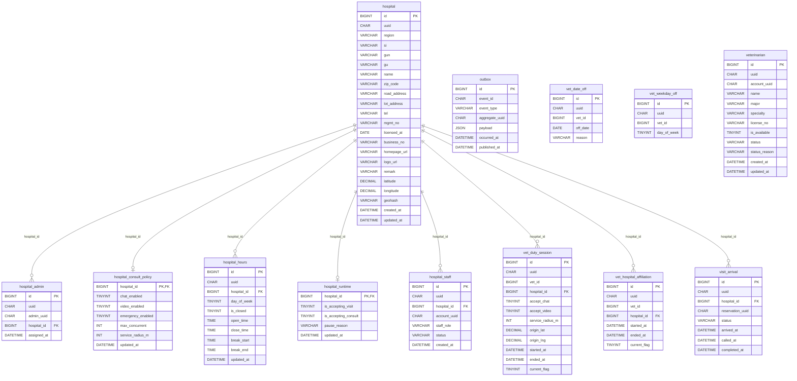

# svc_clinic ERD

[전체 ERD 목록](../erd.md)

## 테이블 구조

컬럼 타입은 기본 타입으로 표시한다. 길이·NULL 허용·기본값과 복합 인덱스는 아래 상세 표를 따른다. 관계선은 참조 대상이 확인된 외래키이며, 필수 여부와 유일성은 모델의 컬럼과 인덱스를 기준으로 표시한다.

#### `svc_clinic.hospital`

동물병원

| 컬럼 | 타입 | NULL | 기본값 | 속성 / 주석 |
| --- | --- | --- | --- | --- |
| `id` | `BIGINT` | NOT NULL | — | AUTO_INCREMENT |
| `uuid` | `CHAR(36)` | NOT NULL | — | — |
| `region` | `VARCHAR(50)` | NULL | `NULL` | — |
| `si` | `VARCHAR(50)` | NULL | `NULL` | — |
| `gun` | `VARCHAR(50)` | NULL | `NULL` | — |
| `gu` | `VARCHAR(50)` | NULL | `NULL` | — |
| `name` | `VARCHAR(100)` | NOT NULL | — | — |
| `zip_code` | `VARCHAR(10)` | NULL | `NULL` | — |
| `road_address` | `VARCHAR(255)` | NULL | `NULL` | — |
| `lot_address` | `VARCHAR(255)` | NULL | `NULL` | — |
| `tel` | `VARCHAR(20)` | NULL | `NULL` | — |
| `mgmt_no` | `VARCHAR(50)` | NULL | `NULL` | — |
| `licensed_at` | `DATE` | NULL | `NULL` | — |
| `business_no` | `VARCHAR(20)` | NULL | `NULL` | — |
| `homepage_url` | `VARCHAR(500)` | NULL | `NULL` | — |
| `logo_url` | `VARCHAR(500)` | NULL | `NULL` | — |
| `remark` | `VARCHAR(500)` | NULL | `NULL` | — |
| `latitude` | `DECIMAL(9,6)` | NULL | `NULL` | 위도 |
| `longitude` | `DECIMAL(9,6)` | NULL | `NULL` | 경도 |
| `geohash` | `VARCHAR(12)` | NULL | `NULL` | 지오해시 |
| `created_at` | `DATETIME` | NOT NULL | — | — |
| `updated_at` | `DATETIME` | NOT NULL | — | — |

**인덱스**

| 이름 | 종류 | 컬럼 |
| --- | --- | --- |
| `PRIMARY` | PRIMARY KEY | `id` |
| `uk_hospital_uuid` | UNIQUE | `uuid` |
| `idx_hospital_region` | INDEX | `region`, `si`, `gu`, `name` |
| `idx_hospital_name` | INDEX | `name` |
| `idx_hospital_geo` | INDEX | `latitude`, `longitude` |
| `idx_hospital_geohash` | INDEX | `geohash` |

**외래키**

모델에 명시된 외래키가 없습니다.

#### `svc_clinic.hospital_admin`

관리자-병원 배정. admin_uuid 는 identity 값이며 FK 없음

| 컬럼 | 타입 | NULL | 기본값 | 속성 / 주석 |
| --- | --- | --- | --- | --- |
| `id` | `BIGINT` | NOT NULL | — | AUTO_INCREMENT |
| `uuid` | `CHAR(36)` | NOT NULL | — | — |
| `admin_uuid` | `CHAR(36)` | NOT NULL | — | — |
| `hospital_id` | `BIGINT` | NOT NULL | — | — |
| `assigned_at` | `DATETIME` | NOT NULL | — | — |

**인덱스**

| 이름 | 종류 | 컬럼 |
| --- | --- | --- |
| `PRIMARY` | PRIMARY KEY | `id` |
| `uk_hospital_admin_uuid` | UNIQUE | `uuid` |
| `uk_hospital_admin_pair` | UNIQUE | `admin_uuid`, `hospital_id` |
| `idx_hospital_admin_hospital` | INDEX | `hospital_id` |

**외래키**

| 이름 | 컬럼 | 참조 대상 | 삭제 / 수정 규칙 | 비고 |
| --- | --- | --- | --- | --- |
| `fk_hospital_admin_hospital` | `hospital_id` | `svc_clinic.hospital` (`id`) | 미지정 / 미지정 | — |

#### `svc_clinic.hospital_consult_policy`

병원별 실시간 상담 정책

| 컬럼 | 타입 | NULL | 기본값 | 속성 / 주석 |
| --- | --- | --- | --- | --- |
| `hospital_id` | `BIGINT` | NOT NULL | — | — |
| `chat_enabled` | `TINYINT(1)` | NOT NULL | — | — |
| `video_enabled` | `TINYINT(1)` | NOT NULL | — | — |
| `emergency_enabled` | `TINYINT(1)` | NOT NULL | — | — |
| `max_concurrent` | `INT` | NOT NULL | — | — |
| `service_radius_m` | `INT` | NOT NULL | — | — |
| `updated_at` | `DATETIME` | NOT NULL | — | — |

**인덱스**

| 이름 | 종류 | 컬럼 |
| --- | --- | --- |
| `PRIMARY` | PRIMARY KEY | `hospital_id` |

**외래키**

| 이름 | 컬럼 | 참조 대상 | 삭제 / 수정 규칙 | 비고 |
| --- | --- | --- | --- | --- |
| `fk_consult_policy_hospital` | `hospital_id` | `svc_clinic.hospital` (`id`) | 미지정 / 미지정 | — |

#### `svc_clinic.hospital_hours`

병원 요일 영업. 1=월 7=일. 병원 애그리거트 자식

| 컬럼 | 타입 | NULL | 기본값 | 속성 / 주석 |
| --- | --- | --- | --- | --- |
| `id` | `BIGINT` | NOT NULL | — | AUTO_INCREMENT |
| `uuid` | `CHAR(36)` | NOT NULL | — | — |
| `hospital_id` | `BIGINT` | NOT NULL | — | — |
| `day_of_week` | `TINYINT` | NOT NULL | — | — |
| `is_closed` | `TINYINT(1)` | NOT NULL | — | — |
| `open_time` | `TIME` | NULL | `NULL` | — |
| `close_time` | `TIME` | NULL | `NULL` | — |
| `break_start` | `TIME` | NULL | `NULL` | — |
| `break_end` | `TIME` | NULL | `NULL` | — |
| `updated_at` | `DATETIME` | NOT NULL | — | — |

**인덱스**

| 이름 | 종류 | 컬럼 |
| --- | --- | --- |
| `PRIMARY` | PRIMARY KEY | `id` |
| `uk_hours_uuid` | UNIQUE | `uuid` |
| `uk_hours_day` | UNIQUE | `hospital_id`, `day_of_week` |

**외래키**

| 이름 | 컬럼 | 참조 대상 | 삭제 / 수정 규칙 | 비고 |
| --- | --- | --- | --- | --- |
| `fk_hours_hospital` | `hospital_id` | `svc_clinic.hospital` (`id`) | 미지정 / 미지정 | — |

#### `svc_clinic.hospital_runtime`

병원 앱의 지금 접수 상태. 요일 영업시간과 별개

| 컬럼 | 타입 | NULL | 기본값 | 속성 / 주석 |
| --- | --- | --- | --- | --- |
| `hospital_id` | `BIGINT` | NOT NULL | — | — |
| `is_accepting_visit` | `TINYINT(1)` | NOT NULL | — | — |
| `is_accepting_consult` | `TINYINT(1)` | NOT NULL | — | — |
| `pause_reason` | `VARCHAR(200)` | NULL | `NULL` | — |
| `updated_at` | `DATETIME` | NOT NULL | — | — |

**인덱스**

| 이름 | 종류 | 컬럼 |
| --- | --- | --- |
| `PRIMARY` | PRIMARY KEY | `hospital_id` |

**외래키**

| 이름 | 컬럼 | 참조 대상 | 삭제 / 수정 규칙 | 비고 |
| --- | --- | --- | --- | --- |
| `fk_runtime_hospital` | `hospital_id` | `svc_clinic.hospital` (`id`) | 미지정 / 미지정 | — |

#### `svc_clinic.hospital_staff`

병원 앱 직원. account_uuid 는 identity 값

| 컬럼 | 타입 | NULL | 기본값 | 속성 / 주석 |
| --- | --- | --- | --- | --- |
| `id` | `BIGINT` | NOT NULL | — | AUTO_INCREMENT |
| `uuid` | `CHAR(36)` | NOT NULL | — | — |
| `hospital_id` | `BIGINT` | NOT NULL | — | — |
| `account_uuid` | `CHAR(36)` | NOT NULL | — | — |
| `staff_role` | `VARCHAR(20)` | NOT NULL | — | — |
| `status` | `VARCHAR(20)` | NOT NULL | — | — |
| `created_at` | `DATETIME` | NOT NULL | — | — |

**인덱스**

| 이름 | 종류 | 컬럼 |
| --- | --- | --- |
| `PRIMARY` | PRIMARY KEY | `id` |
| `uk_staff_uuid` | UNIQUE | `uuid` |
| `uk_staff_pair` | UNIQUE | `hospital_id`, `account_uuid` |
| `idx_staff_account` | INDEX | `account_uuid`, `status` |

**외래키**

| 이름 | 컬럼 | 참조 대상 | 삭제 / 수정 규칙 | 비고 |
| --- | --- | --- | --- | --- |
| `fk_staff_hospital` | `hospital_id` | `svc_clinic.hospital` (`id`) | 미지정 / 미지정 | — |

#### `svc_clinic.outbox`

clinic 트랜잭셔널 아웃박스

| 컬럼 | 타입 | NULL | 기본값 | 속성 / 주석 |
| --- | --- | --- | --- | --- |
| `id` | `BIGINT` | NOT NULL | — | AUTO_INCREMENT |
| `event_id` | `CHAR(36)` | NOT NULL | — | — |
| `event_type` | `VARCHAR(100)` | NOT NULL | — | — |
| `aggregate_uuid` | `CHAR(36)` | NOT NULL | — | — |
| `payload` | `JSON` | NOT NULL | — | — |
| `occurred_at` | `DATETIME(6)` | NOT NULL | — | — |
| `published_at` | `DATETIME(6)` | NULL | `NULL` | — |

**인덱스**

| 이름 | 종류 | 컬럼 |
| --- | --- | --- |
| `PRIMARY` | PRIMARY KEY | `id` |
| `uk_outbox_event` | UNIQUE | `event_id` |
| `idx_outbox_unpublished` | INDEX | `published_at`, `id` |

**외래키**

모델에 명시된 외래키가 없습니다.

#### `svc_clinic.vet_date_off`

수의사 특정일 휴무. 요일 휴무와 별개

| 컬럼 | 타입 | NULL | 기본값 | 속성 / 주석 |
| --- | --- | --- | --- | --- |
| `id` | `BIGINT` | NOT NULL | — | AUTO_INCREMENT |
| `uuid` | `CHAR(36)` | NOT NULL | — | — |
| `vet_id` | `BIGINT` | NOT NULL | — | — |
| `off_date` | `DATE` | NOT NULL | — | — |
| `reason` | `VARCHAR(200)` | NULL | `NULL` | — |

**인덱스**

| 이름 | 종류 | 컬럼 |
| --- | --- | --- |
| `PRIMARY` | PRIMARY KEY | `id` |
| `uk_date_off_uuid` | UNIQUE | `uuid` |
| `uk_date_off` | UNIQUE | `vet_id`, `off_date` |

**외래키**

확인된 외래키가 없습니다.

#### `svc_clinic.vet_duty_session`

출근 세션. 실시간 좌표 핑은 MongoDB vet_live_location

| 컬럼 | 타입 | NULL | 기본값 | 속성 / 주석 |
| --- | --- | --- | --- | --- |
| `id` | `BIGINT` | NOT NULL | — | AUTO_INCREMENT |
| `uuid` | `CHAR(36)` | NOT NULL | — | — |
| `vet_id` | `BIGINT` | NOT NULL | — | — |
| `hospital_id` | `BIGINT` | NOT NULL | — | — |
| `accept_chat` | `TINYINT(1)` | NOT NULL | — | — |
| `accept_video` | `TINYINT(1)` | NOT NULL | — | — |
| `service_radius_m` | `INT` | NOT NULL | — | — |
| `origin_lat` | `DECIMAL(9,6)` | NOT NULL | — | — |
| `origin_lng` | `DECIMAL(9,6)` | NOT NULL | — | — |
| `started_at` | `DATETIME` | NOT NULL | — | — |
| `ended_at` | `DATETIME` | NULL | `NULL` | — |
| `current_flag` | `TINYINT` | NULL | `NULL` | GENERATED if((`ended_at` is null),1,NULL) STORED |

**인덱스**

| 이름 | 종류 | 컬럼 |
| --- | --- | --- |
| `PRIMARY` | PRIMARY KEY | `id` |
| `uk_duty_uuid` | UNIQUE | `uuid` |
| `uk_vet_one_duty` | UNIQUE | `vet_id`, `current_flag` |
| `idx_duty_hospital_open` | INDEX | `hospital_id`, `ended_at` |

**외래키**

| 이름 | 컬럼 | 참조 대상 | 삭제 / 수정 규칙 | 비고 |
| --- | --- | --- | --- | --- |
| `fk_duty_hospital` | `hospital_id` | `svc_clinic.hospital` (`id`) | 미지정 / 미지정 | — |

#### `svc_clinic.vet_hospital_affiliation`

수의사-병원 소속 이력. 현재 소속은 ended_at IS NULL

| 컬럼 | 타입 | NULL | 기본값 | 속성 / 주석 |
| --- | --- | --- | --- | --- |
| `id` | `BIGINT` | NOT NULL | — | AUTO_INCREMENT |
| `uuid` | `CHAR(36)` | NOT NULL | — | — |
| `vet_id` | `BIGINT` | NOT NULL | — | — |
| `hospital_id` | `BIGINT` | NOT NULL | — | — |
| `started_at` | `DATETIME` | NOT NULL | — | — |
| `ended_at` | `DATETIME` | NULL | `NULL` | — |
| `current_flag` | `TINYINT` | NULL | `NULL` | GENERATED if((`ended_at` is null),1,NULL) STORED |

**인덱스**

| 이름 | 종류 | 컬럼 |
| --- | --- | --- |
| `PRIMARY` | PRIMARY KEY | `id` |
| `uk_affiliation_uuid` | UNIQUE | `uuid` |
| `uk_vet_one_current` | UNIQUE | `vet_id`, `current_flag` |
| `idx_affiliation_hospital_open` | INDEX | `hospital_id`, `ended_at` |

**외래키**

| 이름 | 컬럼 | 참조 대상 | 삭제 / 수정 규칙 | 비고 |
| --- | --- | --- | --- | --- |
| `fk_affiliation_hospital` | `hospital_id` | `svc_clinic.hospital` (`id`) | 미지정 / 미지정 | — |

#### `svc_clinic.vet_weekday_off`

수의사 반복 휴무 요일. 병원 휴무와 별개

| 컬럼 | 타입 | NULL | 기본값 | 속성 / 주석 |
| --- | --- | --- | --- | --- |
| `id` | `BIGINT` | NOT NULL | — | AUTO_INCREMENT |
| `uuid` | `CHAR(36)` | NOT NULL | — | — |
| `vet_id` | `BIGINT` | NOT NULL | — | — |
| `day_of_week` | `TINYINT` | NOT NULL | — | — |

**인덱스**

| 이름 | 종류 | 컬럼 |
| --- | --- | --- |
| `PRIMARY` | PRIMARY KEY | `id` |
| `uk_vet_off_uuid` | UNIQUE | `uuid` |
| `uk_vet_off_day` | UNIQUE | `vet_id`, `day_of_week` |

**외래키**

확인된 외래키가 없습니다.

#### `svc_clinic.veterinarian`

수의사. 병원 키는 두지 않는다

| 컬럼 | 타입 | NULL | 기본값 | 속성 / 주석 |
| --- | --- | --- | --- | --- |
| `id` | `BIGINT` | NOT NULL | — | AUTO_INCREMENT |
| `uuid` | `CHAR(36)` | NOT NULL | — | — |
| `account_uuid` | `CHAR(36)` | NOT NULL | — | — |
| `name` | `VARCHAR(50)` | NOT NULL | — | — |
| `major` | `VARCHAR(100)` | NOT NULL | — | — |
| `specialty` | `VARCHAR(100)` | NOT NULL | — | — |
| `license_no` | `VARCHAR(100)` | NOT NULL | — | — |
| `is_available` | `TINYINT(1)` | NOT NULL | — | — |
| `status` | `VARCHAR(20)` | NOT NULL | — | — |
| `status_reason` | `VARCHAR(255)` | NULL | `NULL` | — |
| `created_at` | `DATETIME` | NOT NULL | — | — |
| `updated_at` | `DATETIME` | NOT NULL | — | — |

**인덱스**

| 이름 | 종류 | 컬럼 |
| --- | --- | --- |
| `PRIMARY` | PRIMARY KEY | `id` |
| `uk_vet_uuid` | UNIQUE | `uuid` |
| `uk_vet_account` | UNIQUE | `account_uuid` |
| `uk_vet_license` | UNIQUE | `license_no` |
| `idx_vet_status_available` | INDEX | `status`, `is_available`, `name` |

**외래키**

모델에 명시된 외래키가 없습니다.

#### `svc_clinic.visit_arrival`

병원 앱 내원 대기열. 예약 uuid 는 care 값

| 컬럼 | 타입 | NULL | 기본값 | 속성 / 주석 |
| --- | --- | --- | --- | --- |
| `id` | `BIGINT` | NOT NULL | — | AUTO_INCREMENT |
| `uuid` | `CHAR(36)` | NOT NULL | — | — |
| `hospital_id` | `BIGINT` | NOT NULL | — | — |
| `reservation_uuid` | `CHAR(36)` | NOT NULL | — | — |
| `status` | `VARCHAR(20)` | NOT NULL | — | — |
| `arrived_at` | `DATETIME` | NOT NULL | — | — |
| `called_at` | `DATETIME` | NULL | `NULL` | — |
| `completed_at` | `DATETIME` | NULL | `NULL` | — |

**인덱스**

| 이름 | 종류 | 컬럼 |
| --- | --- | --- |
| `PRIMARY` | PRIMARY KEY | `id` |
| `uk_arrival_uuid` | UNIQUE | `uuid` |
| `uk_arrival_reservation` | UNIQUE | `reservation_uuid` |
| `idx_arrival_queue` | INDEX | `hospital_id`, `status`, `arrived_at` |

**외래키**

| 이름 | 컬럼 | 참조 대상 | 삭제 / 수정 규칙 | 비고 |
| --- | --- | --- | --- | --- |
| `fk_arrival_hospital` | `hospital_id` | `svc_clinic.hospital` (`id`) | 미지정 / 미지정 | — |
