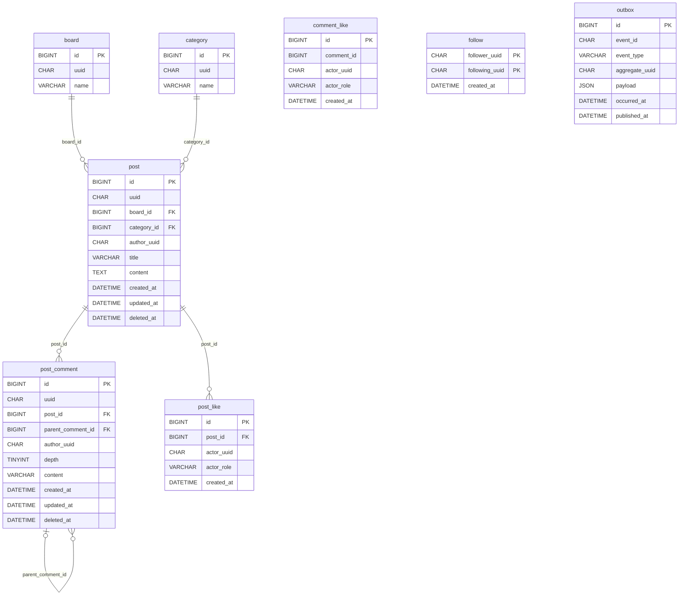

# svc_community ERD

[전체 ERD 목록](../erd.md)

## 테이블 구조

컬럼 타입은 기본 타입으로 표시한다. 길이·NULL 허용·기본값과 복합 인덱스는 아래 상세 표를 따른다. 관계선은 참조 대상이 확인된 외래키이며, 필수 여부와 유일성은 모델의 컬럼과 인덱스를 기준으로 표시한다.

#### `svc_community.board`

게시판

| 컬럼 | 타입 | NULL | 기본값 | 속성 / 주석 |
| --- | --- | --- | --- | --- |
| `id` | `BIGINT` | 불가 | — | AUTO_INCREMENT |
| `uuid` | `CHAR(36)` | 불가 | — | — |
| `name` | `VARCHAR(100)` | 불가 | — | — |

**인덱스**

| 이름 | 종류 | 컬럼 |
| --- | --- | --- |
| `PRIMARY` | PRIMARY KEY | `id` |
| `uk_board_uuid` | UNIQUE | `uuid` |
| `uk_board_name` | UNIQUE | `name` |

**외래키**

모델에 명시된 외래키가 없습니다.

#### `svc_community.category`

글 카테고리

| 컬럼 | 타입 | NULL | 기본값 | 속성 / 주석 |
| --- | --- | --- | --- | --- |
| `id` | `BIGINT` | 불가 | — | AUTO_INCREMENT |
| `uuid` | `CHAR(36)` | 불가 | — | — |
| `name` | `VARCHAR(100)` | 불가 | — | — |

**인덱스**

| 이름 | 종류 | 컬럼 |
| --- | --- | --- |
| `PRIMARY` | PRIMARY KEY | `id` |
| `uk_category_uuid` | UNIQUE | `uuid` |
| `uk_category_name` | UNIQUE | `name` |

**외래키**

모델에 명시된 외래키가 없습니다.

#### `svc_community.comment_like`

댓글 좋아요 중계

| 컬럼 | 타입 | NULL | 기본값 | 속성 / 주석 |
| --- | --- | --- | --- | --- |
| `id` | `BIGINT` | 불가 | — | AUTO_INCREMENT |
| `comment_id` | `BIGINT` | 불가 | — | — |
| `actor_uuid` | `CHAR(36)` | 불가 | — | — |
| `actor_role` | `VARCHAR(20)` | 불가 | — | — |
| `created_at` | `DATETIME` | 불가 | — | — |

**인덱스**

| 이름 | 종류 | 컬럼 |
| --- | --- | --- |
| `PRIMARY` | PRIMARY KEY | `id` |
| `uk_comment_like` | UNIQUE | `comment_id`, `actor_uuid` |
| `idx_comment_like_actor` | INDEX | `actor_uuid`, `created_at` |

**외래키**

확인된 외래키가 없습니다.

#### `svc_community.follow`

팔로우 중계. 양쪽 모두 identity uuid

| 컬럼 | 타입 | NULL | 기본값 | 속성 / 주석 |
| --- | --- | --- | --- | --- |
| `follower_uuid` | `CHAR(36)` | 불가 | — | — |
| `following_uuid` | `CHAR(36)` | 불가 | — | — |
| `created_at` | `DATETIME` | 불가 | — | — |

**인덱스**

| 이름 | 종류 | 컬럼 |
| --- | --- | --- |
| `PRIMARY` | PRIMARY KEY | `follower_uuid`, `following_uuid` |
| `idx_follow_following` | INDEX | `following_uuid`, `created_at` |

**외래키**

모델에 명시된 외래키가 없습니다.

#### `svc_community.outbox`

community 트랜잭셔널 아웃박스

| 컬럼 | 타입 | NULL | 기본값 | 속성 / 주석 |
| --- | --- | --- | --- | --- |
| `id` | `BIGINT` | 불가 | — | AUTO_INCREMENT |
| `event_id` | `CHAR(36)` | 불가 | — | — |
| `event_type` | `VARCHAR(100)` | 불가 | — | — |
| `aggregate_uuid` | `CHAR(36)` | 불가 | — | — |
| `payload` | `JSON` | 불가 | — | — |
| `occurred_at` | `DATETIME(6)` | 불가 | — | — |
| `published_at` | `DATETIME(6)` | 허용 | `NULL` | — |

**인덱스**

| 이름 | 종류 | 컬럼 |
| --- | --- | --- |
| `PRIMARY` | PRIMARY KEY | `id` |
| `uk_outbox_event` | UNIQUE | `event_id` |
| `idx_outbox_unpublished` | INDEX | `published_at`, `id` |

**외래키**

모델에 명시된 외래키가 없습니다.

#### `svc_community.post`

게시글. 좋아요/조회 수는 두지 않는다

| 컬럼 | 타입 | NULL | 기본값 | 속성 / 주석 |
| --- | --- | --- | --- | --- |
| `id` | `BIGINT` | 불가 | — | AUTO_INCREMENT |
| `uuid` | `CHAR(36)` | 불가 | — | — |
| `board_id` | `BIGINT` | 불가 | — | — |
| `category_id` | `BIGINT` | 불가 | — | — |
| `author_uuid` | `CHAR(36)` | 불가 | — | — |
| `title` | `VARCHAR(200)` | 불가 | — | — |
| `content` | `TEXT` | 불가 | — | — |
| `created_at` | `DATETIME` | 불가 | — | — |
| `updated_at` | `DATETIME` | 허용 | `NULL` | — |
| `deleted_at` | `DATETIME` | 허용 | `NULL` | — |

**인덱스**

| 이름 | 종류 | 컬럼 |
| --- | --- | --- |
| `PRIMARY` | PRIMARY KEY | `id` |
| `uk_post_uuid` | UNIQUE | `uuid` |
| `idx_post_board_created` | INDEX | `board_id`, `created_at` |
| `idx_post_category_created` | INDEX | `category_id`, `created_at` |
| `idx_post_author_created` | INDEX | `author_uuid`, `created_at` |

**외래키**

| 이름 | 컬럼 | 참조 대상 | 삭제 / 수정 규칙 | 비고 |
| --- | --- | --- | --- | --- |
| `fk_post_board` | `board_id` | `svc_community.board` (`id`) | 미지정 / 미지정 | — |
| `fk_post_category` | `category_id` | `svc_community.category` (`id`) | 미지정 / 미지정 | — |

#### `svc_community.post_comment`

댓글. 작성자는 uuid 값

| 컬럼 | 타입 | NULL | 기본값 | 속성 / 주석 |
| --- | --- | --- | --- | --- |
| `id` | `BIGINT` | 불가 | — | AUTO_INCREMENT |
| `uuid` | `CHAR(36)` | 불가 | — | — |
| `post_id` | `BIGINT` | 불가 | — | — |
| `parent_comment_id` | `BIGINT` | 허용 | `NULL` | — |
| `author_uuid` | `CHAR(36)` | 불가 | — | — |
| `depth` | `TINYINT` | 불가 | — | — |
| `content` | `VARCHAR(2000)` | 불가 | — | — |
| `created_at` | `DATETIME` | 불가 | — | — |
| `updated_at` | `DATETIME` | 허용 | `NULL` | — |
| `deleted_at` | `DATETIME` | 허용 | `NULL` | — |

**인덱스**

| 이름 | 종류 | 컬럼 |
| --- | --- | --- |
| `PRIMARY` | PRIMARY KEY | `id` |
| `uk_comment_uuid` | UNIQUE | `uuid` |
| `idx_comment_post_depth_created` | INDEX | `post_id`, `depth`, `created_at` |
| `idx_comment_author_created` | INDEX | `author_uuid`, `created_at` |
| `fk_comment_parent` | INDEX | `parent_comment_id` |

**외래키**

| 이름 | 컬럼 | 참조 대상 | 삭제 / 수정 규칙 | 비고 |
| --- | --- | --- | --- | --- |
| `fk_comment_parent` | `parent_comment_id` | `svc_community.post_comment` (`id`) | 미지정 / 미지정 | — |
| `fk_comment_post` | `post_id` | `svc_community.post` (`id`) | 미지정 / 미지정 | — |

#### `svc_community.post_like`

게시글 좋아요 중계

| 컬럼 | 타입 | NULL | 기본값 | 속성 / 주석 |
| --- | --- | --- | --- | --- |
| `id` | `BIGINT` | 불가 | — | AUTO_INCREMENT |
| `post_id` | `BIGINT` | 불가 | — | — |
| `actor_uuid` | `CHAR(36)` | 불가 | — | — |
| `actor_role` | `VARCHAR(20)` | 불가 | — | — |
| `created_at` | `DATETIME` | 불가 | — | — |

**인덱스**

| 이름 | 종류 | 컬럼 |
| --- | --- | --- |
| `PRIMARY` | PRIMARY KEY | `id` |
| `uk_post_like` | UNIQUE | `post_id`, `actor_uuid` |
| `idx_post_like_actor` | INDEX | `actor_uuid`, `created_at` |

**외래키**

| 이름 | 컬럼 | 참조 대상 | 삭제 / 수정 규칙 | 비고 |
| --- | --- | --- | --- | --- |
| `fk_post_like_post` | `post_id` | `svc_community.post` (`id`) | 미지정 / 미지정 | — |
