# svc_identity ERD

[전체 ERD 목록](../erd.md)

## 테이블 구조

컬럼 타입은 기본 타입으로 표시한다. 길이·NULL 허용·기본값과 복합 인덱스는 아래 상세 표를 따른다. 관계선은 참조 대상이 확인된 외래키이며, 필수 여부와 유일성은 모델의 컬럼과 인덱스를 기준으로 표시한다.

```mermaid
erDiagram
    account {
        BIGINT id PK
        CHAR uuid
        VARCHAR status
        VARCHAR name
        VARCHAR phone_number
        VARCHAR gender
        DATE birth_date
        VARCHAR address
        VARCHAR email
        TINYINT terms_agreed
        DATETIME created_at
        DATETIME updated_at
        DATETIME deleted_at
    }
    admin_account {
        BIGINT id PK
        CHAR uuid
        VARCHAR name
        VARCHAR phone_number
        VARCHAR email
        TINYINT is_super_admin
        VARCHAR status
        DATETIME created_at
        DATETIME updated_at
        DATETIME deleted_at
    }
    admin_login {
        BIGINT id PK
        BIGINT admin_account_id FK
        VARCHAR login_id
        VARCHAR password_hash
        DATETIME created_at
        DATETIME updated_at
    }
    login_credential {
        BIGINT id PK
        BIGINT account_id FK
        VARCHAR login_id
        VARCHAR password_hash
        DATETIME created_at
        DATETIME updated_at
    }
    login_history {
        BIGINT id PK
        BIGINT account_id FK
        DATETIME authenticated_at
        VARCHAR login_type
    }
    outbox {
        BIGINT id PK
        CHAR event_id
        VARCHAR event_type
        CHAR aggregate_uuid
        JSON payload
        DATETIME occurred_at
        DATETIME published_at
    }
    social_auth {
        BIGINT id PK
        BIGINT account_id FK
        VARCHAR provider
        VARCHAR provider_id
        DATETIME created_at
    }
    user_profile {
        BIGINT id PK
        BIGINT account_id FK
        VARCHAR nickname
        VARCHAR user_type
        DATETIME created_at
        DATETIME updated_at
    }
    admin_account ||--o| admin_login : "admin_account_id"
    account ||--o| login_credential : "account_id"
    account ||--o{ login_history : "account_id"
    account ||--o{ social_auth : "account_id"
    account ||--o| user_profile : "account_id"
```

#### `svc_identity.account`

앱 사용자 계정

| 컬럼 | 타입 | NULL | 기본값 | 속성 / 주석 |
| --- | --- | --- | --- | --- |
| `id` | `BIGINT` | 불가 | — | AUTO_INCREMENT |
| `uuid` | `CHAR(36)` | 불가 | — | — |
| `status` | `VARCHAR(20)` | 불가 | — | — |
| `name` | `VARCHAR(100)` | 불가 | — | — |
| `phone_number` | `VARCHAR(30)` | 불가 | — | — |
| `gender` | `VARCHAR(20)` | 불가 | — | — |
| `birth_date` | `DATE` | 불가 | — | — |
| `address` | `VARCHAR(255)` | 불가 | — | — |
| `email` | `VARCHAR(254)` | 불가 | — | — |
| `terms_agreed` | `TINYINT(1)` | 불가 | — | — |
| `created_at` | `DATETIME` | 불가 | — | — |
| `updated_at` | `DATETIME` | 불가 | — | — |
| `deleted_at` | `DATETIME` | 허용 | `NULL` | — |

**인덱스**

| 이름 | 종류 | 컬럼 |
| --- | --- | --- |
| `PRIMARY` | PRIMARY KEY | `id` |
| `uk_account_uuid` | UNIQUE | `uuid` |
| `uk_account_email` | UNIQUE | `email` |
| `idx_account_status_created` | INDEX | `status`, `created_at` |
| `idx_account_phone` | INDEX | `phone_number` |

**외래키**

모델에 명시된 외래키가 없습니다.

#### `svc_identity.admin_account`

백오피스 관리자

| 컬럼 | 타입 | NULL | 기본값 | 속성 / 주석 |
| --- | --- | --- | --- | --- |
| `id` | `BIGINT` | 불가 | — | AUTO_INCREMENT |
| `uuid` | `CHAR(36)` | 불가 | — | — |
| `name` | `VARCHAR(100)` | 불가 | — | — |
| `phone_number` | `VARCHAR(30)` | 허용 | `NULL` | — |
| `email` | `VARCHAR(254)` | 허용 | `NULL` | — |
| `is_super_admin` | `TINYINT(1)` | 불가 | `'0'` | — |
| `status` | `VARCHAR(20)` | 불가 | `'ACTIVE'` | — |
| `created_at` | `DATETIME` | 불가 | — | — |
| `updated_at` | `DATETIME` | 불가 | — | — |
| `deleted_at` | `DATETIME` | 허용 | `NULL` | — |

**인덱스**

| 이름 | 종류 | 컬럼 |
| --- | --- | --- |
| `PRIMARY` | PRIMARY KEY | `id` |
| `uk_admin_uuid` | UNIQUE | `uuid` |
| `idx_admin_status` | INDEX | `status`, `created_at` |

**외래키**

모델에 명시된 외래키가 없습니다.

#### `svc_identity.admin_login`

관리자 자격증명

| 컬럼 | 타입 | NULL | 기본값 | 속성 / 주석 |
| --- | --- | --- | --- | --- |
| `id` | `BIGINT` | 불가 | — | AUTO_INCREMENT |
| `admin_account_id` | `BIGINT` | 불가 | — | — |
| `login_id` | `VARCHAR(100)` | 불가 | — | — |
| `password_hash` | `VARCHAR(255)` | 불가 | — | — |
| `created_at` | `DATETIME` | 불가 | — | — |
| `updated_at` | `DATETIME` | 불가 | — | — |

**인덱스**

| 이름 | 종류 | 컬럼 |
| --- | --- | --- |
| `PRIMARY` | PRIMARY KEY | `id` |
| `uk_admin_login_account` | UNIQUE | `admin_account_id` |
| `uk_admin_login_id` | UNIQUE | `login_id` |

**외래키**

| 이름 | 컬럼 | 참조 대상 | 삭제 / 수정 규칙 | 비고 |
| --- | --- | --- | --- | --- |
| `fk_admin_login_account` | `admin_account_id` | `svc_identity.admin_account` (`id`) | 미지정 / 미지정 | — |

#### `svc_identity.login_credential`

계정 자격증명. 수의사 uuid 를 두지 않는다

| 컬럼 | 타입 | NULL | 기본값 | 속성 / 주석 |
| --- | --- | --- | --- | --- |
| `id` | `BIGINT` | 불가 | — | AUTO_INCREMENT |
| `account_id` | `BIGINT` | 불가 | — | — |
| `login_id` | `VARCHAR(100)` | 불가 | — | — |
| `password_hash` | `VARCHAR(255)` | 허용 | `NULL` | — |
| `created_at` | `DATETIME` | 불가 | — | — |
| `updated_at` | `DATETIME` | 불가 | — | — |

**인덱스**

| 이름 | 종류 | 컬럼 |
| --- | --- | --- |
| `PRIMARY` | PRIMARY KEY | `id` |
| `uk_login_account` | UNIQUE | `account_id` |
| `uk_login_id` | UNIQUE | `login_id` |

**외래키**

| 이름 | 컬럼 | 참조 대상 | 삭제 / 수정 규칙 | 비고 |
| --- | --- | --- | --- | --- |
| `fk_login_account` | `account_id` | `svc_identity.account` (`id`) | 미지정 / 미지정 | — |

#### `svc_identity.login_history`

로그인 감사 로그

| 컬럼 | 타입 | NULL | 기본값 | 속성 / 주석 |
| --- | --- | --- | --- | --- |
| `id` | `BIGINT` | 불가 | — | AUTO_INCREMENT |
| `account_id` | `BIGINT` | 불가 | — | — |
| `authenticated_at` | `DATETIME` | 불가 | — | — |
| `login_type` | `VARCHAR(30)` | 불가 | — | — |

**인덱스**

| 이름 | 종류 | 컬럼 |
| --- | --- | --- |
| `PRIMARY` | PRIMARY KEY | `id` |
| `idx_login_history_account_at` | INDEX | `account_id`, `authenticated_at` |

**외래키**

| 이름 | 컬럼 | 참조 대상 | 삭제 / 수정 규칙 | 비고 |
| --- | --- | --- | --- | --- |
| `fk_login_history_account` | `account_id` | `svc_identity.account` (`id`) | 미지정 / 미지정 | — |

#### `svc_identity.outbox`

identity 트랜잭셔널 아웃박스

| 컬럼 | 타입 | NULL | 기본값 | 속성 / 주석 |
| --- | --- | --- | --- | --- |
| `id` | `BIGINT` | 불가 | — | AUTO_INCREMENT |
| `event_id` | `CHAR(36)` | 불가 | — | — |
| `event_type` | `VARCHAR(100)` | 불가 | — | — |
| `aggregate_uuid` | `CHAR(36)` | 불가 | — | — |
| `payload` | `JSON` | 불가 | — | — |
| `occurred_at` | `DATETIME(6)` | 불가 | — | — |
| `published_at` | `DATETIME(6)` | 허용 | `NULL` | — |

**인덱스**

| 이름 | 종류 | 컬럼 |
| --- | --- | --- |
| `PRIMARY` | PRIMARY KEY | `id` |
| `uk_outbox_event` | UNIQUE | `event_id` |
| `idx_outbox_unpublished` | INDEX | `published_at`, `id` |

**외래키**

모델에 명시된 외래키가 없습니다.

#### `svc_identity.social_auth`

소셜 인증

| 컬럼 | 타입 | NULL | 기본값 | 속성 / 주석 |
| --- | --- | --- | --- | --- |
| `id` | `BIGINT` | 불가 | — | AUTO_INCREMENT |
| `account_id` | `BIGINT` | 불가 | — | — |
| `provider` | `VARCHAR(30)` | 불가 | — | — |
| `provider_id` | `VARCHAR(191)` | 불가 | — | — |
| `created_at` | `DATETIME` | 불가 | — | — |

**인덱스**

| 이름 | 종류 | 컬럼 |
| --- | --- | --- |
| `PRIMARY` | PRIMARY KEY | `id` |
| `uk_social_provider` | UNIQUE | `provider`, `provider_id` |
| `idx_social_account` | INDEX | `account_id` |

**외래키**

| 이름 | 컬럼 | 참조 대상 | 삭제 / 수정 규칙 | 비고 |
| --- | --- | --- | --- | --- |
| `fk_social_account` | `account_id` | `svc_identity.account` (`id`) | 미지정 / 미지정 | — |

#### `svc_identity.user_profile`

닉네임과 사용자 유형

| 컬럼 | 타입 | NULL | 기본값 | 속성 / 주석 |
| --- | --- | --- | --- | --- |
| `id` | `BIGINT` | 불가 | — | AUTO_INCREMENT |
| `account_id` | `BIGINT` | 불가 | — | — |
| `nickname` | `VARCHAR(50)` | 불가 | — | — |
| `user_type` | `VARCHAR(20)` | 불가 | — | — |
| `created_at` | `DATETIME` | 불가 | — | — |
| `updated_at` | `DATETIME` | 불가 | — | — |

**인덱스**

| 이름 | 종류 | 컬럼 |
| --- | --- | --- |
| `PRIMARY` | PRIMARY KEY | `id` |
| `uk_profile_account` | UNIQUE | `account_id` |
| `uk_profile_nickname` | UNIQUE | `nickname` |
| `idx_profile_type` | INDEX | `user_type`, `nickname` |

**외래키**

| 이름 | 컬럼 | 참조 대상 | 삭제 / 수정 규칙 | 비고 |
| --- | --- | --- | --- | --- |
| `fk_profile_account` | `account_id` | `svc_identity.account` (`id`) | 미지정 / 미지정 | — |
