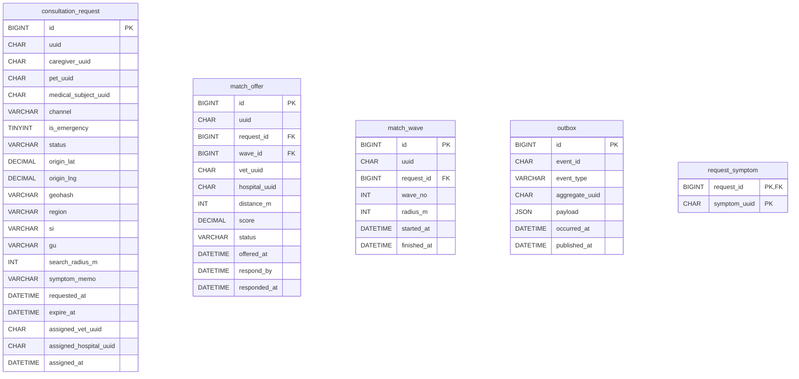
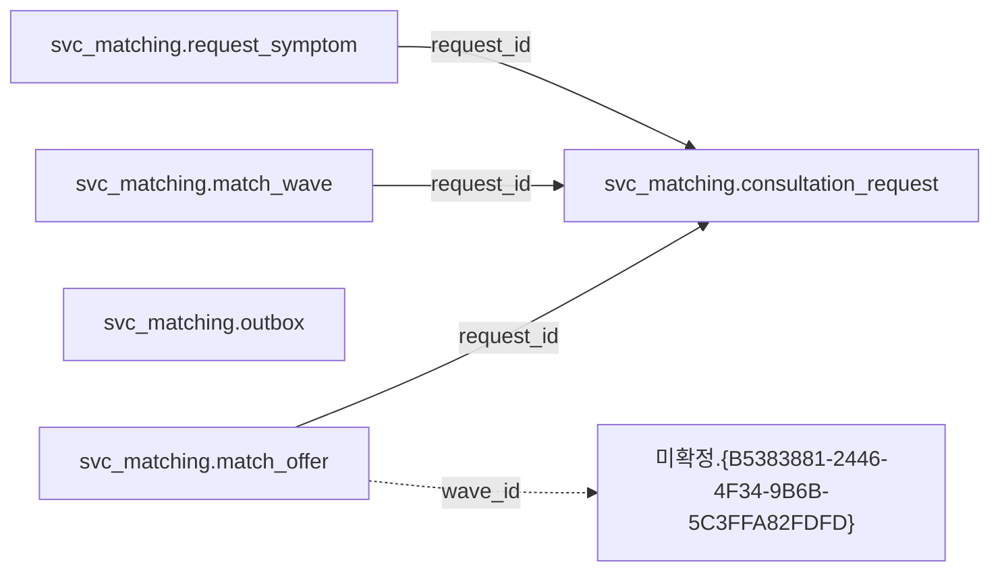

# svc_matching ERD

[전체 ERD 목록](../erd.md)

## 테이블 구조

컬럼 타입은 기본 타입으로 표시한다. 길이·NULL 허용·기본값과 복합 인덱스는 아래 상세 표를 따른다.

## 외래키 관계
관계도는 외래키가 가리키는 방향을 화살표로 표시한다.

#### `svc_matching.consultation_request`

보호자 호출. 택시 호출에 해당. 실시간 후보 검색은 Mongo 2dsphere

| 컬럼 | 타입 | NULL | 기본값 | 속성 / 주석 |
| --- | --- | --- | --- | --- |
| `id` | `BIGINT` | 불가 | — | AUTO_INCREMENT |
| `uuid` | `CHAR(36)` | 불가 | — | — |
| `caregiver_uuid` | `CHAR(36)` | 불가 | — | — |
| `pet_uuid` | `CHAR(36)` | 불가 | — | — |
| `medical_subject_uuid` | `CHAR(36)` | 불가 | — | — |
| `channel` | `VARCHAR(20)` | 불가 | — | — |
| `is_emergency` | `TINYINT(1)` | 불가 | — | — |
| `status` | `VARCHAR(20)` | 불가 | — | — |
| `origin_lat` | `DECIMAL(9,6)` | 불가 | — | — |
| `origin_lng` | `DECIMAL(9,6)` | 불가 | — | — |
| `geohash` | `VARCHAR(12)` | 불가 | — | — |
| `region` | `VARCHAR(50)` | 불가 | — | — |
| `si` | `VARCHAR(50)` | 불가 | — | — |
| `gu` | `VARCHAR(50)` | 불가 | — | — |
| `search_radius_m` | `INT` | 불가 | — | — |
| `symptom_memo` | `VARCHAR(200)` | 허용 | `NULL` | — |
| `requested_at` | `DATETIME` | 불가 | — | — |
| `expire_at` | `DATETIME` | 불가 | — | — |
| `assigned_vet_uuid` | `CHAR(36)` | 허용 | `NULL` | — |
| `assigned_hospital_uuid` | `CHAR(36)` | 허용 | `NULL` | — |
| `assigned_at` | `DATETIME` | 허용 | `NULL` | — |

**인덱스**

| 이름 | 종류 | 컬럼 |
| --- | --- | --- |
| `PRIMARY` | PRIMARY KEY | `id` |
| `uk_request_uuid` | UNIQUE | `uuid` |
| `idx_request_status_at` | INDEX | `status`, `requested_at` |
| `idx_request_region` | INDEX | `region`, `status`, `is_emergency`, `requested_at` |
| `idx_request_caregiver` | INDEX | `caregiver_uuid`, `requested_at` |
| `idx_request_geo` | INDEX | `origin_lat`, `origin_lng` |

**외래키**

모델에 명시된 외래키가 없습니다.

#### `svc_matching.match_offer`

수의사 앱에 뜨는 콜 카드. 한 명이 수락하면 나머지는 SUPERSEDED

| 컬럼 | 타입 | NULL | 기본값 | 속성 / 주석 |
| --- | --- | --- | --- | --- |
| `id` | `BIGINT` | 불가 | — | AUTO_INCREMENT |
| `uuid` | `CHAR(36)` | 불가 | — | — |
| `request_id` | `BIGINT` | 불가 | — | — |
| `wave_id` | `BIGINT` | 불가 | — | — |
| `vet_uuid` | `CHAR(36)` | 불가 | — | — |
| `hospital_uuid` | `CHAR(36)` | 불가 | — | — |
| `distance_m` | `INT` | 불가 | — | — |
| `score` | `DECIMAL(6,2)` | 불가 | — | — |
| `status` | `VARCHAR(20)` | 불가 | — | — |
| `offered_at` | `DATETIME` | 불가 | — | — |
| `respond_by` | `DATETIME` | 불가 | — | — |
| `responded_at` | `DATETIME` | 허용 | `NULL` | — |

**인덱스**

| 이름 | 종류 | 컬럼 |
| --- | --- | --- |
| `PRIMARY` | PRIMARY KEY | `id` |
| `uk_offer_uuid` | UNIQUE | `uuid` |
| `uk_offer_vet` | UNIQUE | `request_id`, `vet_uuid` |
| `idx_offer_inbox` | INDEX | `vet_uuid`, `status`, `offered_at` |
| `idx_offer_request` | INDEX | `request_id`, `status` |
| `fk_offer_wave` | INDEX | `wave_id` |

**외래키**

| 이름 | 컬럼 | 참조 대상 | 삭제 / 수정 규칙 | 비고 |
| --- | --- | --- | --- | --- |
| `fk_offer_request` | `request_id` | `svc_matching.consultation_request` (`id`) | 미지정 / 미지정 | — |
| `fk_offer_wave` | `wave_id` | `미확정 {B5383881-2446-4F34-9B6B-5C3FFA82FDFD}` (`미확정 {2723F9ED-B05B-4DDC-9B89-CC893B554C4E}`) | 미지정 / 미지정 | — |

#### `svc_matching.match_wave`

반경을 넓혀 가며 다시 부르는 차수

| 컬럼 | 타입 | NULL | 기본값 | 속성 / 주석 |
| --- | --- | --- | --- | --- |
| `id` | `BIGINT` | 불가 | — | AUTO_INCREMENT |
| `uuid` | `CHAR(36)` | 불가 | — | — |
| `request_id` | `BIGINT` | 불가 | — | — |
| `wave_no` | `INT` | 불가 | — | — |
| `radius_m` | `INT` | 불가 | — | — |
| `started_at` | `DATETIME` | 불가 | — | — |
| `finished_at` | `DATETIME` | 허용 | `NULL` | — |

**인덱스**

| 이름 | 종류 | 컬럼 |
| --- | --- | --- |
| `PRIMARY` | PRIMARY KEY | `id` |
| `uk_wave_uuid` | UNIQUE | `uuid` |
| `uk_wave_no` | UNIQUE | `request_id`, `wave_no` |

**외래키**

| 이름 | 컬럼 | 참조 대상 | 삭제 / 수정 규칙 | 비고 |
| --- | --- | --- | --- | --- |
| `fk_wave_request` | `request_id` | `svc_matching.consultation_request` (`id`) | 미지정 / 미지정 | — |

#### `svc_matching.outbox`

matching 아웃박스. 토픽 matching.request.v1, matching.offer.v1

| 컬럼 | 타입 | NULL | 기본값 | 속성 / 주석 |
| --- | --- | --- | --- | --- |
| `id` | `BIGINT` | 불가 | — | AUTO_INCREMENT |
| `event_id` | `CHAR(36)` | 불가 | — | — |
| `event_type` | `VARCHAR(100)` | 불가 | — | — |
| `aggregate_uuid` | `CHAR(36)` | 불가 | — | — |
| `payload` | `JSON` | 불가 | — | — |
| `occurred_at` | `DATETIME(6)` | 불가 | — | — |
| `published_at` | `DATETIME(6)` | 허용 | `NULL` | — |

**인덱스**

| 이름 | 종류 | 컬럼 |
| --- | --- | --- |
| `PRIMARY` | PRIMARY KEY | `id` |
| `uk_outbox_event` | UNIQUE | `event_id` |
| `idx_outbox_unpublished` | INDEX | `published_at`, `id` |

**외래키**

모델에 명시된 외래키가 없습니다.

#### `svc_matching.request_symptom`

호출-증상. symptom_uuid 는 care 값

| 컬럼 | 타입 | NULL | 기본값 | 속성 / 주석 |
| --- | --- | --- | --- | --- |
| `request_id` | `BIGINT` | 불가 | — | — |
| `symptom_uuid` | `CHAR(36)` | 불가 | — | — |

**인덱스**

| 이름 | 종류 | 컬럼 |
| --- | --- | --- |
| `PRIMARY` | PRIMARY KEY | `request_id`, `symptom_uuid` |
| `idx_request_symptom` | INDEX | `symptom_uuid`, `request_id` |

**외래키**

| 이름 | 컬럼 | 참조 대상 | 삭제 / 수정 규칙 | 비고 |
| --- | --- | --- | --- | --- |
| `fk_request_symptom_request` | `request_id` | `svc_matching.consultation_request` (`id`) | 미지정 / 미지정 | — |
