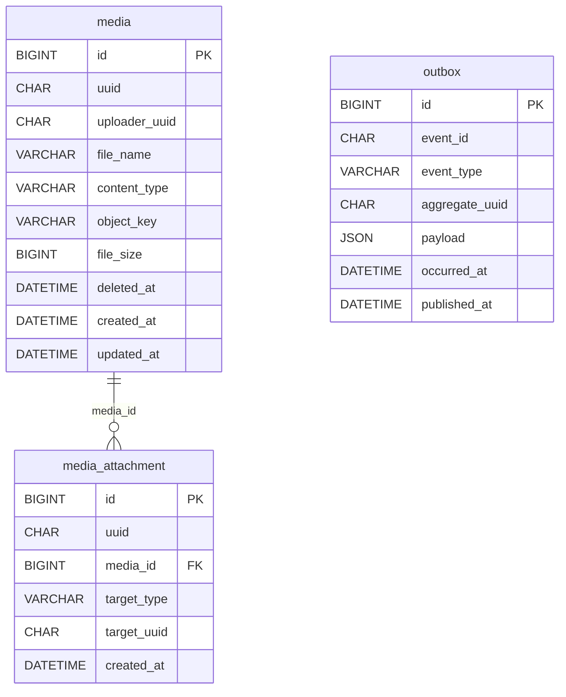

# svc_media ERD

[전체 ERD 목록](../erd.md)

## 테이블 구조

컬럼 타입은 기본 타입으로 표시한다. 길이·NULL 허용·기본값과 복합 인덱스는 아래 상세 표를 따른다. 관계선은 참조 대상이 확인된 외래키이며, 필수 여부와 유일성은 모델의 컬럼과 인덱스를 기준으로 표시한다.

#### `svc_media.media`

파일 원본

| 컬럼 | 타입 | NULL | 기본값 | 속성 / 주석 |
| --- | --- | --- | --- | --- |
| `id` | `BIGINT` | NOT NULL | — | AUTO_INCREMENT |
| `uuid` | `CHAR(36)` | NOT NULL | — | — |
| `uploader_uuid` | `CHAR(36)` | NOT NULL | — | — |
| `file_name` | `VARCHAR(255)` | NOT NULL | — | — |
| `content_type` | `VARCHAR(100)` | NOT NULL | — | — |
| `object_key` | `VARCHAR(500)` | NOT NULL | — | — |
| `file_size` | `BIGINT` | NOT NULL | — | — |
| `deleted_at` | `DATETIME` | NULL | `NULL` | — |
| `created_at` | `DATETIME` | NOT NULL | — | — |
| `updated_at` | `DATETIME` | NOT NULL | — | — |

**인덱스**

| 이름 | 종류 | 컬럼 |
| --- | --- | --- |
| `PRIMARY` | PRIMARY KEY | `id` |
| `uk_media_uuid` | UNIQUE | `uuid` |
| `uk_media_object` | UNIQUE | `object_key` |
| `idx_media_uploader_created` | INDEX | `uploader_uuid`, `created_at` |

**외래키**

모델에 명시된 외래키가 없습니다.

#### `svc_media.media_attachment`

첨부 중계. 대상 서비스 행을 FK 로 잡지 않는다

| 컬럼 | 타입 | NULL | 기본값 | 속성 / 주석 |
| --- | --- | --- | --- | --- |
| `id` | `BIGINT` | NOT NULL | — | AUTO_INCREMENT |
| `uuid` | `CHAR(36)` | NOT NULL | — | — |
| `media_id` | `BIGINT` | NOT NULL | — | — |
| `target_type` | `VARCHAR(30)` | NOT NULL | — | — |
| `target_uuid` | `CHAR(36)` | NOT NULL | — | — |
| `created_at` | `DATETIME` | NOT NULL | — | — |

**인덱스**

| 이름 | 종류 | 컬럼 |
| --- | --- | --- |
| `PRIMARY` | PRIMARY KEY | `id` |
| `uk_attachment_uuid` | UNIQUE | `uuid` |
| `uk_attachment_target` | UNIQUE | `media_id`, `target_type`, `target_uuid` |
| `idx_attachment_target` | INDEX | `target_type`, `target_uuid` |

**외래키**

| 이름 | 컬럼 | 참조 대상 | 삭제 / 수정 규칙 | 비고 |
| --- | --- | --- | --- | --- |
| `fk_attachment_media` | `media_id` | `svc_media.media` (`id`) | 미지정 / 미지정 | — |

#### `svc_media.outbox`

media 트랜잭셔널 아웃박스

| 컬럼 | 타입 | NULL | 기본값 | 속성 / 주석 |
| --- | --- | --- | --- | --- |
| `id` | `BIGINT` | NOT NULL | — | AUTO_INCREMENT |
| `event_id` | `CHAR(36)` | NOT NULL | — | — |
| `event_type` | `VARCHAR(100)` | NOT NULL | — | — |
| `aggregate_uuid` | `CHAR(36)` | NOT NULL | — | — |
| `payload` | `JSON` | NOT NULL | — | — |
| `occurred_at` | `DATETIME(6)` | NOT NULL | — | — |
| `published_at` | `DATETIME(6)` | NULL | `NULL` | — |

**인덱스**

| 이름 | 종류 | 컬럼 |
| --- | --- | --- |
| `PRIMARY` | PRIMARY KEY | `id` |
| `uk_outbox_event` | UNIQUE | `event_id` |
| `idx_outbox_unpublished` | INDEX | `published_at`, `id` |

**외래키**

모델에 명시된 외래키가 없습니다.

## 모델과 후속 정책의 차이

위 구조는 확정 SQL의 원본 모델이며 아래 정책은 아직 SQL에 반영되지 않았다. `uk_attachment_target`은 동일 미디어·대상 조합만 제한한다. 합의한 단일 활성 연결을 보장하려면 `media_attachment.media_id`의 UNIQUE 제약을 추가해야 한다. 게시글 첨부 순서를 연결 관계에 저장하며 컬럼·인덱스는 미정이다. 원본에서 `target_uuid`는 필수이므로 연결 전 파일에는 연결 행이 없다. 미디어의 기본 상태와 정리 보호·재시도 상태의 구체 저장 구조는 구현 설계에서 정한다. 외부 `mediaId`는 `media.uuid`를 사용한다. S3 실제 삭제 후에도 미디어 기록은 `deleted_at`으로 남긴다.
