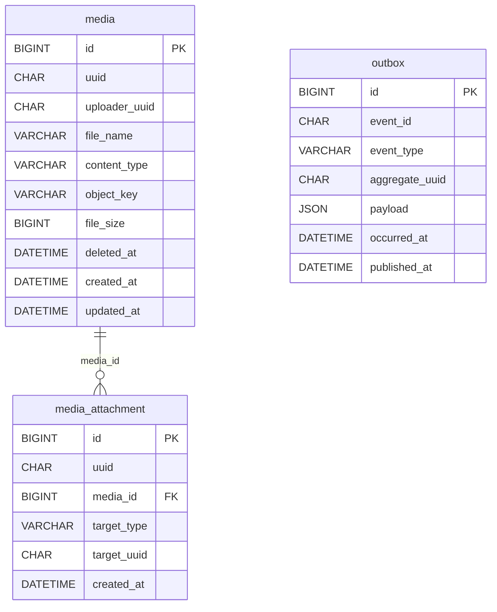

# svc_media ERD

[전체 ERD 목록](../erd.md)

## 테이블 구조

컬럼 타입은 기본 타입으로 표시한다. 길이·NULL 허용·기본값과 복합 인덱스는 아래 상세 표를 따른다. 관계선은 참조 대상이 확인된 외래키이며, 필수 여부와 유일성은 모델의 컬럼과 인덱스를 기준으로 표시한다.

#### `svc_media.media`

파일 원본

| 컬럼 | 타입 | NULL | 기본값 | 속성 / 주석 |
| --- | --- | --- | --- | --- |
| `id` | `BIGINT` | 불가 | — | AUTO_INCREMENT |
| `uuid` | `CHAR(36)` | 불가 | — | — |
| `uploader_uuid` | `CHAR(36)` | 불가 | — | — |
| `file_name` | `VARCHAR(255)` | 불가 | — | — |
| `content_type` | `VARCHAR(100)` | 불가 | — | — |
| `object_key` | `VARCHAR(500)` | 불가 | — | — |
| `file_size` | `BIGINT` | 불가 | — | — |
| `deleted_at` | `DATETIME` | 허용 | `NULL` | — |
| `created_at` | `DATETIME` | 불가 | — | — |
| `updated_at` | `DATETIME` | 불가 | — | — |

**인덱스**

| 이름 | 종류 | 컬럼 |
| --- | --- | --- |
| `PRIMARY` | PRIMARY KEY | `id` |
| `uk_media_uuid` | UNIQUE | `uuid` |
| `uk_media_object` | UNIQUE | `object_key` |
| `idx_media_uploader_created` | INDEX | `uploader_uuid`, `created_at` |

**외래키**

모델에 명시된 외래키가 없습니다.

#### `svc_media.media_attachment`

첨부 중계. 대상 서비스 행을 FK 로 잡지 않는다

| 컬럼 | 타입 | NULL | 기본값 | 속성 / 주석 |
| --- | --- | --- | --- | --- |
| `id` | `BIGINT` | 불가 | — | AUTO_INCREMENT |
| `uuid` | `CHAR(36)` | 불가 | — | — |
| `media_id` | `BIGINT` | 불가 | — | — |
| `target_type` | `VARCHAR(30)` | 불가 | — | — |
| `target_uuid` | `CHAR(36)` | 불가 | — | — |
| `created_at` | `DATETIME` | 불가 | — | — |

**인덱스**

| 이름 | 종류 | 컬럼 |
| --- | --- | --- |
| `PRIMARY` | PRIMARY KEY | `id` |
| `uk_attachment_uuid` | UNIQUE | `uuid` |
| `uk_attachment_target` | UNIQUE | `media_id`, `target_type`, `target_uuid` |
| `idx_attachment_target` | INDEX | `target_type`, `target_uuid` |

**외래키**

| 이름 | 컬럼 | 참조 대상 | 삭제 / 수정 규칙 | 비고 |
| --- | --- | --- | --- | --- |
| `fk_attachment_media` | `media_id` | `svc_media.media` (`id`) | 미지정 / 미지정 | — |

#### `svc_media.outbox`

media 트랜잭셔널 아웃박스

| 컬럼 | 타입 | NULL | 기본값 | 속성 / 주석 |
| --- | --- | --- | --- | --- |
| `id` | `BIGINT` | 불가 | — | AUTO_INCREMENT |
| `event_id` | `CHAR(36)` | 불가 | — | — |
| `event_type` | `VARCHAR(100)` | 불가 | — | — |
| `aggregate_uuid` | `CHAR(36)` | 불가 | — | — |
| `payload` | `JSON` | 불가 | — | — |
| `occurred_at` | `DATETIME(6)` | 불가 | — | — |
| `published_at` | `DATETIME(6)` | 허용 | `NULL` | — |

**인덱스**

| 이름 | 종류 | 컬럼 |
| --- | --- | --- |
| `PRIMARY` | PRIMARY KEY | `id` |
| `uk_outbox_event` | UNIQUE | `event_id` |
| `idx_outbox_unpublished` | INDEX | `published_at`, `id` |

**외래키**

모델에 명시된 외래키가 없습니다.
