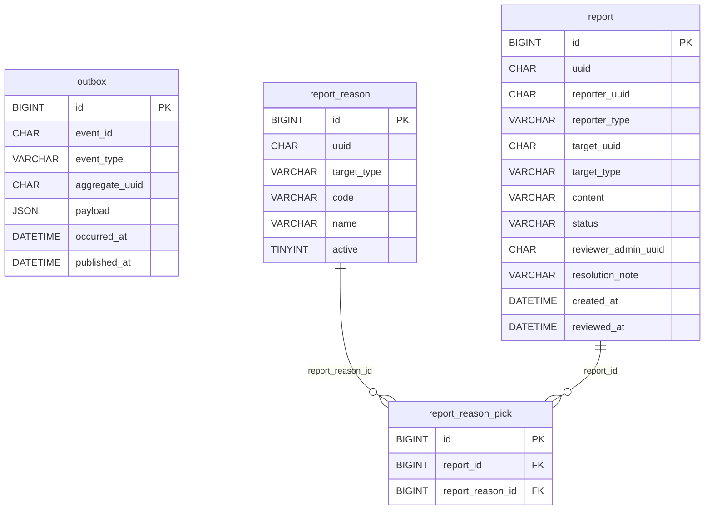

# svc_moderation ERD

[전체 ERD 목록](../erd.md)

## 테이블 구조

컬럼 타입은 기본 타입으로 표시한다. 길이·NULL 허용·기본값과 복합 인덱스는 아래 상세 표를 따른다. 관계선은 참조 대상이 확인된 외래키이며, 필수 여부와 유일성은 모델의 컬럼과 인덱스를 기준으로 표시한다.

#### `svc_moderation.outbox`

moderation 트랜잭셔널 아웃박스

| 컬럼 | 타입 | NULL | 기본값 | 속성 / 주석 |
| --- | --- | --- | --- | --- |
| `id` | `BIGINT` | NOT NULL | — | AUTO_INCREMENT |
| `event_id` | `CHAR(36)` | NOT NULL | — | — |
| `event_type` | `VARCHAR(100)` | NOT NULL | — | — |
| `aggregate_uuid` | `CHAR(36)` | NOT NULL | — | — |
| `payload` | `JSON` | NOT NULL | — | — |
| `occurred_at` | `DATETIME(6)` | NOT NULL | — | — |
| `published_at` | `DATETIME(6)` | NULL | `NULL` | — |

**인덱스**

| 이름 | 종류 | 컬럼 |
| --- | --- | --- |
| `PRIMARY` | PRIMARY KEY | `id` |
| `uk_outbox_event` | UNIQUE | `event_id` |
| `idx_outbox_unpublished` | INDEX | `published_at`, `id` |

**외래키**

모델에 명시된 외래키가 없습니다.

#### `svc_moderation.report`

신고. 대상은 type + uuid 이며 FK 없음

| 컬럼 | 타입 | NULL | 기본값 | 속성 / 주석 |
| --- | --- | --- | --- | --- |
| `id` | `BIGINT` | NOT NULL | — | AUTO_INCREMENT |
| `uuid` | `CHAR(36)` | NOT NULL | — | — |
| `reporter_uuid` | `CHAR(36)` | NOT NULL | — | — |
| `reporter_type` | `VARCHAR(20)` | NOT NULL | — | — |
| `target_uuid` | `CHAR(36)` | NOT NULL | — | — |
| `target_type` | `VARCHAR(30)` | NOT NULL | — | — |
| `content` | `VARCHAR(2000)` | NOT NULL | — | — |
| `status` | `VARCHAR(20)` | NOT NULL | — | — |
| `reviewer_admin_uuid` | `CHAR(36)` | NULL | `NULL` | — |
| `resolution_note` | `VARCHAR(2000)` | NULL | `NULL` | — |
| `created_at` | `DATETIME` | NOT NULL | — | — |
| `reviewed_at` | `DATETIME` | NULL | `NULL` | — |

**인덱스**

| 이름 | 종류 | 컬럼 |
| --- | --- | --- |
| `PRIMARY` | PRIMARY KEY | `id` |
| `uk_report_uuid` | UNIQUE | `uuid` |
| `idx_report_status_created` | INDEX | `status`, `created_at` |
| `idx_report_target` | INDEX | `target_type`, `target_uuid` |
| `idx_report_reporter` | INDEX | `reporter_uuid`, `created_at` |

**외래키**

모델에 명시된 외래키가 없습니다.

#### `svc_moderation.report_reason`

신고 사유 코드

| 컬럼 | 타입 | NULL | 기본값 | 속성 / 주석 |
| --- | --- | --- | --- | --- |
| `id` | `BIGINT` | NOT NULL | — | AUTO_INCREMENT |
| `uuid` | `CHAR(36)` | NOT NULL | — | — |
| `target_type` | `VARCHAR(30)` | NOT NULL | — | — |
| `code` | `VARCHAR(50)` | NOT NULL | — | — |
| `name` | `VARCHAR(100)` | NOT NULL | — | — |
| `active` | `TINYINT(1)` | NOT NULL | — | — |

**인덱스**

| 이름 | 종류 | 컬럼 |
| --- | --- | --- |
| `PRIMARY` | PRIMARY KEY | `id` |
| `uk_reason_uuid` | UNIQUE | `uuid` |
| `uk_reason_code` | UNIQUE | `target_type`, `code` |
| `idx_reason_active` | INDEX | `target_type`, `active` |

**외래키**

모델에 명시된 외래키가 없습니다.

#### `svc_moderation.report_reason_pick`

신고-사유 N:M

| 컬럼 | 타입 | NULL | 기본값 | 속성 / 주석 |
| --- | --- | --- | --- | --- |
| `id` | `BIGINT` | NOT NULL | — | AUTO_INCREMENT |
| `report_id` | `BIGINT` | NOT NULL | — | — |
| `report_reason_id` | `BIGINT` | NOT NULL | — | — |

**인덱스**

| 이름 | 종류 | 컬럼 |
| --- | --- | --- |
| `PRIMARY` | PRIMARY KEY | `id` |
| `uk_report_reason_pick` | UNIQUE | `report_id`, `report_reason_id` |
| `idx_report_reason_pick_reason` | INDEX | `report_reason_id` |

**외래키**

| 이름 | 컬럼 | 참조 대상 | 삭제 / 수정 규칙 | 비고 |
| --- | --- | --- | --- | --- |
| `fk_pick_reason` | `report_reason_id` | `svc_moderation.report_reason` (`id`) | 미지정 / 미지정 | — |
| `fk_pick_report` | `report_id` | `svc_moderation.report` (`id`) | 미지정 / 미지정 | — |

## 모델과 후속 정책의 차이

위 구조는 원본 모델이다. 외부 `reportId`는 `report.uuid`를 사용한다. 합의한 신고당 사유 하나와 중복 신고 제한은 기존 UNIQUE만으로 보장되지 않는다. 회원 신고의 게시글 맥락, 처리 결과 및 완료 알림을 위한 저장·전달 구조와 제약은 구현 설계에서 보완한다. 상세 사유·상태 코드와 조회 모델 동기화는 미정이다. 제품 정책은 [PRD](../prd.md#67-커뮤니티--com), 동작은 [커뮤니티 API](../api/community.md)를 따른다.
