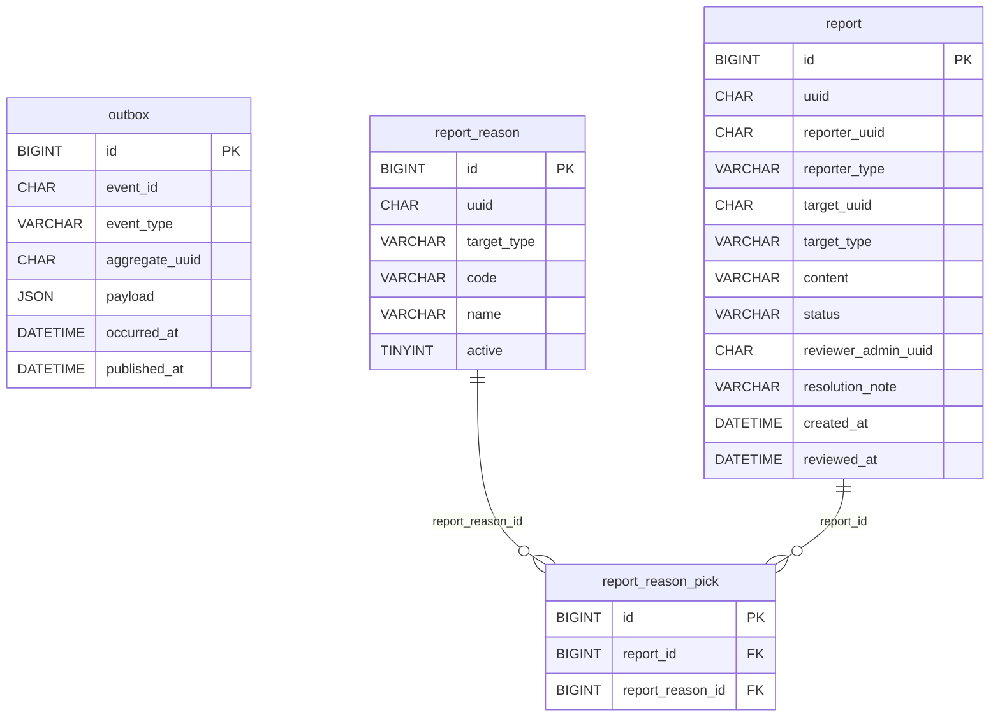
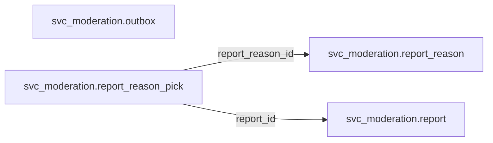

# svc_moderation ERD

[전체 ERD 목록](../erd.md)

## 테이블 구조

컬럼 타입은 기본 타입으로 표시한다. 길이·NULL 허용·기본값과 복합 인덱스는 아래 상세 표를 따른다. 관계선은 참조 대상이 확인된 외래키이며, 필수 여부와 유일성은 모델의 컬럼과 인덱스를 기준으로 표시한다. 참조 대상이 미확정인 관계는 아래 외래키 관계도에 점선으로 표시한다.

## 외래키 관계
관계도는 외래키가 가리키는 방향을 화살표로 표시한다.

#### `svc_moderation.outbox`

moderation 트랜잭셔널 아웃박스

| 컬럼 | 타입 | NULL | 기본값 | 속성 / 주석 |
| --- | --- | --- | --- | --- |
| `id` | `BIGINT` | 불가 | — | AUTO_INCREMENT |
| `event_id` | `CHAR(36)` | 불가 | — | — |
| `event_type` | `VARCHAR(100)` | 불가 | — | — |
| `aggregate_uuid` | `CHAR(36)` | 불가 | — | — |
| `payload` | `JSON` | 불가 | — | — |
| `occurred_at` | `DATETIME(6)` | 불가 | — | — |
| `published_at` | `DATETIME(6)` | 허용 | `NULL` | — |

**인덱스**

| 이름 | 종류 | 컬럼 |
| --- | --- | --- |
| `PRIMARY` | PRIMARY KEY | `id` |
| `uk_outbox_event` | UNIQUE | `event_id` |
| `idx_outbox_unpublished` | INDEX | `published_at`, `id` |

**외래키**

모델에 명시된 외래키가 없습니다.

#### `svc_moderation.report`

신고. 대상은 type + uuid 이며 FK 없음

| 컬럼 | 타입 | NULL | 기본값 | 속성 / 주석 |
| --- | --- | --- | --- | --- |
| `id` | `BIGINT` | 불가 | — | AUTO_INCREMENT |
| `uuid` | `CHAR(36)` | 불가 | — | — |
| `reporter_uuid` | `CHAR(36)` | 불가 | — | — |
| `reporter_type` | `VARCHAR(20)` | 불가 | — | — |
| `target_uuid` | `CHAR(36)` | 불가 | — | — |
| `target_type` | `VARCHAR(30)` | 불가 | — | — |
| `content` | `VARCHAR(2000)` | 불가 | — | — |
| `status` | `VARCHAR(20)` | 불가 | — | — |
| `reviewer_admin_uuid` | `CHAR(36)` | 허용 | `NULL` | — |
| `resolution_note` | `VARCHAR(2000)` | 허용 | `NULL` | — |
| `created_at` | `DATETIME` | 불가 | — | — |
| `reviewed_at` | `DATETIME` | 허용 | `NULL` | — |

**인덱스**

| 이름 | 종류 | 컬럼 |
| --- | --- | --- |
| `PRIMARY` | PRIMARY KEY | `id` |
| `uk_report_uuid` | UNIQUE | `uuid` |
| `idx_report_status_created` | INDEX | `status`, `created_at` |
| `idx_report_target` | INDEX | `target_type`, `target_uuid` |
| `idx_report_reporter` | INDEX | `reporter_uuid`, `created_at` |

**외래키**

모델에 명시된 외래키가 없습니다.

#### `svc_moderation.report_reason`

신고 사유 코드

| 컬럼 | 타입 | NULL | 기본값 | 속성 / 주석 |
| --- | --- | --- | --- | --- |
| `id` | `BIGINT` | 불가 | — | AUTO_INCREMENT |
| `uuid` | `CHAR(36)` | 불가 | — | — |
| `target_type` | `VARCHAR(30)` | 불가 | — | — |
| `code` | `VARCHAR(50)` | 불가 | — | — |
| `name` | `VARCHAR(100)` | 불가 | — | — |
| `active` | `TINYINT(1)` | 불가 | — | — |

**인덱스**

| 이름 | 종류 | 컬럼 |
| --- | --- | --- |
| `PRIMARY` | PRIMARY KEY | `id` |
| `uk_reason_uuid` | UNIQUE | `uuid` |
| `uk_reason_code` | UNIQUE | `target_type`, `code` |
| `idx_reason_active` | INDEX | `target_type`, `active` |

**외래키**

모델에 명시된 외래키가 없습니다.

#### `svc_moderation.report_reason_pick`

신고-사유 N:M

| 컬럼 | 타입 | NULL | 기본값 | 속성 / 주석 |
| --- | --- | --- | --- | --- |
| `id` | `BIGINT` | 불가 | — | AUTO_INCREMENT |
| `report_id` | `BIGINT` | 불가 | — | — |
| `report_reason_id` | `BIGINT` | 불가 | — | — |

**인덱스**

| 이름 | 종류 | 컬럼 |
| --- | --- | --- |
| `PRIMARY` | PRIMARY KEY | `id` |
| `uk_report_reason_pick` | UNIQUE | `report_id`, `report_reason_id` |
| `idx_report_reason_pick_reason` | INDEX | `report_reason_id` |

**외래키**

| 이름 | 컬럼 | 참조 대상 | 삭제 / 수정 규칙 | 비고 |
| --- | --- | --- | --- | --- |
| `fk_pick_reason` | `report_reason_id` | `svc_moderation.report_reason` (`id`) | 미지정 / 미지정 | — |
| `fk_pick_report` | `report_id` | `svc_moderation.report` (`id`) | 미지정 / 미지정 | — |
