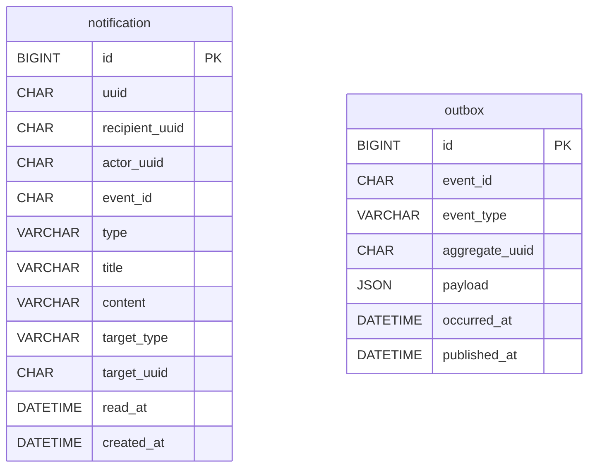

# svc_notification ERD

[전체 ERD 목록](../erd.md)

## 테이블 구조

컬럼 타입은 기본 타입으로 표시한다. 길이·NULL 허용·기본값과 복합 인덱스는 아래 상세 표를 따른다. 관계선은 참조 대상이 확인된 외래키이며, 필수 여부와 유일성은 모델의 컬럼과 인덱스를 기준으로 표시한다.

#### `svc_notification.notification`

알림 수신함. 생산자 테이블 FK 없음. event_id 로 멱등

| 컬럼 | 타입 | NULL | 기본값 | 속성 / 주석 |
| --- | --- | --- | --- | --- |
| `id` | `BIGINT` | 불가 | — | AUTO_INCREMENT |
| `uuid` | `CHAR(36)` | 불가 | — | — |
| `recipient_uuid` | `CHAR(36)` | 불가 | — | — |
| `actor_uuid` | `CHAR(36)` | 불가 | — | — |
| `event_id` | `CHAR(36)` | 불가 | — | — |
| `type` | `VARCHAR(30)` | 불가 | — | — |
| `title` | `VARCHAR(200)` | 불가 | — | — |
| `content` | `VARCHAR(500)` | 불가 | — | — |
| `target_type` | `VARCHAR(30)` | 불가 | — | — |
| `target_uuid` | `CHAR(36)` | 불가 | — | — |
| `read_at` | `DATETIME` | 허용 | `NULL` | — |
| `created_at` | `DATETIME` | 불가 | — | — |

**인덱스**

| 이름 | 종류 | 컬럼 |
| --- | --- | --- |
| `PRIMARY` | PRIMARY KEY | `id` |
| `uk_notification_uuid` | UNIQUE | `uuid` |
| `uk_notification_event` | UNIQUE | `recipient_uuid`, `event_id` |
| `idx_notification_inbox` | INDEX | `recipient_uuid`, `read_at`, `created_at` |

**외래키**

모델에 명시된 외래키가 없습니다.

#### `svc_notification.outbox`

notification 트랜잭셔널 아웃박스

| 컬럼 | 타입 | NULL | 기본값 | 속성 / 주석 |
| --- | --- | --- | --- | --- |
| `id` | `BIGINT` | 불가 | — | AUTO_INCREMENT |
| `event_id` | `CHAR(36)` | 불가 | — | — |
| `event_type` | `VARCHAR(100)` | 불가 | — | — |
| `aggregate_uuid` | `CHAR(36)` | 불가 | — | — |
| `payload` | `JSON` | 불가 | — | — |
| `occurred_at` | `DATETIME(6)` | 불가 | — | — |
| `published_at` | `DATETIME(6)` | 허용 | `NULL` | — |

**인덱스**

| 이름 | 종류 | 컬럼 |
| --- | --- | --- |
| `PRIMARY` | PRIMARY KEY | `id` |
| `uk_outbox_event` | UNIQUE | `event_id` |
| `idx_outbox_unpublished` | INDEX | `published_at`, `id` |

**외래키**

모델에 명시된 외래키가 없습니다.
