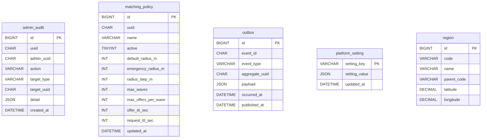

# svc_platform ERD

[전체 ERD 목록](../erd.md)

## 테이블 구조

컬럼 타입은 기본 타입으로 표시한다. 길이·NULL 허용·기본값과 복합 인덱스는 아래 상세 표를 따른다. 관계선은 참조 대상이 확인된 외래키이며, 필수 여부와 유일성은 모델의 컬럼과 인덱스를 기준으로 표시한다.

#### `svc_platform.admin_audit`

플랫폼 관리자 감사 로그

| 컬럼 | 타입 | NULL | 기본값 | 속성 / 주석 |
| --- | --- | --- | --- | --- |
| `id` | `BIGINT` | NOT NULL | — | AUTO_INCREMENT |
| `uuid` | `CHAR(36)` | NOT NULL | — | — |
| `admin_uuid` | `CHAR(36)` | NOT NULL | — | — |
| `action` | `VARCHAR(80)` | NOT NULL | — | — |
| `target_type` | `VARCHAR(40)` | NOT NULL | — | — |
| `target_uuid` | `CHAR(36)` | NOT NULL | — | — |
| `detail` | `JSON` | NULL | `NULL` | — |
| `created_at` | `DATETIME` | NOT NULL | — | — |

**인덱스**

| 이름 | 종류 | 컬럼 |
| --- | --- | --- |
| `PRIMARY` | PRIMARY KEY | `id` |
| `uk_audit_uuid` | UNIQUE | `uuid` |
| `idx_audit_created` | INDEX | `created_at` |
| `idx_audit_target` | INDEX | `target_type`, `target_uuid` |

**외래키**

모델에 명시된 외래키가 없습니다.

#### `svc_platform.matching_policy`

호출 반경, 제안 수, 수락 제한시간. 카카오택시의 배차 정책에 해당

| 컬럼 | 타입 | NULL | 기본값 | 속성 / 주석 |
| --- | --- | --- | --- | --- |
| `id` | `BIGINT` | NOT NULL | — | AUTO_INCREMENT |
| `uuid` | `CHAR(36)` | NOT NULL | — | — |
| `name` | `VARCHAR(50)` | NOT NULL | — | — |
| `active` | `TINYINT(1)` | NOT NULL | — | — |
| `default_radius_m` | `INT` | NOT NULL | — | — |
| `emergency_radius_m` | `INT` | NOT NULL | — | — |
| `radius_step_m` | `INT` | NOT NULL | — | — |
| `max_waves` | `INT` | NOT NULL | — | — |
| `max_offers_per_wave` | `INT` | NOT NULL | — | — |
| `offer_ttl_sec` | `INT` | NOT NULL | — | — |
| `request_ttl_sec` | `INT` | NOT NULL | — | — |
| `updated_at` | `DATETIME` | NOT NULL | — | — |

**인덱스**

| 이름 | 종류 | 컬럼 |
| --- | --- | --- |
| `PRIMARY` | PRIMARY KEY | `id` |
| `uk_policy_uuid` | UNIQUE | `uuid` |
| `idx_policy_active` | INDEX | `active`, `updated_at` |

**외래키**

모델에 명시된 외래키가 없습니다.

#### `svc_platform.outbox`

platform 트랜잭셔널 아웃박스. 토픽 platform.policy.v1

| 컬럼 | 타입 | NULL | 기본값 | 속성 / 주석 |
| --- | --- | --- | --- | --- |
| `id` | `BIGINT` | NOT NULL | — | AUTO_INCREMENT |
| `event_id` | `CHAR(36)` | NOT NULL | — | — |
| `event_type` | `VARCHAR(100)` | NOT NULL | — | — |
| `aggregate_uuid` | `CHAR(36)` | NOT NULL | — | — |
| `payload` | `JSON` | NOT NULL | — | — |
| `occurred_at` | `DATETIME(6)` | NOT NULL | — | — |
| `published_at` | `DATETIME(6)` | NULL | `NULL` | — |

**인덱스**

| 이름 | 종류 | 컬럼 |
| --- | --- | --- |
| `PRIMARY` | PRIMARY KEY | `id` |
| `uk_outbox_event` | UNIQUE | `event_id` |
| `idx_outbox_unpublished` | INDEX | `published_at`, `id` |

**외래키**

모델에 명시된 외래키가 없습니다.

#### `svc_platform.platform_setting`

플랫폼 운영 설정

| 컬럼 | 타입 | NULL | 기본값 | 속성 / 주석 |
| --- | --- | --- | --- | --- |
| `setting_key` | `VARCHAR(80)` | NOT NULL | — | — |
| `setting_value` | `JSON` | NOT NULL | — | — |
| `updated_at` | `DATETIME` | NOT NULL | — | — |

**인덱스**

| 이름 | 종류 | 컬럼 |
| --- | --- | --- |
| `PRIMARY` | PRIMARY KEY | `setting_key` |

**외래키**

모델에 명시된 외래키가 없습니다.

#### `svc_platform.region`

플랫폼 권역 코드

| 컬럼 | 타입 | NULL | 기본값 | 속성 / 주석 |
| --- | --- | --- | --- | --- |
| `id` | `BIGINT` | NOT NULL | — | AUTO_INCREMENT |
| `code` | `VARCHAR(20)` | NOT NULL | — | — |
| `name` | `VARCHAR(50)` | NOT NULL | — | — |
| `parent_code` | `VARCHAR(20)` | NULL | `NULL` | — |
| `latitude` | `DECIMAL(9,6)` | NULL | `NULL` | — |
| `longitude` | `DECIMAL(9,6)` | NULL | `NULL` | — |

**인덱스**

| 이름 | 종류 | 컬럼 |
| --- | --- | --- |
| `PRIMARY` | PRIMARY KEY | `id` |
| `uk_region_code` | UNIQUE | `code` |
| `idx_region_parent` | INDEX | `parent_code`, `name` |

**외래키**

모델에 명시된 외래키가 없습니다.
