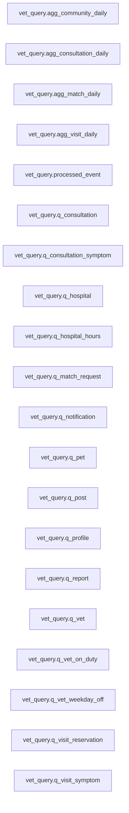

# vet_query ERD

[전체 ERD 목록](../erd.md)

## 테이블 구조

컬럼 타입은 기본 타입으로 표시한다. 길이·NULL 허용·기본값과 복합 인덱스는 아래 상세 표를 따른다. 관계선은 참조 대상이 확인된 외래키이며, 필수 여부와 유일성은 모델의 컬럼과 인덱스를 기준으로 표시한다. 참조 대상이 미확정인 관계는 아래 외래키 관계도에 점선으로 표시한다.

```mermaid
erDiagram
    agg_community_daily {
        DATE stat_date PK
        VARCHAR board_name PK
        INT post_count
        INT comment_count
        INT like_count
    }
    agg_consultation_daily {
        DATE stat_date PK
        VARCHAR subject_name PK
        VARCHAR status PK
        TINYINT is_emergency PK
        INT consultation_count
    }
    agg_match_daily {
        DATE stat_date PK
        VARCHAR region PK
        VARCHAR channel PK
        VARCHAR status PK
        TINYINT is_emergency PK
        INT request_count
        INT avg_match_sec
    }
    agg_visit_daily {
        DATE stat_date PK
        CHAR hospital_uuid PK
        VARCHAR hospital_name
        VARCHAR region
        VARCHAR status PK
        INT reservation_count
    }
    processed_event {
        CHAR event_id PK
        VARCHAR event_type
        DATETIME processed_at
    }
    q_consultation {
        CHAR consultation_uuid PK
        VARCHAR status
        VARCHAR consult_type
        TINYINT is_emergency
        VARCHAR summary
        CHAR caregiver_uuid
        VARCHAR caregiver_nickname
        CHAR pet_uuid
        VARCHAR pet_name
        VARCHAR species_name
        CHAR vet_uuid
        VARCHAR vet_name
        VARCHAR subject_name
        CHAR hospital_uuid
        VARCHAR hospital_name
        VARCHAR region
        DATETIME created_at
        DATETIME accepted_at
        DATETIME completed_at
    }
    q_consultation_symptom {
        CHAR consultation_uuid PK
        CHAR symptom_uuid PK
        VARCHAR symptom_name
    }
    q_hospital {
        CHAR hospital_uuid PK
        VARCHAR region
        VARCHAR si
        VARCHAR gun
        VARCHAR gu
        VARCHAR name
        VARCHAR road_address
        VARCHAR lot_address
        VARCHAR tel
    }
    q_hospital_hours {
        CHAR hospital_uuid PK
        TINYINT day_of_week PK
        TINYINT is_closed
        TIME open_time
        TIME close_time
    }
    q_match_request {
        CHAR request_uuid PK
        VARCHAR status
        VARCHAR channel
        TINYINT is_emergency
        VARCHAR region
        VARCHAR gu
        DECIMAL origin_lat
        DECIMAL origin_lng
        VARCHAR caregiver_nickname
        VARCHAR pet_name
        VARCHAR subject_name
        VARCHAR assigned_vet_name
        VARCHAR assigned_hospital_name
        INT distance_m
        DATETIME requested_at
        DATETIME assigned_at
    }
    q_notification {
        CHAR notification_uuid PK
        CHAR recipient_uuid
        VARCHAR type
        VARCHAR title
        DATETIME read_at
        DATETIME created_at
        TINYINT is_unread
    }
    q_pet {
        CHAR pet_uuid PK
        CHAR caregiver_uuid PK
        VARCHAR caregiver_nickname
        VARCHAR name
        VARCHAR species_name
        VARCHAR breed_name
        VARCHAR sex
        DATE birth_date
        DECIMAL weight_kg
        TINYINT is_neutered
        VARCHAR status
    }
    q_post {
        CHAR post_uuid PK
        VARCHAR board_name
        VARCHAR category_name
        CHAR author_uuid
        VARCHAR author_nickname
        VARCHAR author_type
        VARCHAR title
        TEXT content
        INT like_count
        INT comment_count
        DATETIME created_at
    }
    q_profile {
        CHAR account_uuid PK
        VARCHAR nickname
        VARCHAR user_type
        VARCHAR status
        VARCHAR name
    }
    q_report {
        CHAR report_uuid PK
        VARCHAR status
        VARCHAR reporter_type
        CHAR reporter_uuid
        VARCHAR target_type
        CHAR target_uuid
        VARCHAR reason_codes
        DATETIME created_at
        DATETIME reviewed_at
    }
    q_vet {
        CHAR vet_uuid PK
        CHAR account_uuid
        VARCHAR name
        VARCHAR major
        VARCHAR specialty
        TINYINT is_available
        VARCHAR status
        CHAR hospital_uuid
        VARCHAR hospital_name
        VARCHAR region
        VARCHAR si
        VARCHAR gu
    }
    q_vet_on_duty {
        CHAR vet_uuid PK
        VARCHAR vet_name
        CHAR hospital_uuid
        VARCHAR hospital_name
        VARCHAR region
        TINYINT accept_chat
        TINYINT accept_video
        INT service_radius_m
        DECIMAL origin_lat
        DECIMAL origin_lng
        DATETIME started_at
    }
    q_vet_weekday_off {
        CHAR vet_uuid PK
        TINYINT day_of_week PK
    }
    q_visit_reservation {
        CHAR reservation_uuid PK
        VARCHAR status
        DATE hoped_visit_date
        TIME hoped_start_time
        VARCHAR symptom_memo
        CHAR hospital_uuid
        VARCHAR hospital_name
        VARCHAR region
        VARCHAR si
        VARCHAR gu
        VARCHAR subject_name
        CHAR slot_uuid
        TIME slot_start
        TIME slot_end
        CHAR caregiver_uuid
        VARCHAR caregiver_nickname
        CHAR pet_uuid
        VARCHAR pet_name
        VARCHAR species_name
        VARCHAR breed_name
        DATETIME created_at
    }
    q_visit_symptom {
        CHAR reservation_uuid PK
        CHAR symptom_uuid PK
        VARCHAR symptom_name
    }
```

## 외래키 관계
관계도는 외래키가 가리키는 방향을 화살표로 표시한다.

#### `vet_query.agg_community_daily`

일별 게시판 활동 건수

| 컬럼 | 타입 | NULL | 기본값 | 속성 / 주석 |
| --- | --- | --- | --- | --- |
| `stat_date` | `DATE` | 불가 | — | — |
| `board_name` | `VARCHAR(100)` | 불가 | — | — |
| `post_count` | `INT` | 불가 | — | — |
| `comment_count` | `INT` | 불가 | — | — |
| `like_count` | `INT` | 불가 | — | — |

**인덱스**

| 이름 | 종류 | 컬럼 |
| --- | --- | --- |
| `PRIMARY` | PRIMARY KEY | `stat_date`, `board_name` |

**외래키**

모델에 명시된 외래키가 없습니다.

#### `vet_query.agg_consultation_daily`

일별 상담 건수. 과목/상태/응급

| 컬럼 | 타입 | NULL | 기본값 | 속성 / 주석 |
| --- | --- | --- | --- | --- |
| `stat_date` | `DATE` | 불가 | — | — |
| `subject_name` | `VARCHAR(100)` | 불가 | — | — |
| `status` | `VARCHAR(20)` | 불가 | — | — |
| `is_emergency` | `TINYINT(1)` | 불가 | — | — |
| `consultation_count` | `INT` | 불가 | — | — |

**인덱스**

| 이름 | 종류 | 컬럼 |
| --- | --- | --- |
| `PRIMARY` | PRIMARY KEY | `stat_date`, `subject_name`, `status`, `is_emergency` |
| `idx_agg_consult_status` | INDEX | `stat_date`, `status`, `is_emergency` |

**외래키**

모델에 명시된 외래키가 없습니다.

#### `vet_query.agg_match_daily`

일별 호출 건수와 평균 배정 초

| 컬럼 | 타입 | NULL | 기본값 | 속성 / 주석 |
| --- | --- | --- | --- | --- |
| `stat_date` | `DATE` | 불가 | — | — |
| `region` | `VARCHAR(50)` | 불가 | — | — |
| `channel` | `VARCHAR(20)` | 불가 | — | — |
| `status` | `VARCHAR(20)` | 불가 | — | — |
| `is_emergency` | `TINYINT(1)` | 불가 | — | — |
| `request_count` | `INT` | 불가 | — | — |
| `avg_match_sec` | `INT` | 허용 | `NULL` | — |

**인덱스**

| 이름 | 종류 | 컬럼 |
| --- | --- | --- |
| `PRIMARY` | PRIMARY KEY | `stat_date`, `region`, `channel`, `status`, `is_emergency` |

**외래키**

모델에 명시된 외래키가 없습니다.

#### `vet_query.agg_visit_daily`

일별 병원 예약 건수. 목록 테이블을 스캔하지 않는다

| 컬럼 | 타입 | NULL | 기본값 | 속성 / 주석 |
| --- | --- | --- | --- | --- |
| `stat_date` | `DATE` | 불가 | — | — |
| `hospital_uuid` | `CHAR(36)` | 불가 | — | — |
| `hospital_name` | `VARCHAR(100)` | 불가 | — | — |
| `region` | `VARCHAR(50)` | 불가 | — | — |
| `status` | `VARCHAR(20)` | 불가 | — | — |
| `reservation_count` | `INT` | 불가 | — | — |

**인덱스**

| 이름 | 종류 | 컬럼 |
| --- | --- | --- |
| `PRIMARY` | PRIMARY KEY | `stat_date`, `hospital_uuid`, `status` |
| `idx_agg_visit_region` | INDEX | `stat_date`, `region`, `status` |

**외래키**

모델에 명시된 외래키가 없습니다.

#### `vet_query.processed_event`

프로젝터 멱등 키

| 컬럼 | 타입 | NULL | 기본값 | 속성 / 주석 |
| --- | --- | --- | --- | --- |
| `event_id` | `CHAR(36)` | 불가 | — | — |
| `event_type` | `VARCHAR(100)` | 불가 | — | — |
| `processed_at` | `DATETIME(6)` | 불가 | — | — |

**인덱스**

| 이름 | 종류 | 컬럼 |
| --- | --- | --- |
| `PRIMARY` | PRIMARY KEY | `event_id` |

**외래키**

모델에 명시된 외래키가 없습니다.

#### `vet_query.q_consultation`

상담 목록. 지역/응급/상태/과목을 한 테이블에서 필터

| 컬럼 | 타입 | NULL | 기본값 | 속성 / 주석 |
| --- | --- | --- | --- | --- |
| `consultation_uuid` | `CHAR(36)` | 불가 | — | — |
| `status` | `VARCHAR(20)` | 불가 | — | — |
| `consult_type` | `VARCHAR(20)` | 불가 | — | — |
| `is_emergency` | `TINYINT(1)` | 불가 | — | — |
| `summary` | `VARCHAR(500)` | 허용 | `NULL` | — |
| `caregiver_uuid` | `CHAR(36)` | 불가 | — | — |
| `caregiver_nickname` | `VARCHAR(50)` | 불가 | — | — |
| `pet_uuid` | `CHAR(36)` | 불가 | — | — |
| `pet_name` | `VARCHAR(50)` | 불가 | — | — |
| `species_name` | `VARCHAR(50)` | 불가 | — | — |
| `vet_uuid` | `CHAR(36)` | 허용 | `NULL` | — |
| `vet_name` | `VARCHAR(50)` | 허용 | `NULL` | — |
| `subject_name` | `VARCHAR(100)` | 불가 | — | — |
| `hospital_uuid` | `CHAR(36)` | 허용 | `NULL` | — |
| `hospital_name` | `VARCHAR(100)` | 허용 | `NULL` | — |
| `region` | `VARCHAR(50)` | 허용 | `NULL` | — |
| `created_at` | `DATETIME` | 불가 | — | — |
| `accepted_at` | `DATETIME` | 허용 | `NULL` | — |
| `completed_at` | `DATETIME` | 허용 | `NULL` | — |

**인덱스**

| 이름 | 종류 | 컬럼 |
| --- | --- | --- |
| `PRIMARY` | PRIMARY KEY | `consultation_uuid` |
| `idx_q_consult_status_created` | INDEX | `status`, `created_at` |
| `idx_q_consult_emergency` | INDEX | `is_emergency`, `status`, `region`, `created_at` |
| `idx_q_consult_vet` | INDEX | `vet_uuid`, `status`, `created_at` |
| `idx_q_consult_caregiver` | INDEX | `caregiver_uuid`, `created_at` |
| `idx_q_consult_subject` | INDEX | `subject_name`, `status`, `created_at` |
| `idx_q_consult_agg` | INDEX | `created_at`, `subject_name`, `status`, `is_emergency` |
| `ft_q_consult` | FULLTEXT | `summary`, `pet_name`, `vet_name`, `subject_name` |

**외래키**

모델에 명시된 외래키가 없습니다.

#### `vet_query.q_consultation_symptom`

상담 증상 필터

| 컬럼 | 타입 | NULL | 기본값 | 속성 / 주석 |
| --- | --- | --- | --- | --- |
| `consultation_uuid` | `CHAR(36)` | 불가 | — | — |
| `symptom_uuid` | `CHAR(36)` | 불가 | — | — |
| `symptom_name` | `VARCHAR(100)` | 불가 | — | — |

**인덱스**

| 이름 | 종류 | 컬럼 |
| --- | --- | --- |
| `PRIMARY` | PRIMARY KEY | `symptom_uuid`, `consultation_uuid` |
| `idx_q_consult_symptom_consultation` | INDEX | `consultation_uuid` |
| `idx_q_consult_symptom_name` | INDEX | `symptom_name`, `consultation_uuid` |

**외래키**

모델에 명시된 외래키가 없습니다.

#### `vet_query.q_hospital`

병원 지역 필터 + 이름/주소 검색

| 컬럼 | 타입 | NULL | 기본값 | 속성 / 주석 |
| --- | --- | --- | --- | --- |
| `hospital_uuid` | `CHAR(36)` | 불가 | — | — |
| `region` | `VARCHAR(50)` | 불가 | — | — |
| `si` | `VARCHAR(50)` | 불가 | — | — |
| `gun` | `VARCHAR(50)` | 불가 | — | — |
| `gu` | `VARCHAR(50)` | 불가 | — | — |
| `name` | `VARCHAR(100)` | 불가 | — | — |
| `road_address` | `VARCHAR(255)` | 불가 | — | — |
| `lot_address` | `VARCHAR(255)` | 불가 | — | — |
| `tel` | `VARCHAR(20)` | 허용 | `NULL` | — |

**인덱스**

| 이름 | 종류 | 컬럼 |
| --- | --- | --- |
| `PRIMARY` | PRIMARY KEY | `hospital_uuid` |
| `idx_q_hospital_region_name` | INDEX | `region`, `si`, `gu`, `name` |
| `ft_q_hospital` | FULLTEXT | `name`, `road_address`, `lot_address` |

**외래키**

모델에 명시된 외래키가 없습니다.

#### `vet_query.q_hospital_hours`

요일 영업 필터. 1=월 7=일

| 컬럼 | 타입 | NULL | 기본값 | 속성 / 주석 |
| --- | --- | --- | --- | --- |
| `hospital_uuid` | `CHAR(36)` | 불가 | — | — |
| `day_of_week` | `TINYINT` | 불가 | — | — |
| `is_closed` | `TINYINT(1)` | 불가 | — | — |
| `open_time` | `TIME` | 허용 | `NULL` | — |
| `close_time` | `TIME` | 허용 | `NULL` | — |

**인덱스**

| 이름 | 종류 | 컬럼 |
| --- | --- | --- |
| `PRIMARY` | PRIMARY KEY | `hospital_uuid`, `day_of_week` |
| `idx_q_hours_open` | INDEX | `day_of_week`, `is_closed`, `hospital_uuid` |

**외래키**

모델에 명시된 외래키가 없습니다.

#### `vet_query.q_match_request`

호출 운영 목록. 후보 반경 검색은 MongoDB

| 컬럼 | 타입 | NULL | 기본값 | 속성 / 주석 |
| --- | --- | --- | --- | --- |
| `request_uuid` | `CHAR(36)` | 불가 | — | — |
| `status` | `VARCHAR(20)` | 불가 | — | — |
| `channel` | `VARCHAR(20)` | 불가 | — | — |
| `is_emergency` | `TINYINT(1)` | 불가 | — | — |
| `region` | `VARCHAR(50)` | 불가 | — | — |
| `gu` | `VARCHAR(50)` | 불가 | — | — |
| `origin_lat` | `DECIMAL(9,6)` | 불가 | — | — |
| `origin_lng` | `DECIMAL(9,6)` | 불가 | — | — |
| `caregiver_nickname` | `VARCHAR(50)` | 불가 | — | — |
| `pet_name` | `VARCHAR(50)` | 불가 | — | — |
| `subject_name` | `VARCHAR(100)` | 불가 | — | — |
| `assigned_vet_name` | `VARCHAR(50)` | 허용 | `NULL` | — |
| `assigned_hospital_name` | `VARCHAR(100)` | 허용 | `NULL` | — |
| `distance_m` | `INT` | 허용 | `NULL` | — |
| `requested_at` | `DATETIME` | 불가 | — | — |
| `assigned_at` | `DATETIME` | 허용 | `NULL` | — |

**인덱스**

| 이름 | 종류 | 컬럼 |
| --- | --- | --- |
| `PRIMARY` | PRIMARY KEY | `request_uuid` |
| `idx_q_match_status` | INDEX | `status`, `requested_at` |
| `idx_q_match_region` | INDEX | `region`, `is_emergency`, `status`, `requested_at` |

**외래키**

모델에 명시된 외래키가 없습니다.

#### `vet_query.q_notification`

수신함. 미읽음은 is_unread=1

| 컬럼 | 타입 | NULL | 기본값 | 속성 / 주석 |
| --- | --- | --- | --- | --- |
| `notification_uuid` | `CHAR(36)` | 불가 | — | — |
| `recipient_uuid` | `CHAR(36)` | 불가 | — | — |
| `type` | `VARCHAR(30)` | 불가 | — | — |
| `title` | `VARCHAR(200)` | 불가 | — | — |
| `read_at` | `DATETIME` | 허용 | `NULL` | — |
| `created_at` | `DATETIME` | 불가 | — | — |
| `is_unread` | `TINYINT` | 허용 | `NULL` | GENERATED if((`read_at` is null),1,0) STORED |

**인덱스**

| 이름 | 종류 | 컬럼 |
| --- | --- | --- |
| `PRIMARY` | PRIMARY KEY | `notification_uuid` |
| `idx_q_notification_inbox` | INDEX | `recipient_uuid`, `is_unread`, `created_at` |
| `idx_q_notification_type` | INDEX | `recipient_uuid`, `type`, `created_at` |

**외래키**

모델에 명시된 외래키가 없습니다.

#### `vet_query.q_pet`

펫 카드. 보호자 연결마다 한 행

| 컬럼 | 타입 | NULL | 기본값 | 속성 / 주석 |
| --- | --- | --- | --- | --- |
| `pet_uuid` | `CHAR(36)` | 불가 | — | — |
| `caregiver_uuid` | `CHAR(36)` | 불가 | — | — |
| `caregiver_nickname` | `VARCHAR(50)` | 불가 | — | — |
| `name` | `VARCHAR(50)` | 불가 | — | — |
| `species_name` | `VARCHAR(50)` | 불가 | — | — |
| `breed_name` | `VARCHAR(50)` | 불가 | — | — |
| `sex` | `VARCHAR(10)` | 불가 | — | — |
| `birth_date` | `DATE` | 허용 | `NULL` | — |
| `weight_kg` | `DECIMAL(5,2)` | 허용 | `NULL` | — |
| `is_neutered` | `TINYINT(1)` | 허용 | `NULL` | — |
| `status` | `VARCHAR(20)` | 불가 | — | — |

**인덱스**

| 이름 | 종류 | 컬럼 |
| --- | --- | --- |
| `PRIMARY` | PRIMARY KEY | `pet_uuid`, `caregiver_uuid` |
| `idx_q_pet_caregiver` | INDEX | `caregiver_uuid`, `status`, `name` |
| `idx_q_pet_species` | INDEX | `species_name`, `breed_name`, `status` |
| `ft_q_pet` | FULLTEXT | `name`, `breed_name`, `species_name`, `caregiver_nickname` |

**외래키**

모델에 명시된 외래키가 없습니다.

#### `vet_query.q_post`

피드. 카운터는 좋아요/댓글 이벤트의 조회값

| 컬럼 | 타입 | NULL | 기본값 | 속성 / 주석 |
| --- | --- | --- | --- | --- |
| `post_uuid` | `CHAR(36)` | 불가 | — | — |
| `board_name` | `VARCHAR(100)` | 불가 | — | — |
| `category_name` | `VARCHAR(100)` | 불가 | — | — |
| `author_uuid` | `CHAR(36)` | 불가 | — | — |
| `author_nickname` | `VARCHAR(50)` | 불가 | — | — |
| `author_type` | `VARCHAR(20)` | 불가 | — | — |
| `title` | `VARCHAR(200)` | 불가 | — | — |
| `content` | `TEXT` | 불가 | — | — |
| `like_count` | `INT` | 불가 | — | — |
| `comment_count` | `INT` | 불가 | — | — |
| `created_at` | `DATETIME` | 불가 | — | — |

**인덱스**

| 이름 | 종류 | 컬럼 |
| --- | --- | --- |
| `PRIMARY` | PRIMARY KEY | `post_uuid` |
| `idx_q_post_board_created` | INDEX | `board_name`, `created_at` |
| `idx_q_post_category_created` | INDEX | `category_name`, `created_at` |
| `idx_q_post_author_created` | INDEX | `author_uuid`, `created_at` |
| `ft_q_post` | FULLTEXT | `title`, `content` |

**외래키**

모델에 명시된 외래키가 없습니다.

#### `vet_query.q_profile`

사용자 검색. 닉네임/이름

| 컬럼 | 타입 | NULL | 기본값 | 속성 / 주석 |
| --- | --- | --- | --- | --- |
| `account_uuid` | `CHAR(36)` | 불가 | — | — |
| `nickname` | `VARCHAR(50)` | 불가 | — | — |
| `user_type` | `VARCHAR(20)` | 불가 | — | — |
| `status` | `VARCHAR(20)` | 불가 | — | — |
| `name` | `VARCHAR(100)` | 불가 | — | — |

**인덱스**

| 이름 | 종류 | 컬럼 |
| --- | --- | --- |
| `PRIMARY` | PRIMARY KEY | `account_uuid` |
| `uk_q_profile_nickname` | UNIQUE | `nickname` |
| `idx_q_profile_type_status` | INDEX | `user_type`, `status`, `nickname` |
| `ft_q_profile_name` | FULLTEXT | `nickname`, `name` |

**외래키**

모델에 명시된 외래키가 없습니다.

#### `vet_query.q_report`

신고 큐. reason_codes 는 표시용이고 필터 키는 status+target_type

| 컬럼 | 타입 | NULL | 기본값 | 속성 / 주석 |
| --- | --- | --- | --- | --- |
| `report_uuid` | `CHAR(36)` | 불가 | — | — |
| `status` | `VARCHAR(20)` | 불가 | — | — |
| `reporter_type` | `VARCHAR(20)` | 불가 | — | — |
| `reporter_uuid` | `CHAR(36)` | 불가 | — | — |
| `target_type` | `VARCHAR(30)` | 불가 | — | — |
| `target_uuid` | `CHAR(36)` | 불가 | — | — |
| `reason_codes` | `VARCHAR(255)` | 불가 | — | — |
| `created_at` | `DATETIME` | 불가 | — | — |
| `reviewed_at` | `DATETIME` | 허용 | `NULL` | — |

**인덱스**

| 이름 | 종류 | 컬럼 |
| --- | --- | --- |
| `PRIMARY` | PRIMARY KEY | `report_uuid` |
| `idx_q_report_queue` | INDEX | `status`, `target_type`, `created_at` |
| `idx_q_report_target` | INDEX | `target_type`, `target_uuid` |
| `idx_q_report_reporter` | INDEX | `reporter_uuid`, `created_at` |

**외래키**

모델에 명시된 외래키가 없습니다.

#### `vet_query.q_vet`

현재 소속 기준 수의사 한 행. 소속 이력은 쓰지 않는다

| 컬럼 | 타입 | NULL | 기본값 | 속성 / 주석 |
| --- | --- | --- | --- | --- |
| `vet_uuid` | `CHAR(36)` | 불가 | — | — |
| `account_uuid` | `CHAR(36)` | 불가 | — | — |
| `name` | `VARCHAR(50)` | 불가 | — | — |
| `major` | `VARCHAR(100)` | 불가 | — | — |
| `specialty` | `VARCHAR(100)` | 불가 | — | — |
| `is_available` | `TINYINT(1)` | 불가 | — | — |
| `status` | `VARCHAR(20)` | 불가 | — | — |
| `hospital_uuid` | `CHAR(36)` | 불가 | — | — |
| `hospital_name` | `VARCHAR(100)` | 불가 | — | — |
| `region` | `VARCHAR(50)` | 불가 | — | — |
| `si` | `VARCHAR(50)` | 불가 | — | — |
| `gu` | `VARCHAR(50)` | 불가 | — | — |

**인덱스**

| 이름 | 종류 | 컬럼 |
| --- | --- | --- |
| `PRIMARY` | PRIMARY KEY | `vet_uuid` |
| `idx_q_vet_place` | INDEX | `region`, `si`, `gu`, `status`, `is_available` |
| `idx_q_vet_hospital` | INDEX | `hospital_uuid`, `status`, `is_available` |
| `idx_q_vet_specialty` | INDEX | `specialty`, `status`, `is_available` |
| `ft_q_vet` | FULLTEXT | `name`, `major`, `specialty`, `hospital_name` |

**외래키**

모델에 명시된 외래키가 없습니다.

#### `vet_query.q_vet_on_duty`

출근 중 수의사. 하트비트 좌표는 MongoDB가 최신

| 컬럼 | 타입 | NULL | 기본값 | 속성 / 주석 |
| --- | --- | --- | --- | --- |
| `vet_uuid` | `CHAR(36)` | 불가 | — | — |
| `vet_name` | `VARCHAR(50)` | 불가 | — | — |
| `hospital_uuid` | `CHAR(36)` | 불가 | — | — |
| `hospital_name` | `VARCHAR(100)` | 불가 | — | — |
| `region` | `VARCHAR(50)` | 불가 | — | — |
| `accept_chat` | `TINYINT(1)` | 불가 | — | — |
| `accept_video` | `TINYINT(1)` | 불가 | — | — |
| `service_radius_m` | `INT` | 불가 | — | — |
| `origin_lat` | `DECIMAL(9,6)` | 불가 | — | — |
| `origin_lng` | `DECIMAL(9,6)` | 불가 | — | — |
| `started_at` | `DATETIME` | 불가 | — | — |

**인덱스**

| 이름 | 종류 | 컬럼 |
| --- | --- | --- |
| `PRIMARY` | PRIMARY KEY | `vet_uuid` |
| `idx_q_duty_region` | INDEX | `region`, `accept_video`, `accept_chat` |

**외래키**

모델에 명시된 외래키가 없습니다.

#### `vet_query.q_vet_weekday_off`

휴무 요일 제외 필터. NOT EXISTS 용

| 컬럼 | 타입 | NULL | 기본값 | 속성 / 주석 |
| --- | --- | --- | --- | --- |
| `vet_uuid` | `CHAR(36)` | 불가 | — | — |
| `day_of_week` | `TINYINT` | 불가 | — | — |

**인덱스**

| 이름 | 종류 | 컬럼 |
| --- | --- | --- |
| `PRIMARY` | PRIMARY KEY | `day_of_week`, `vet_uuid` |
| `idx_q_vet_off_vet` | INDEX | `vet_uuid`, `day_of_week` |

**외래키**

모델에 명시된 외래키가 없습니다.

#### `vet_query.q_visit_reservation`

예약 목록. 필터 컬럼을 평탄화

| 컬럼 | 타입 | NULL | 기본값 | 속성 / 주석 |
| --- | --- | --- | --- | --- |
| `reservation_uuid` | `CHAR(36)` | 불가 | — | — |
| `status` | `VARCHAR(20)` | 불가 | — | — |
| `hoped_visit_date` | `DATE` | 불가 | — | — |
| `hoped_start_time` | `TIME` | 불가 | — | — |
| `symptom_memo` | `VARCHAR(200)` | 허용 | `NULL` | — |
| `hospital_uuid` | `CHAR(36)` | 불가 | — | — |
| `hospital_name` | `VARCHAR(100)` | 불가 | — | — |
| `region` | `VARCHAR(50)` | 불가 | — | — |
| `si` | `VARCHAR(50)` | 불가 | — | — |
| `gu` | `VARCHAR(50)` | 불가 | — | — |
| `subject_name` | `VARCHAR(100)` | 불가 | — | — |
| `slot_uuid` | `CHAR(36)` | 불가 | — | — |
| `slot_start` | `TIME` | 불가 | — | — |
| `slot_end` | `TIME` | 불가 | — | — |
| `caregiver_uuid` | `CHAR(36)` | 불가 | — | — |
| `caregiver_nickname` | `VARCHAR(50)` | 불가 | — | — |
| `pet_uuid` | `CHAR(36)` | 불가 | — | — |
| `pet_name` | `VARCHAR(50)` | 불가 | — | — |
| `species_name` | `VARCHAR(50)` | 불가 | — | — |
| `breed_name` | `VARCHAR(50)` | 불가 | — | — |
| `created_at` | `DATETIME` | 불가 | — | — |

**인덱스**

| 이름 | 종류 | 컬럼 |
| --- | --- | --- |
| `PRIMARY` | PRIMARY KEY | `reservation_uuid` |
| `idx_q_visit_status_date_hospital` | INDEX | `status`, `hoped_visit_date`, `hospital_uuid` |
| `idx_q_visit_hospital_date` | INDEX | `hospital_uuid`, `hoped_visit_date`, `status` |
| `idx_q_visit_region_date` | INDEX | `region`, `hoped_visit_date`, `status` |
| `idx_q_visit_caregiver_date` | INDEX | `caregiver_uuid`, `hoped_visit_date` |
| `idx_q_visit_pet_date` | INDEX | `pet_uuid`, `hoped_visit_date` |
| `idx_q_visit_agg` | INDEX | `hoped_visit_date`, `hospital_uuid`, `status` |

**외래키**

모델에 명시된 외래키가 없습니다.

#### `vet_query.q_visit_symptom`

예약 증상 필터. 이름 조건은 이 인덱스를 탄다

| 컬럼 | 타입 | NULL | 기본값 | 속성 / 주석 |
| --- | --- | --- | --- | --- |
| `reservation_uuid` | `CHAR(36)` | 불가 | — | — |
| `symptom_uuid` | `CHAR(36)` | 불가 | — | — |
| `symptom_name` | `VARCHAR(100)` | 불가 | — | — |

**인덱스**

| 이름 | 종류 | 컬럼 |
| --- | --- | --- |
| `PRIMARY` | PRIMARY KEY | `symptom_uuid`, `reservation_uuid` |
| `idx_q_visit_symptom_reservation` | INDEX | `reservation_uuid` |
| `idx_q_visit_symptom_name` | INDEX | `symptom_name`, `reservation_uuid` |

**외래키**

모델에 명시된 외래키가 없습니다.
